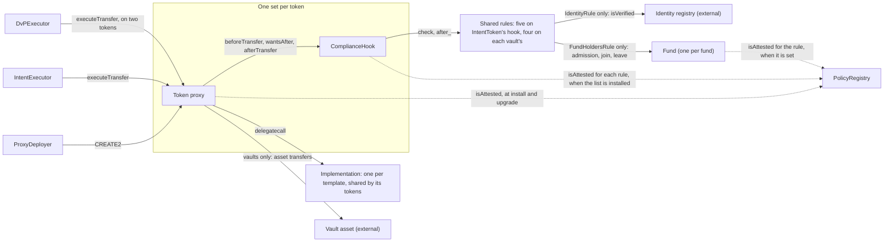
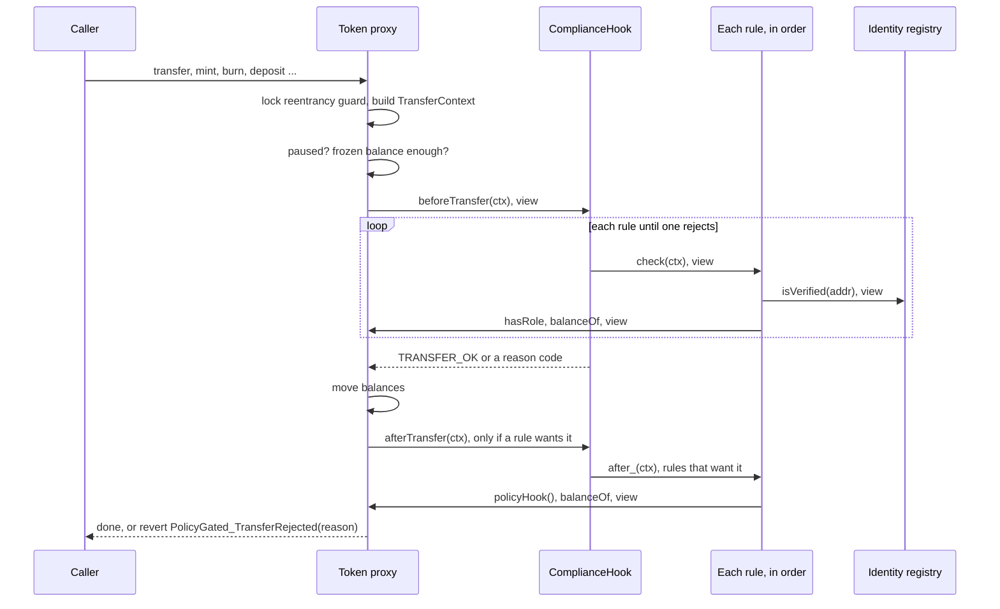
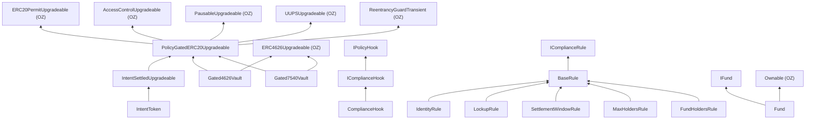

# Architecture

This repo holds one base contract and three tokens built on it. Every balance movement in every token goes through the same function in the base, `_update`. That function asks one external contract, the hook, whether the movement is allowed. The hook asks a list of small contracts, the rules. A rule answers with a reason code. `TRANSFER_OK` means yes. Anything else rejects the movement.

The base does only mechanical work: roles, pause, frozen balances, forced transfers, and the pointer to the hook. Everything about who may hold, send or receive lives in rules.

A fund groups several of these tokens as its share classes. The `Fund` contract records which tokens are classes and how many distinct investors hold any of them, and `FundHoldersRule`, one more rule in each class's hook, feeds it and enforces a fund-wide cap. See [The fund](#the-fund).

## The contracts

| Contract | File | Proxy or immutable | What it does |
|---|---|---|---|
| `PolicyGatedERC20Upgradeable` | `contracts/base/` | abstract | ERC-20 with permit, roles, pause, frozen balances, `mint`, `burn`, `forcedTransfer`, and `_update`, which calls the hook |
| `IntentSettledUpgradeable` | `contracts/mixins/` | abstract | Adds holder-signed EIP-712 transfer intents, settled by `EXECUTOR_ROLE` |
| `IntentToken` | `contracts/tokens/` | UUPS proxy | The base plus the intent mixin |
| `Gated4626Vault` | `contracts/vaults/` | UUPS proxy | ERC-4626 vault. The shares are a gated token |
| `Gated7540Vault` | `contracts/vaults/` | UUPS proxy | ERC-7540 asynchronous vault. The shares are a gated token |
| `ComplianceHook` | `contracts/hooks/` | immutable, one per token | Holds an ordered list of up to 16 rules. First rejection wins |
| `BaseRule` and five rules | `contracts/hooks/`, `contracts/hooks/rules/` | `BaseRule` abstract; each rule immutable, one instance shared by every token whose hook lists it (`FundHoldersRule` is bound to one fund, so it is shared by that fund's classes) | `IdentityRule`, `LockupRule`, `SettlementWindowRule`, `MaxHoldersRule`, `FundHoldersRule`. As deployed, `SettlementWindowRule` is on `IntentToken`'s hook only |
| `Fund` | `contracts/fund/` | immutable code, one per fund, owned by the deployer until `Activate` hands it to the main timelock | The fund's classes, the number of distinct investors across them, and each investor's class mask. It holds no policy: `FundHoldersRule` decides and the fund records |
| `PolicyRegistry` | `contracts/governance/` | immutable, one per deployment | List of attested codehashes, each marked `HOOK`, `RULE` or `IMPLEMENTATION` |
| `IntentExecutor` | `contracts/intents/` | immutable | Role-gated caller that submits signed intents to a token, one at a time or as an atomic batch |
| `DvPExecutor` | `contracts/intents/` | immutable | Role-gated caller that settles a share trade against cash atomically, from two signed legs. The cash is a gated token or an ERC-3009 token. See [flows-dvp.md](flows-dvp.md) |
| `ProxyDeployer` | `contracts/deploy/` | immutable | Creates each token proxy at an address that can be computed before the hook exists |
| `TokenProxy` | `contracts/deploy/` | the proxy | OpenZeppelin's `ERC1967Proxy`, constructible without init data |
| `GovernanceTimelock` | `contracts/governance/` | immutable | The main timelock: OpenZeppelin's `TimelockController` plus one power for the recovery timelock, revoking `CANCELLER_ROLE`. Holds the admin powers once deployment is finished |
| `TimelockController` | OpenZeppelin, not in this repo | immutable | Deployed unmodified as the recovery timelock, which can only unpause the tokens and the executors, revoke `GUARDIAN_ROLE` on them, and revoke `CANCELLER_ROLE` on the main timelock from any holder. Like every OpenZeppelin timelock it is also its own admin |

Two external contracts are neither in this repo nor deployed by it. The identity registry is any contract with `isVerified(address)`, and `IdentityRule` reads it. The vault asset is any standard ERC-20. The vaults credit the amount named in the call, not the amount that arrives, so fee-on-transfer assets are not supported. `Gated7540Vault` also books fixed asset amounts for pending deposits and claimable redemptions, so an asset whose balances change on their own (rebasing) can break its claims.

A token's implementation contract calls `_disableInitializers()` in its constructor, so only a proxy can be initialised. Hooks and rules are not proxies. To change one you deploy a new one and install it.

Code: `PolicyGatedERC20Upgradeable`, `IntentSettledUpgradeable`, `ComplianceHook`, `BaseRule`, `Fund`, `FundHoldersRule`, `PolicyRegistry`, `IntentExecutor`, `DvPExecutor`, `ProxyDeployer`, `TokenProxy`, `GovernanceTimelock`.

## Structure

The diagram shows what exists once a token is deployed and what each piece points at.

Solid arrows are calls, except `CREATE2`, which is a deployment, and `delegatecall`, which runs the implementation's code against the proxy's storage. Dotted arrows are registry checks that run when something is installed, not on every transfer. The two executors appear only for `IntentToken`, which is the only template with `executeTransfer`. `DvPExecutor` also calls a second token for the cash leg, a gated cash token or an ERC-3009 token, which is not drawn.

The main timelock administers the tokens, the hook, the registry and both executors, and owns `ProxyDeployer` and `Fund`. The recovery timelock can unpause the tokens and the executors and remove the guardian. [roles.md](roles.md) shows both.

Code: `ProxyDeployer.deploy`, `PolicyGatedERC20Upgradeable._setHook`, `ComplianceHook._setRules`, `Fund.setRule`.

## Calls during one movement

When someone calls `transfer`, `mint`, `deposit` or any other function that changes a balance, these calls happen inside the token's `_update`.

`beforeTransfer` and `check` are `view` functions, so they are called with `STATICCALL` and cannot write state. A rule that needs to write state does it in `after_`, which runs after the balances have moved. `afterTransfer` and `after_` run while the token's reentrancy guard is still held. `_update` is `nonReentrant`, so a rule that calls back into any function that moves balances reverts.

The hook address is read once at the start of `_update` into a local variable. If the stored hook changed during the call, the hook that approved the movement would still be the one that receives `afterTransfer`.

Code: `PolicyGatedERC20Upgradeable._update`, `_check`, `ComplianceHook.beforeTransfer`, `afterTransfer`, `BaseRule.onlyHook`. The full decision path is in [transfer-checks.md](transfer-checks.md).

## Inheritance

The two vaults inherit `ERC4626Upgradeable` and the base side by side. Each overrides `_update` once, to resolve the two parents, and the override only calls `super._update`. The result is that vault shares are moved by the base's `_update` like any other token.

`Gated7540Vault` also implements `IERC7540Operator`, `IERC7540Deposit`, `IERC7540Redeem` and `IGated7540Vault`, and reports ERC-165 support for ERC-7575.

Code: `Gated4626Vault._update`, `Gated7540Vault._update`, `supportsInterface` in each contract.

## What each template adds

| Template | Added on top of the base | Own storage |
|---|---|---|
| `IntentToken` | `executeTransfer`, `cancelIntent`, `canExecute`, `intentHash`, `nonceUsed` | used-nonce map per signer |
| `Gated4626Vault` | OZ ERC-4626 with a decimals offset of 6, and `maxDeposit`, `maxMint`, `maxRedeem`, `maxWithdraw` that reflect the hook | none |
| `Gated7540Vault` | request, fulfil and claim for deposits and redemptions; reject; agent recovery of pending redemptions and of claimable amounts; operators; custody address; last fulfilment price | per-controller deposit and redemption state, operator approvals, custody, `lastPrice` |

On both vaults the base's `mint(address,uint256)` and `burn(address,uint256)` always revert with `Gated4626Vault_Unsupported` or `Gated7540Vault_Unsupported`. On `Gated4626Vault`, shares are created by ERC-4626 `deposit` and `mint(shares, receiver)` and destroyed by `withdraw` and `redeem`. On `Gated7540Vault`, shares are created by deposit claims and by the agent's `recoverClaimable`, and destroyed by redemption fulfilments.

Code: `IntentSettledUpgradeable`, `Gated4626Vault`, `Gated7540Vault`.

## The fund

A fund is a set of share classes. Each class is one of the three tokens, with its own balances, hook and roles, so a class can be an `IntentToken`, a `Gated4626Vault` or a `Gated7540Vault`, and the fund never branches on which. `Fund` adds what no single class can know: which tokens are its classes, how many distinct investors hold any of them, and which classes each investor holds. It does not add up balances across classes, because units of different classes are not comparable. `positionsOf(account)` returns the account's balance in each class it holds, and a caller prices them.

What it keeps:

- **Classes.** An append-only list, numbered from 1 in the order of `registerClass`, at most `MAX_CLASSES` (32). `classIndexOf(token)` is 0 for a token that is not a class. Registration is permanent. A token can be registered only if it is new, the rule is set, it reports ERC-165 support for `IPolicyGated`, its current hook lists the installed rule (read with `rules()`), and its total supply is zero. The last check closes the cold start: a class with holders the fund never saw would start with a wrong count.
- **Each account's classes.** One storage slot per account: bit `n - 1` is set while the account holds class `n`, and the top bit means "exempt". The class token itself is never recorded as holding itself, which is how the 7540 vault's escrow stays out of the count without a stored exemption.
- **The investor count.** The number of accounts that hold at least one class and are not exempt. An account that holds three classes counts once. An exempt account never counts. `setExempt` on an account that holds a class moves the count by one.
- **The cap and the installed rule.** The installed rule, the count and the cap share one slot (the count and the cap are 48 bits each). The first count write is then never a write to an empty slot, and the rule can be read with the count and cap at no extra cost.

Who records which classes an account holds: only the installed rule, through `join` and `leave`, and only for a registered class. (The owner's `setExempt` also moves the count, for an account that holds a class.) `FundHoldersRule.after_` calls `join` when an account's balance in a class goes from zero to positive, and `leave` when it reaches zero. A movement that changes neither writes nothing. `join` and `leave` do nothing for an account that already has, or already lacks, the class. The fund's state is shared by every class, so a token that only names itself in a movement must not reach it. `FundHoldersRule.check` rejects a token that is not a registered class, and `Fund.join` and `Fund.leave` revert for one (`Fund_NotAClass`), which is what stops a fake token that calls `after_` directly.

Each change to an account's classes emits `HolderClassesUpdated(account, classes)`, and each change to the count emits `HolderCountUpdated(count)`. With the class tokens' own `Transfer` events these are the investor register, so the fund keeps no on-chain list of holders.

Who configures it: the fund is `Ownable`. The deployer owns it while `Activate` configures it, and then ownership moves to the main timelock. The owner calls `registerClass`, `setRule` (the rule must be attested as `RULE`), `setHolderCap` (at most `type(uint48).max`) and `setExempt`. `join` and `leave` are for the installed rule only.

What `FundHoldersRule` decides is in [transfer-checks.md](transfer-checks.md#fundholdersrule). In short, it rejects a new investor over the cap, and rejects every movement of a token that is not a registered class or whose hook lists a rule that is no longer the fund's. Replacing the rule therefore takes one timelock batch that sets it in the fund and in every class's hook. [governance-and-deployment.md](governance-and-deployment.md#changing-the-funds-rule) has the steps.

What it costs, measured on `IntentToken` proxies with `IdentityRule` and a class `MaxHoldersRule` as the baseline: about 26,900 gas more on an ordinary transfer between existing holders, about 31,800 more when an existing investor takes a second class, and about 53,300 to 57,300 more when a new investor joins the fund. Recording a new investor is one fresh storage write for the account's slot (about 22,100) and a rewrite of the shared slot for the count (about 5,000).

Code: `Fund`, `FundHoldersRule`.

## Storage

The base and each template keep their state in ERC-7201 namespaced slots, so a later upgrade can add fields without moving existing ones.

| Namespace | Holds |
|---|---|
| `gated.storage.PolicyGatedERC20` | registry address, hook address, frozen amount per account |
| `gated.storage.IntentSettled` | `nonces[signer][nonce]` |
| `gated.storage.Gated7540Vault` | `custody`, `lastPrice`, `deposits[controller]`, `redeems[controller]`, `operators[controller][operator]` |

`Fund` is not upgradeable, so it uses plain storage: the slot with the installed rule, the count and the cap, the class list, the class number of each token, and one state slot per account.

The base also uses three transient-storage slots of its own, `gated.transient.kind`, `gated.transient.ref` and `gated.transient.deadline`. A fourth transient slot belongs to OpenZeppelin's `ReentrancyGuardTransient`. A function that transfers tokens between two accounts as `FORCED` or `EXECUTED` writes the three slots just before calling `_transfer`, through `_moveAs`. The enforcement mint in `Gated7540Vault.recoverClaimable` writes them before calling `_mint`, through `_mintAs`. `_update` reads them and clears them. The token cannot infer these two kinds from the addresses, so this is how the hook learns them. The transient slots live for one transaction.

Code: `PolicyGatedERC20Upgradeable._moveAs`, `_mintAs`, `_consumePending`, `_getPolicyGatedStorage`.

## What can be replaced, and by whom

| Component | How it is replaced | Who | What is checked |
|---|---|---|---|
| Hook | `setPolicyHook(newHook)` on the token | `DEFAULT_ADMIN_ROLE`, which is the main timelock | the new hook's codehash is attested as `HOOK` |
| Rule list | `setRules(rules)` on the hook | the hook's `ADMIN`, which is the main timelock | each rule's codehash is attested as `RULE`, at most 16, no two with the same `ruleId` |
| Token implementation | UUPS `upgradeToAndCall` | `UPGRADER_ROLE`, which is the main timelock | the new implementation's codehash is attested as `IMPLEMENTATION` |
| Rule logic | deploy a new rule and put it in the list | as for the rule list | as for the rule list |
| Registry | the token's pointer has no setter; only an upgrade to an attested implementation could change it. Rules are vetted against the hook's own immutable `REGISTRY`, which comes with the hook | as for the hook or the implementation | as for the hook or the implementation |
| Fund rule | `setRule(newRule)` on the fund, and `setRules` on every class's hook in the same batch | the fund's owner and each hook's `ADMIN`, which are the main timelock | the new rule is attested as `RULE`. Until every hook lists it, the old rule rejects every movement |
| Fund class | `registerClass(token)` on the fund, for a new token only | the fund's owner, which is the main timelock | the token reports ERC-165 support for `IPolicyGated`, its hook lists the rule, its supply is zero, and the fund has room |
| Executor | grant `EXECUTOR_ROLE` to a new executor of either kind, revoke the old one | `DEFAULT_ADMIN_ROLE` | none |
| 7540 custody address | `setCustody` | `DEFAULT_ADMIN_ROLE` | non-zero address |

The registry check looks at `target.codehash`, so hooks, rules and implementations must be plain contracts. The registry is consulted only when something is installed. Revoking an attestation later does not change a token that already runs the revoked code.

Code: `PolicyGatedERC20Upgradeable.setPolicyHook`, `_authorizeUpgrade`, `ComplianceHook.setRules`, `Fund.setRule`, `Fund.registerClass`, `PolicyRegistry.isAttested`.
