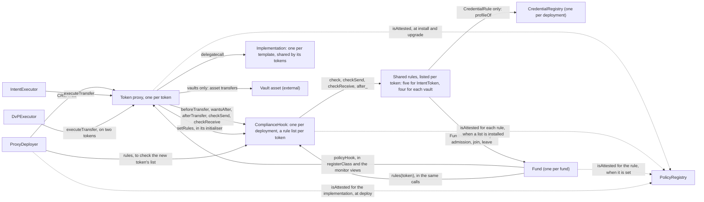
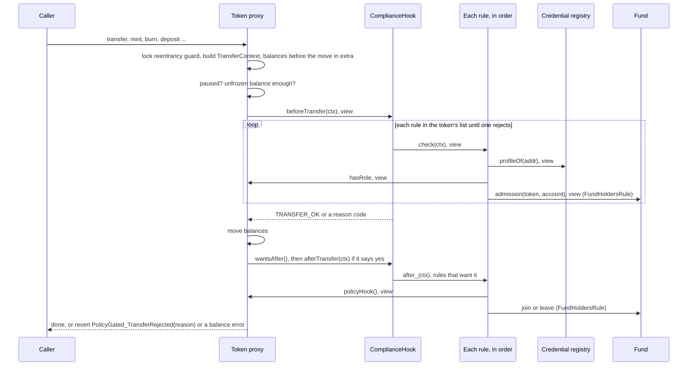

# Architecture

This repo holds one base contract and three tokens built on it. Every balance movement in every token goes through the same function in the base, `_update`. That function asks one external contract, the hook, whether the movement is allowed. One `ComplianceHook` serves every token of a deployment. It keeps a separate ordered list of small contracts, the rules, for each token, and asks the rules in that token's list. A rule answers with a reason code. `TRANSFER_OK` means yes. Anything else rejects the movement.

The base does only mechanical work: roles, pause, frozen balances, forced transfers, and the pointer to the hook. Everything about who may hold, send or receive lives in rules.

A fund groups several of these tokens as its share classes. The `Fund` contract records which tokens are classes and how many distinct investors hold any of them, and `FundHoldersRule`, one more rule in each class's rule list, feeds it and enforces a fund-wide cap. See [The fund](#the-fund).

## The contracts

| Contract | File | Proxy or immutable | What it does |
|---|---|---|---|
| `PolicyGatedERC20Upgradeable` | `contracts/base/` | abstract | ERC-20 with permit, roles, pause, frozen amounts, `mint`, `burn`, `forcedTransfer`, the ERC-7943 fungible interface (`canSend`, `canReceive`, `canTransfer` and the freeze functions), `multicall`, `templateId`, and `_update`, which calls the hook |
| `IntentSettledUpgradeable` | `contracts/mixins/` | abstract | Adds holder-signed EIP-712 transfer intents, settled by `EXECUTOR_ROLE` |
| `IntentToken` | `contracts/tokens/` | UUPS proxy | The base plus the intent mixin |
| `Gated4626Vault` | `contracts/vaults/` | UUPS proxy | ERC-4626 vault. The shares are a gated token |
| `Gated7540Vault` | `contracts/vaults/` | UUPS proxy | ERC-7540 asynchronous vault. The shares are a gated token |
| `ComplianceHook` | `contracts/hooks/` | immutable, one per deployment | Holds an ordered list of up to 16 rules for each token. First rejection wins. A token with an empty list has every movement rejected (`NO_RULES`). Its only immutable is the registry, so one attested codehash serves every token |
| `BaseRule` and seven rules | `contracts/hooks/`, `contracts/hooks/rules/` | `BaseRule` abstract; each rule immutable, one instance shared by every token whose rule list names it (`FundHoldersRule` is bound to one fund, so it is shared by that fund's classes) | `CredentialRule`, `IdentityRule`, `HolderRestrictionRule` (lockup and address freeze), `MinPositionRule`, `SettlementWindowRule`, `MaxHoldersRule`, `FundHoldersRule`. As deployed, `CredentialRule` heads every token's list, `SettlementWindowRule` is in `IntentToken`'s list only, `MaxHoldersRule` is deployed and attested but in no token's list, and `IdentityRule` is not deployed at all: it is for a deployment with an external identity registry |
| `Fund` | `contracts/fund/` | immutable code, one per fund, owned by the deployer until `Activate` hands it to the main timelock | The fund's classes, the number of distinct investors across them, and each investor's class mask, plus views that report whether each class's rule list still names the fund's rule (`isClassIntact`, `firstBrokenClass`). It holds no policy: `FundHoldersRule` decides and the fund records |
| `PolicyRegistry` | `contracts/governance/` | immutable, one per deployment | List of attested codehashes, each marked `HOOK`, `RULE` or `IMPLEMENTATION` |
| `CredentialRegistry` | `contracts/identity/` | immutable, one per deployment, administered by the deployer until `Activate` hands it to the main timelock | One record per address: which attester vouched for it, its qualification bits, its country, until when, and its standing. Attesters write directly or sign EIP-712 credentials that anyone submits. The guardian can block an address or kill an attester. See [credentials.md](credentials.md) |
| `IntentExecutor` | `contracts/intents/` | immutable | Role-gated caller that submits signed intents to a token, one at a time or as an atomic batch. It refuses an intent that states a consideration, because it cannot enforce a payment |
| `DvPExecutor` | `contracts/intents/` | immutable | Role-gated caller that settles a share trade against cash atomically, from two signed legs. The cash is a gated token or an ERC-3009 token. See [flows-dvp.md](flows-dvp.md) |
| `ProxyDeployer` | `contracts/deploy/` | immutable | Creates each token proxy at an address that can be computed from the symbol and the implementation alone, initialises it in the same transaction, and reverts unless the implementation is attested as `IMPLEMENTATION` and the token came up on the deployer's registry with the shared hook and exactly the expected rule list |
| `TokenProxy` | `contracts/deploy/` | the proxy | OpenZeppelin's `ERC1967Proxy`, constructible without init data |
| `GovernanceTimelock` | `contracts/governance/` | immutable | The main timelock: OpenZeppelin's `TimelockController` plus one power for the recovery timelock, revoking `CANCELLER_ROLE`. Holds the admin powers once deployment is finished |
| `TimelockController` | OpenZeppelin, not in this repo | immutable | Deployed unmodified as the recovery timelock, which can only unpause the tokens and the executors, revoke `GUARDIAN_ROLE` on them and on the credential registry, revoke `CANCELLER_ROLE` on the main timelock from any holder, and clear a guardian block or revive an attester on the credential registry. Like every OpenZeppelin timelock it is also its own admin |

One external contract is neither in this repo nor deployed by it: the vault asset, any standard ERC-20. A deployment that lists `IdentityRule` instead of `CredentialRule` has a second, an identity registry, which is any contract with `isVerified(address)`. The vaults credit the amount named in the call, not the amount that arrives, so fee-on-transfer assets are not supported. `Gated7540Vault` also books fixed asset amounts for pending deposits and claimable redemptions, so an asset whose balances change on their own (rebasing) can break its claims.

A token's implementation contract calls `_disableInitializers()` in its constructor, so only a proxy can be initialised. Hooks and rules are not proxies. To change one you deploy a new one and install it.

Code: `PolicyGatedERC20Upgradeable`, `IntentSettledUpgradeable`, `ComplianceHook`, `BaseRule`, `CredentialRegistry`, `CredentialRule`, `Fund`, `FundHoldersRule`, `PolicyRegistry`, `IntentExecutor`, `DvPExecutor`, `ProxyDeployer`, `TokenProxy`, `GovernanceTimelock`.

## Structure

The diagram shows what exists once the tokens are deployed and what each piece points at.

Solid arrows are calls, except `CREATE2`, which is a deployment, and `delegatecall`, which runs the implementation's code against the proxy's storage. Dotted arrows are registry checks that run when something is installed, not on every transfer. The hook is shared: every token's proxy points at the same one, and it keeps one rule list for each token. The rules are shared the same way, so one rule instance can sit in the lists of several tokens. The two executors appear only for `IntentToken`, which is the only template with `executeTransfer`. `DvPExecutor` also calls a second token for the cash leg, a gated cash token or an ERC-3009 token, which is not drawn.

The main timelock administers the tokens, the registry, the credential registry and both executors, and owns `ProxyDeployer` and `Fund`. The hook has no owner or admin of its own: it accepts `setRules` for a token from the token itself (the token's code calls it only in its initialiser) or from an account that holds the token's `DEFAULT_ADMIN_ROLE`, which is the main timelock. The recovery timelock can unpause the tokens and the executors, remove the guardian, and undo the guardian's blocks and attester kills on the credential registry. [roles.md](roles.md) shows both.

Code: `ProxyDeployer.deploy`, `PolicyGatedERC20Upgradeable._setHook`, `ComplianceHook.setRules`, `Fund.setRule`.

## Calls during one movement

When someone calls `transfer`, `mint`, `deposit` or any other function that changes a balance, these calls happen inside the token's `_update`.

The balance error is the token's own check, made before the hook is asked. It is `ERC7943InsufficientUnfrozenBalance` when a frozen amount keeps an amount within the balance from moving, and OpenZeppelin's `ERC20InsufficientBalance` when the amount is above the balance ([transfer-checks.md](transfer-checks.md)).

`beforeTransfer` and `check` are `view` functions, so they are called with `STATICCALL` and cannot write state. A rule that needs to write state does it in `after_`, which runs after the balances have moved. `afterTransfer` and `after_` run while the token's reentrancy guard is still held. `_update` is `nonReentrant`, so a rule that calls back into any function that moves balances reverts. `afterTransfer` accepts only a call from the token named in the context (`ComplianceHook_OnlyToken`), and `wantsAfter()` answers for the token that asks.

The hook address is read once in `_update`, after the context is built and before the checks, into a local variable. If the stored hook changed during the call, the hook that approved the movement would still be the one that receives `afterTransfer`.

`TransferContext` has no `ref` or `deadline` field. Its `extra` field carries `abi.encode(fromBalance, toBalance)`, the balances before the move, each zero for the zero address. For an executed intent it continues with the intent's `ref` and `deadline`. One function in the token, `_context`, builds it for the write and for every pre-flight, so a pre-flight sees what the write would. A rule that needs a balance reads it from `extra` and works out the balance after the move from `amount`, so on the movement path it makes no call back into the token to read one.

Code: `PolicyGatedERC20Upgradeable._update`, `_check`, `_context`, `ComplianceHook.beforeTransfer`, `afterTransfer`, `BaseRule.onlyHook`. The full decision path is in [transfer-checks.md](transfer-checks.md).

## Account-level questions

A token also answers two questions about one account, with no amount and no counterparty. They are the ERC-7943 functions `canSend(account)` and `canReceive(account)`. Each returns false while the token is paused and when it has no hook. Otherwise the token asks the hook's `checkSend(token, account)` or `checkReceive(token, account)`, which asks the token's rules in the same order as `beforeTransfer` does, and the first rule that says no wins. A token with an empty rule list gets `NO_RULES`, so both are false.

A rule's account answer must agree with its `check` for the kinds the rule does not exempt: a rule that rejects an account in `checkSend` or `checkReceive` also rejects, in `check`, a movement from or to it of a kind the rule does not exempt. The exemptions are the rule's own (FORCED for the credential and holder rules, an enforcement burn for the credential rule and the lockup), so `canSend` can be false for a holder with no credential, a blocked one, a frozen one or a locked one while `forcedTransfer` still passes. A rule whose decision depends on an amount or a count has no account-level answer, because the ERC-7943 questions are independent of any amount. The holder cap and the investor cap are therefore decided by `check`, on the movement. A full cap does not make `canReceive` false for a new holder or investor. A mint or a partial transfer to it is refused with `MAX_HOLDERS`, and a transfer that takes the sender's whole balance can admit it, because the count does not change ([transfer-checks.md](transfer-checks.md#maxholdersrule)). As deployed:

- `CredentialRule` asks the credential registry. `checkSend` refuses an address that reads `NONE` or `BLOCKED`, and `checkReceive` refuses everything but an `ACTIVE` credential that meets the token's policy (`CREDENTIAL_EXPIRED` for a lapsed one, `RECEIVER_NOT_ELIGIBLE` for one the policy does not accept). A lapsed holder can send. `IdentityRule`, where a deployment lists it, asks its external registry.
- `HolderRestrictionRule` answers `SENDER_FROZEN` or `LOCKED` for a sender and `RECEIVER_FROZEN` for a receiver. A locked account can still be paid, and a forced transfer from a locked holder still passes `check`.
- `FundHoldersRule` answers `NOT_FUND_CLASS`, for a sender and a receiver alike, when the token is not a registered class of the fund or when it is not the fund's installed rule, and accepts otherwise. It leaves the investor cap to `check`.
- `MinPositionRule`, `SettlementWindowRule` and `MaxHoldersRule` have no account-level opinion and accept.

Because the answer does not depend on an amount, true does not mean that a given transfer will pass. The unfrozen balance, the minimum position and the holder and investor caps are judged only on a movement. `canTransferWithReason(from, to, amount)` runs the whole movement path without the write and returns the reason code. `canTransfer`, the ERC-7943 bool, does the same except that it does not fail on a balance shortfall with no frozen amount in the way, which ERC-7943 forbids. With nothing frozen, an amount above the balance reads true in `canTransfer` when the hook accepts it, while `canTransferWithReason` says `INSUFFICIENT_UNFROZEN` and the write reverts with `ERC20InsufficientBalance`. Once the sender has a frozen amount, an amount above its unfrozen balance reads false in both, except for a burn by a sender that holds `BURNER_ROLE`, which may take frozen tokens, so its burn above the balance reads true in `canTransfer` too ([transfer-checks.md](transfer-checks.md#pre-flight-calls)). The vaults do not use `canReceive` for their `max*` functions. `Gated4626Vault.maxDeposit` and `maxMint` pre-flight a mint of a very large amount to the receiver (`type(uint128).max` shares), the same path as `canTransfer(address(0), receiver, amount)`. `Gated7540Vault.maxDeposit`, `maxMint`, `requestDeposit` and the check at a deposit claim pre-flight the same mint to the controller; at a claim, the mint to the receiver still goes through the hook. The amount is not zero, so a cap sees a new holder and refuses it when it is full, and it is above any minimum position up to `type(uint128).max`, so such a minimum does not read as a block. A rule that bounded the size of a position, such as a supply cap or a maximum balance, would refuse that probe and take those functions to 0. None of the deployed rules does. `maxRedeem`, `maxWithdraw` and the redemption payout of `Gated7540Vault` ask a zero-amount burn instead ([flows-vaults.md](flows-vaults.md)).

Code: `PolicyGatedERC20Upgradeable.canSend`, `canReceive`, `canTransfer`, `canTransferWithReason`, `_mintProbe`; `ComplianceHook.checkSend`, `checkReceive`.

## Inheritance

```mermaid
flowchart BT
  IT["IntentToken"] --> ISU["IntentSettledUpgradeable"]
  ISU --> PG["PolicyGatedERC20Upgradeable"]
  V4["Gated4626Vault"] --> PG
  V4 --> E4["ERC4626Upgradeable (OZ)"]
  V7["Gated7540Vault"] --> PG
  V7 --> E4
  PG --> P1["ERC20PermitUpgradeable (OZ)"]
  PG --> P2["AccessControlUpgradeable (OZ)"]
  PG --> P3["PausableUpgradeable (OZ)"]
  PG --> P4["UUPSUpgradeable (OZ)"]
  PG --> P5["ReentrancyGuardTransient (OZ)"]
  PG --> P6["MulticallUpgradeable (OZ)"]
  CH["ComplianceHook"] --> ICH["IComplianceHook"]
  ICH --> IPH["IPolicyHook"]
  CR["CredentialRule"] --> BR["BaseRule"]
  IdR["IdentityRule"] --> BR
  HR["HolderRestrictionRule"] --> BR
  MP["MinPositionRule"] --> BR
  SW["SettlementWindowRule"] --> BR
  MH["MaxHoldersRule"] --> BR
  FH["FundHoldersRule"] --> BR
  BR --> ICR["IComplianceRule"]
  CRG["CredentialRegistry"] --> ICRG["ICredentialRegistry"]
  CRG --> IIR["IIdentityRegistry"]
  CRG --> AC["AccessControl (OZ)"]
  CRG --> E712["EIP712 (OZ)"]
  FU["Fund"] --> IFU["IFund"]
  FU --> OWN["Ownable (OZ)"]
```

The two vaults inherit `ERC4626Upgradeable` and the base side by side. Each overrides `_update` once, to resolve the two parents, and the override only calls `super._update`. The result is that vault shares are moved by the base's `_update` like any other token.

`Gated7540Vault` also implements `IERC7540Operator`, `IERC7540Deposit`, `IERC7540Redeem` and `IGated7540Vault`, and reports ERC-165 support for ERC-7575.

Code: `Gated4626Vault._update`, `Gated7540Vault._update`, `supportsInterface` in each contract.

## What each template adds

| Template | Added on top of the base | Own storage |
|---|---|---|
| `IntentToken` | `executeTransfer`, `cancelIntent`, `canExecute`, `intentHash`, `nonceUsed` | used-nonce map per signer |
| `Gated4626Vault` | OZ ERC-4626 with a decimals offset of 6, and `maxDeposit`, `maxMint`, `maxRedeem`, `maxWithdraw` that reflect the hook | none |
| `Gated7540Vault` | request, fulfil and claim for deposits and redemptions; reject; agent recovery of pending redemptions and of claimable amounts; operators; custody address; last fulfilment price | per-controller deposit and redemption state, operator approvals, custody, `lastPrice` |

On both vaults the base's `mint(address,uint256)` and `burn(address,uint256)` always revert with `Gated4626Vault_Unsupported` or `Gated7540Vault_Unsupported`. On `Gated4626Vault`, shares are created by ERC-4626 `deposit` and `mint(shares, receiver)` and destroyed by `withdraw` and `redeem`. On `Gated7540Vault`, shares are created by deposit claims and by the agent's `recoverClaimable`, and destroyed by redemption fulfilments.

Each template reports its own `templateId()`: `keccak256('IntentToken')`, `keccak256('Gated4626Vault')` or `keccak256('Gated7540Vault')`. The base's upgrade check reads it (see [What can be replaced](#what-can-be-replaced-and-by-whom)).

Code: `IntentSettledUpgradeable`, `Gated4626Vault`, `Gated7540Vault`, `templateId` in each token.

## The fund

A fund is a set of share classes. Each class is one of the three tokens, with its own balances, rule list and roles, so a class can be an `IntentToken`, a `Gated4626Vault` or a `Gated7540Vault`, and the fund never branches on which. `Fund` adds what no single class can know: which tokens are its classes, how many distinct investors hold any of them, and which classes each investor holds. It does not add up balances across classes, because units of different classes are not comparable. `positionsOf(account)` returns the account's balance in each class it holds, and a caller prices them.

What it keeps:

- **Classes.** An append-only list, numbered from 1 in the order of `registerClass`, at most `MAX_CLASSES` (32). `classIndexOf(token)` is 0 for a token that is not a class. Registration is permanent. A token can be registered only if it is new, the rule is set, it reports ERC-165 support for `IPolicyGated`, its current hook lists the installed rule for it (read with the hook's `rules(token)`), and its total supply is zero. The last check closes the cold start: a class with holders the fund never saw would start with a wrong count.
- **Each account's classes.** One storage slot per account: bit `n - 1` is set while the account holds class `n`, and the top bit means "exempt". The class token itself is never recorded as holding itself, which is how the 7540 vault's escrow stays out of the count without a stored exemption.
- **The investor count.** The number of accounts that hold at least one class and are not exempt. An account that holds three classes counts once. An exempt account never counts. `setExempt` on an account that holds a class moves the count by one.
- **The cap and the installed rule.** The installed rule, the count and the cap share one slot (the count and the cap are 48 bits each). The first count write is then never a write to an empty slot, and the rule can be read with the count and cap at no extra cost.

Who records which classes an account holds: only the installed rule, through `join` and `leave`, and only for a registered class. (The owner's `setExempt` also moves the count, for an account that holds a class.) `FundHoldersRule.after_` calls `join` when an account's balance in a class goes from zero to positive, and `leave` when it reaches zero. A movement that changes neither writes nothing. `join` and `leave` do nothing for an account that already has, or already lacks, the class. The fund's state is shared by every class, so a token that only names itself in a movement must not reach it. `FundHoldersRule.check` rejects a token that is not a registered class, and `Fund.join` and `Fund.leave` revert for one (`Fund_NotAClass`), which is what stops a fake token that calls `after_` directly.

Each change to an account's classes emits `HolderClassesUpdated(account, classes)`, and each change to the count emits `HolderCountUpdated(count)`. With the class tokens' own `Transfer` events these are the investor register, so the fund keeps no on-chain list of holders.

Who configures it: the fund is `Ownable`. The deployer owns it while `Activate` configures it, and then ownership moves to the main timelock. The owner calls `registerClass`, `setRule` (the rule must be attested as `RULE`), `setHolderCap` (at most `type(uint48).max`) and `setExempt`. `join` and `leave` are for the installed rule only.

What `FundHoldersRule` decides is in [transfer-checks.md](transfer-checks.md#fundholdersrule). In short, it rejects a new investor over the cap, and rejects every movement of a token that is not a registered class or whose rule list names a rule that is no longer the fund's. Replacing the rule therefore takes one timelock batch that sets it in the fund and in every class's rule list. [governance-and-deployment.md](governance-and-deployment.md#changing-the-funds-rule) has the steps.

The hook accepts any list of attested rules, so it cannot tell that a class's list has lost the fund's rule. The fund can. `isClassIntact(token)` is true when the token is a registered class and the rule list its hook holds for it names the fund's installed rule. `firstBrokenClass()` returns the first registered class, in registration order, for which that is false, or the zero address when every class is intact. Neither reverts when a token fails to name its hook or a hook fails to list rules: that counts as broken. (A hook address with no code is not covered, and an attested hook always has code.) They detect three things and prevent none of them: the fund's rule dropped from a class's list, which leaves the class uncapped and the fund's count stale, the fund's rule replaced while a class's list still names the old one, which makes that class fail closed with `NOT_FUND_CLASS`, and a class's hook swapped for one that does not list the rule. The post-deploy check asserts that every class is intact.

What it costs, measured on `IntentToken` proxies with `IdentityRule` and a class `MaxHoldersRule` as the baseline: about 26,900 gas more on an ordinary transfer between existing holders, about 31,800 more when an existing investor takes a second class, and about 53,300 to 57,300 more when a new investor joins the fund. Recording a new investor is one fresh storage write for the account's slot (about 22,100) and a rewrite of the shared slot for the count (about 5,000).

Code: `Fund`, `FundHoldersRule`.

## Storage

The base and each template keep their state in ERC-7201 namespaced slots, so a later upgrade can add fields without moving existing ones.

| Namespace | Holds |
|---|---|
| `gated.storage.PolicyGatedERC20` | registry address, hook address, frozen amount per account |
| `gated.storage.IntentSettled` | `nonces[signer][nonce]` |
| `gated.storage.Gated7540Vault` | `custody`, `lastPrice`, `deposits[controller]`, `redeems[controller]`, `operators[controller][operator]` |

`Fund` is not upgradeable, so it uses plain storage: the slot with the installed rule, the count and the cap, the class list, the class number of each token, and one state slot per account.

`ComplianceHook` is not upgradeable either. For each token it keeps the rule count and the after mask in one slot, and the rules by position in a mapping.

The base also uses three transient-storage slots of its own, `gated.transient.kind`, `gated.transient.ref` and `gated.transient.deadline`. A fourth transient slot belongs to OpenZeppelin's `ReentrancyGuardTransient`. A function that transfers tokens between two accounts as `FORCED` or `EXECUTED` writes the three slots just before calling `_transfer`, through `_moveAs`. The enforcement mint in `Gated7540Vault.recoverClaimable` writes them before calling `_mint`, through `_mintAs`. `_update` reads them and clears them. The token cannot infer these two kinds from the addresses, so this is how the hook learns them. `_update` then puts `ref` and `deadline` into the context's `extra` for an `EXECUTED` movement. The transient slots live for one transaction.

Code: `PolicyGatedERC20Upgradeable._moveAs`, `_mintAs`, `_consumePending`, `_getPolicyGatedStorage`.

## What can be replaced, and by whom

| Component | How it is replaced | Who | What is checked |
|---|---|---|---|
| Hook | `setPolicyHook(newHook)` on the token | `DEFAULT_ADMIN_ROLE`, which is the main timelock | the new hook's codehash is attested as `HOOK`, and its `REGISTRY()` is the token's own registry (`PolicyGated_HookRegistryMismatch`). A hook keeps a rule list for each token, and the old hook's list is not carried over: the new hook rejects every movement of the token with `NO_RULES` unless `setRules(token, rules)` has been called on it |
| Rule list | `setRules(token, rules)` on the hook | an account that holds the token's `DEFAULT_ADMIN_ROLE`, which is the main timelock, and the token itself (its code calls it only in its initialiser) | each rule's codehash is attested as `RULE`, at most 16, no two with the same `ruleId` |
| Token implementation | UUPS `upgradeToAndCall` | `UPGRADER_ROLE`, which is the main timelock | the new implementation's codehash is attested as `IMPLEMENTATION`, and its `templateId()` is the current implementation's (`Templated_WrongTemplate`) |
| Rule logic | deploy a new rule and put it in the list | as for the rule list | as for the rule list |
| Registry | the token's pointer has no setter; only an upgrade to an attested implementation could change it. The hook vets rules against its own immutable `REGISTRY`, and a token accepts a hook only if that is the token's registry | as for the hook or the implementation | as for the hook or the implementation |
| Fund rule | `setRule(newRule)` on the fund, and `setRules(token, rules)` on each class's hook in the same batch | the fund's owner and each class's `DEFAULT_ADMIN_ROLE` holder, which are the main timelock | the new rule is attested as `RULE`. Until every class's list names it, the old rule rejects every movement of that class |
| Fund class | `registerClass(token)` on the fund, for a new token only | the fund's owner, which is the main timelock | the token reports ERC-165 support for `IPolicyGated`, its hook lists the rule, its supply is zero, and the fund has room |
| Executor | grant `EXECUTOR_ROLE` to a new executor of either kind, revoke the old one | `DEFAULT_ADMIN_ROLE` | none |
| 7540 custody address | `setCustody` | `DEFAULT_ADMIN_ROLE` | non-zero address |

The registry check looks at `target.codehash`, so hooks, rules and implementations must be plain contracts. The registry is consulted only when something is installed. Revoking an attestation later does not change a token that already runs the revoked code. A hook's attestation covers its code and its registry. It does not cover any token's rule list, which is storage, so the post-deploy check compares each token's `rules(token)` with the intended list.

The template check keeps an upgrade inside its template. An attestation says that an implementation was reviewed, not what it is for. `_authorizeUpgrade` first requires `UPGRADER_ROLE` and the attestation, then compares the `templateId()` of the running implementation with the target's, and reverts with `Templated_WrongTemplate(newImplementation, expected, actual)` if they differ. So an `IntentToken` proxy cannot be moved onto an attested vault implementation. The id is the hash of the template's name with no version, so a bug-fix implementation of the same template passes. A target with no `templateId()` makes the call revert.

Code: `PolicyGatedERC20Upgradeable.setPolicyHook`, `_setHook`, `_authorizeUpgrade`, `templateId`, `ComplianceHook.setRules`, `Fund.setRule`, `Fund.registerClass`, `PolicyRegistry.isAttested`.
