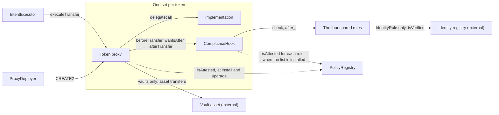
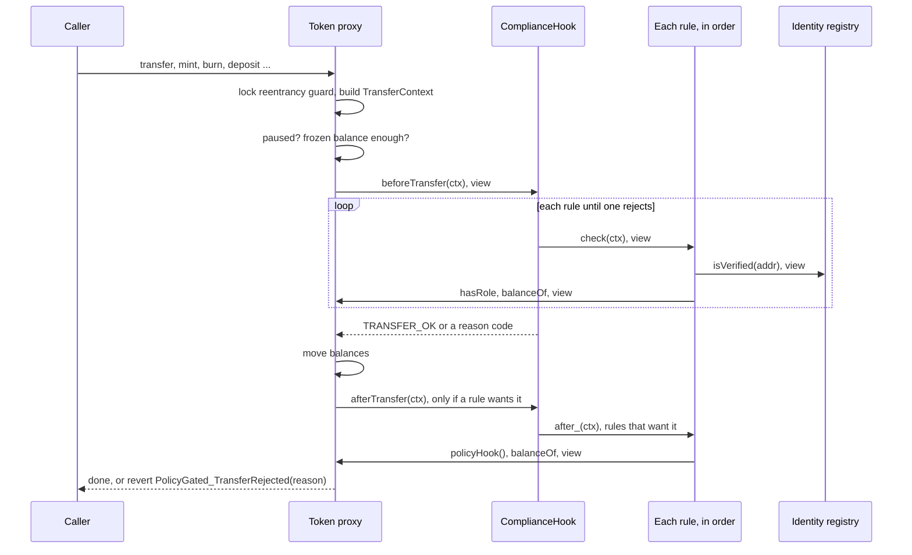
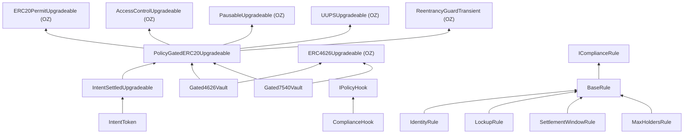

# Architecture

This repo holds one base contract and three tokens built on it. Every balance movement in every token goes through the same function in the base, `_update`. That function asks one external contract, the hook, whether the movement is allowed. The hook asks a list of small contracts, the rules. A rule answers with a reason code. `TRANSFER_OK` means yes. Anything else rejects the movement.

The base does only mechanical work: roles, pause, frozen balances, forced transfers, and the pointer to the hook. Everything about who may hold, send or receive lives in rules.

## The contracts

| Contract | File | Proxy or immutable | What it does |
|---|---|---|---|
| `PolicyGatedERC20Upgradeable` | `contracts/base/` | abstract | ERC-20 with permit, roles, pause, frozen balances, `mint`, `burn`, `forcedTransfer`, and `_update`, which calls the hook |
| `IntentSettledUpgradeable` | `contracts/mixins/` | abstract | Adds holder-signed EIP-712 transfer intents, settled by `EXECUTOR_ROLE` |
| `IntentToken` | `contracts/tokens/` | UUPS proxy | The base plus the intent mixin |
| `Gated4626Vault` | `contracts/vaults/` | UUPS proxy | ERC-4626 vault. The shares are a gated token |
| `Gated7540Vault` | `contracts/vaults/` | UUPS proxy | ERC-7540 asynchronous vault. The shares are a gated token |
| `ComplianceHook` | `contracts/hooks/` | immutable, one per token | Holds an ordered list of up to 16 rules. First rejection wins |
| `BaseRule` and four rules | `contracts/hooks/`, `contracts/hooks/rules/` | immutable, shared by all tokens | `IdentityRule`, `LockupRule`, `SettlementWindowRule`, `MaxHoldersRule` |
| `PolicyRegistry` | `contracts/governance/` | immutable, one per deployment | List of attested codehashes, each marked `HOOK`, `RULE` or `IMPLEMENTATION` |
| `IntentExecutor` | `contracts/intents/` | immutable | Role-gated caller that submits signed intents to a token, one at a time or as an atomic batch |
| `ProxyDeployer` | `contracts/deploy/` | immutable | Creates each token proxy at an address that can be computed before the hook exists |
| `TokenProxy` | `contracts/deploy/` | the proxy | OpenZeppelin's `ERC1967Proxy`, constructible without init data |
| `TimelockController` | OpenZeppelin, not in this repo | immutable | Holds the admin powers once deployment is finished |

Two things sit outside the repo. The identity registry is any contract with `isVerified(address)`, and `IdentityRule` reads it. The vault asset is any ERC-20.

A token's implementation contract calls `_disableInitializers()` in its constructor, so only a proxy can be initialised. Hooks and rules are not proxies. To change one you deploy a new one and install it.

Code: `PolicyGatedERC20Upgradeable`, `IntentSettledUpgradeable`, `ComplianceHook`, `BaseRule`, `PolicyRegistry`, `IntentExecutor`, `ProxyDeployer`, `TokenProxy`.

## Structure

The diagram shows what exists once a token is deployed and what each piece points at.

Solid arrows are calls, except `CREATE2`, which is a deployment, and `delegatecall`, which runs the implementation's code against the proxy's storage. Dotted arrows are registry checks that run when something is installed, not on every transfer. `IntentExecutor` appears only for `IntentToken`, which is the only token with `executeTransfer`.

The timelock administers the tokens, the hook, the registry and the executor, and owns `ProxyDeployer`. [roles.md](roles.md) shows that.

Code: `ProxyDeployer.deploy`, `PolicyGatedERC20Upgradeable._setHook`, `ComplianceHook._setRules`.

## Calls during one movement

When someone calls `transfer`, `mint`, `deposit` or any other function that changes a balance, these calls happen inside the token's `_update`.

`beforeTransfer` and `check` are `view` functions, so they are called with `STATICCALL` and cannot write state. A rule that needs to write state does it in `after_`, which runs after the balances have moved. `afterTransfer` and `after_` run while the token's reentrancy guard is still held. `_update` is `nonReentrant`, so a rule that calls back into any function that moves balances reverts.

The hook address is read once at the start of `_update` into a local variable. If the stored hook changed during the call, the hook that approved the movement would still be the one that receives `afterTransfer`.

Code: `PolicyGatedERC20Upgradeable._update`, `_check`, `ComplianceHook.beforeTransfer`, `afterTransfer`, `BaseRule.onlyHook`. The full decision path is in [transfer-checks.md](transfer-checks.md).

## Inheritance

The two vaults inherit `ERC4626Upgradeable` and the base side by side. Each overrides `_update` once, to resolve the two parents, and the override only calls `super._update`. The result is that vault shares are moved by the base's `_update` like any other token.

`Gated7540Vault` also implements `IERC7540Operator`, `IERC7540Deposit`, `IERC7540Redeem` and `IGated7540Vault`, and reports ERC-165 support for ERC-7575.

Code: `Gated4626Vault._update`, `Gated7540Vault._update`, `supportsInterface` in each contract.

## What each template adds

| Template | Added on top of the base | Own storage |
|---|---|---|
| `IntentToken` | `executeTransfer`, `cancelIntent`, `canExecute`, `intentHash`, `nonceUsed` | used-nonce map per signer |
| `Gated4626Vault` | OZ ERC-4626 with a decimals offset of 6, and `maxDeposit`, `maxMint`, `maxRedeem`, `maxWithdraw` that reflect the hook | none |
| `Gated7540Vault` | request, fulfil and claim for deposits and redemptions, reject, recover, operators, custody address, last fulfilment price | per-controller deposit and redemption state, operator approvals, custody, `lastPrice` |

On both vaults the base's `mint(address,uint256)` and `burn(address,uint256)` always revert with `Gated4626Vault_Unsupported` or `Gated7540Vault_Unsupported`. Shares are created only by deposits (or deposit claims) and destroyed only by redemptions (or redemption fulfilments).

Code: `IntentSettledUpgradeable`, `Gated4626Vault`, `Gated7540Vault`.

## Storage

The base and each template keep their state in ERC-7201 namespaced slots, so a later upgrade can add fields without moving existing ones.

| Namespace | Holds |
|---|---|
| `gated.storage.PolicyGatedERC20` | registry address, hook address, frozen amount per account |
| `gated.storage.IntentSettled` | `nonces[signer][nonce]` |
| `gated.storage.Gated7540Vault` | `custody`, `lastPrice`, `deposits[controller]`, `redeems[controller]`, `operators[controller][operator]` |

The base also uses three transient-storage slots, `gated.transient.kind`, `gated.transient.ref` and `gated.transient.deadline`. A function that moves tokens as `FORCED` or `EXECUTED` writes them just before calling `_transfer`. `_update` reads them and clears them. The token cannot infer these two kinds from the addresses, so this is how the hook learns them. The transient slots live for one transaction.

Code: `PolicyGatedERC20Upgradeable._moveAs`, `_consumePending`, `_getPolicyGatedStorage`.

## What can be replaced, and by whom

| Component | How it is replaced | Who | What is checked |
|---|---|---|---|
| Hook | `setPolicyHook(newHook)` on the token | `DEFAULT_ADMIN_ROLE`, which is the timelock | the new hook's codehash is attested as `HOOK` |
| Rule list | `setRules(rules)` on the hook | the hook's `ADMIN`, which is the timelock | each rule's codehash is attested as `RULE`, at most 16, no two with the same `ruleId` |
| Token implementation | UUPS `upgradeToAndCall` | `UPGRADER_ROLE`, which is the timelock | the new implementation's codehash is attested as `IMPLEMENTATION` |
| Rule logic | deploy a new rule and put it in the list | as for the rule list | as for the rule list |
| Registry | not replaceable. `registry()` has no setter | n/a | n/a |
| Executor | grant `EXECUTOR_ROLE` to a new executor, revoke the old one | `DEFAULT_ADMIN_ROLE` | none |
| 7540 custody address | `setCustody` | `DEFAULT_ADMIN_ROLE` | non-zero address |

The registry check looks at `target.codehash`, so hooks, rules and implementations must be plain contracts. The registry is consulted only when something is installed. Revoking an attestation later does not change a token that already runs the revoked code.

Code: `PolicyGatedERC20Upgradeable.setPolicyHook`, `_authorizeUpgrade`, `ComplianceHook.setRules`, `PolicyRegistry.isAttested`.
