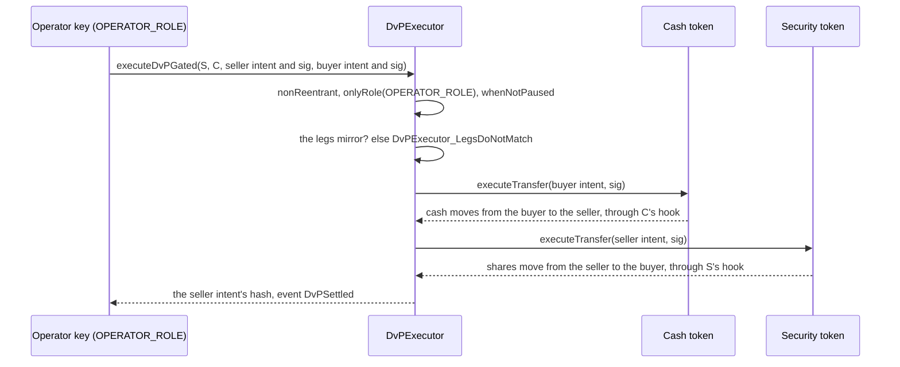
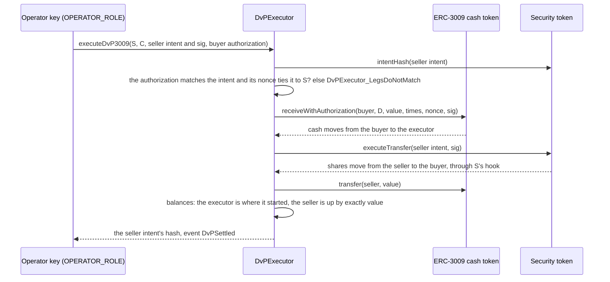

# Delivery versus payment

A trade of a share class against cash, settled in one transaction: the shares move and the cash moves, or neither does. `DvPExecutor` does it, for a security that is an `IntentToken` (a class token, or any token that carries signed intents). The vault templates carry no intents, so their shares trade as plain transfers.

What it is not: matching, price discovery, fees, partial fills, more than two legs, or cross-chain settlement. The parties agree the trade off-chain. Each signs what it gives and what it is to receive, and an operator submits the two signed statements.

## Two forms of cash

| | Gated cash token | ERC-3009 cash token |
|---|---|---|
| The cash is | an `IntentToken` of its own, under its own policy | a USDC-style token with `receiveWithAuthorization` |
| The buyer signs | a transfer intent on the cash token | an ERC-3009 authorization, payable to the executor |
| Entry point | `executeDvPGated` | `executeDvP3009` |
| Pre-flight | `canExecuteDvPGated` | `canExecuteDvP3009` |
| Where the cash goes | straight from the buyer to the seller | from the buyer to the executor, and on to the seller within the call |

## What each party signs

**The seller** signs a `TransferIntent` on the security token. In both forms:

| Field | Value |
|---|---|
| `from` | the seller |
| `to` | the buyer |
| `amount` | the shares |
| `executor` | the `DvPExecutor` |
| `considerationToken`, `considerationAmount` | the cash token and the price |
| `nonce`, `deadline`, `validAfter`, `ref` | as for any intent. `ref` stays free for the ISO 20022 reference |

**The buyer, gated form**, signs a `TransferIntent` on the cash token: `from` the buyer, `to` the seller, `amount` the price, `executor` the `DvPExecutor`, and `considerationToken`, `considerationAmount` the security token and the shares.

**The buyer, ERC-3009 form**, signs `ReceiveWithAuthorization(from, to, value, validAfter, validBefore, nonce)` under the cash token's own domain, with `to` the `DvPExecutor` and `value` the price. The `nonce` is

```
keccak256(abi.encode(securityToken, securityToken.intentHash(securitiesIntent)))
```

That ties the authorization to one securities intent on one security token. The token's address is in it on purpose. The executor cannot tell an honest token's `intentHash` from a counterfeit's, so a bare hash would let an operator pair the buyer's authorization with a substituted token that reports the genuine hash and delivers nothing, and pay the cash to itself. The signing helper in `test/nodejs/fixtures.ts` computes the nonce (`dvpNonce`), `signGatedTrade` builds the gated pair, and `sign3009Trade` builds the intent and the authorization.

In the ERC-3009 form the buyer's wallet shows a value, the executor as payee and an opaque nonce, so it cannot show what the buyer receives. In the gated form the cash intent states the shares in clear.

## The gated form



The legs mirror when the parties are swapped (the seller's `from` is the buyer's `to` and the other way round), each amount is the other leg's stated consideration, each stated consideration token is the other leg's token, and the two tokens differ. The executor does not compare the `executor` fields. Each token does, and a stated consideration forces a named executor, so a leg that states a payment can be run only by the executor it names.

The cash leg runs first. If a leg fails, the whole transaction reverts with `DvPExecutor_LegFailed(leg, reason)`, where `leg` is `CASH` (0) or `SECURITIES` (1) and `reason` is the token's revert data, for example `PolicyGated_TransferRejected(reason)`. If both legs would fail, the cash leg is the one reported.

## The ERC-3009 form



The authorization matches when it is from the seller's receiver, for the seller's stated consideration in the stated cash token, with the nonce above, and the two tokens differ. Only the payee can call `receiveWithAuthorization`, and the executor calls it only inside this function, so nobody can front-run it with `transferWithAuthorization`, which has a different typehash.

The executor ends with the balance it started with, and the payout raises the seller's balance by exactly the price, or the call reverts with `DvPExecutor_CashNotConserved(account, expected, actual)`. A fee-on-transfer cash token fails the trade. Usually the payout reverts with the cash token's own `ERC20InsufficientBalance`, because the executor received less than it must pay. `DvPExecutor_CashNotConserved` is the error when a stray balance in the executor covers the shortfall, or when the fee falls on the payout alone. A seller who is also the payer is paid back what the pull took, and the net change is zero. A failing pull or delivery reverts with `DvPExecutor_LegFailed`. A failing payout to the seller (a blocklisted seller, a re-entering token) reverts with the cash token's own error.

The executor does not map or touch the authorization's times. The intent's deadline is inclusive (valid at the deadline second) and Circle's `validBefore` is exclusive. A buyer who signs the authorization with `validBefore` equal to the intent's deadline loses the intent's last second, and the trade reverts as a whole in that second. With `validBefore` one second later, both are valid on the deadline.

## Pre-flight

`canExecuteDvPGated` and `canExecuteDvP3009` return `(ok, reason)` and never revert on a refusal. They check, in order:

1. the executor's own pause: `PAUSED`;
2. the match: `LEGS_DO_NOT_MATCH`;
3. for the ERC-3009 form, the authorization's window (`INTENT_NOT_YET_VALID` at or before `validAfter`, `INTENT_EXPIRED` at or after `validBefore`, both ends exclusive), its state (`NONCE_USED`) and the buyer's balance (`INSUFFICIENT_UNFROZEN`);
4. each leg's `canExecute` from the executor's address, cash first for the gated form and the securities leg for the ERC-3009 form, with the token's reason.

What it does not see:

- `OPERATOR_ROLE`, and whether the executor holds `EXECUTOR_ROLE` on the tokens. The tokens' own `canExecute` checks neither role. After a token revokes the executor, pre-flight says yes and the real call fails.
- For the ERC-3009 form, the buyer's signature, and a pause or blocklist on the cash token.
- Two legs on tokens that share policy state, such as two classes of one fund. Each leg is asked against the state before either has run, and the first leg's movement can change the second's answer. Example: a fund whose cap was lowered below its investor count, and an investor who swaps their only class for another. The investor leaves the fund on the first leg and counts as a new investor on the second, which the lowered cap refuses (`MAX_HOLDERS`), though pre-flight said yes. A simulation of `executeDvPGated` with `eth_call` shows the real outcome.

## Cancel, pause and time

- Either party cancels by spending its nonce. The seller, and the buyer in the gated form, call `cancelIntent` on their own token. For an ERC-3009 authorization, ERC-3009 defines `cancelAuthorization(authorizer, nonce, v, r, s)`, which anyone can submit with the buyer's signed cancellation. The mock in this repo does not implement it and no test exercises it, so check it on the real token. After a cancel the trade fails as a whole.
- A trade that nobody submits expires at its deadline, or at the authorization's `validBefore`.
- The guardian pauses the executor with no delay. The main timelock or the recovery timelock unpauses it.

## What the operator can and cannot do

The operator chooses which signed legs to pair, when to submit, and the token addresses. It cannot redirect value:

- Gated form: the seller's signature covers the buyer, the shares, the cash token, the price and the executor. The buyer's covers the seller, the price, the security token, the shares and the executor. The mirror requires the two to agree, and each signature is valid only on its own token's domain.
- ERC-3009 form: the seller's signature covers the same terms, and the buyer's nonce commits to the whole securities intent and to the security token's address. The payout goes to the intent's `from`.

An operator that never submits a trade cannot take anything. There is no on-chain allowlist of tokens: a party who signs a trade that names a counterfeit token loses to it.

## Policy and the fund layer

The securities leg reaches the hook as `EXECUTED`, so the settlement window, lockup, identity, holder cap and the fund-wide investor cap apply to it unchanged. At a full per-token cap, a whole-balance sale to a new holder is admitted, because the seller leaves as the buyer joins, and a partial sale is refused. At a full fund-wide cap the sale is admitted only if it empties the seller's only class, which is what makes the seller leave the fund: a seller who holds another class stays in the fund, the count would grow, and the sale is refused. The executor never holds a class token, so it needs no identity entry and no exemption.

A gated cash token is an `IntentToken` under its own hook. The executor needs `EXECUTOR_ROLE` on it, granted by that token's administrator; `Activate` grants it only on the intent token it deploys. An ERC-3009 token is external. The executor was written against Circle's FiatToken v2.2, which has the `bytes` signature overload of `receiveWithAuthorization`. Check that overload on any chain and any token before use. USDC's pause and blocklist apply, and a blocklisted executor, buyer or seller fails the trade.

## Cost

Measured on the local test chain with the real policy on the security token (identity, lockup, settlement window, holder cap, fund rule) and identity on the gated cash token. `npx hardhat test nodejs test/nodejs/dvp.test.ts` prints the figures. They move by a few hundred gas between runs, because the random nonces, references and signatures change the calldata cost (a zero byte costs 4 gas and any other byte 16). The two rows for scale run after the trades, so the cash transfer empties the buyer's balance, and they are not like for like with the first two.

| Operation | Gas |
|---|---|
| Gated trade, `executeDvPGated` | 382,001 |
| ERC-3009 trade, `executeDvP3009`, with a mock cash token | 296,445 |
| One securities intent through `IntentExecutor`, for scale | 205,829 |
| One plain cash `transfer` on the gated cash token, for scale | 68,663 |

The ERC-3009 figure is low for USDC: Circle's token runs behind a proxy and checks a blocklist.

Code: `DvPExecutor` (`executeDvPGated`, `executeDvP3009`, `canExecuteDvPGated`, `canExecuteDvP3009`, `_legsMirror`, `_authorizationMatches`), `IntentSettledUpgradeable._intentPreflight` for the checks the tokens make, and `test/nodejs/fixtures.ts` for the signing helpers.
