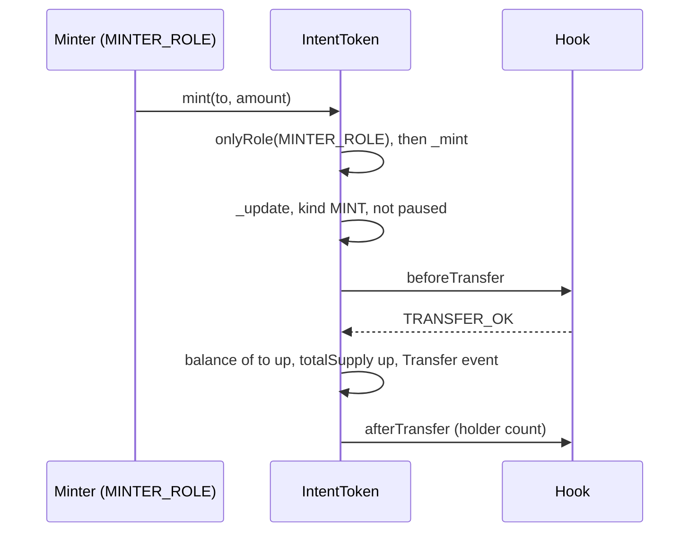
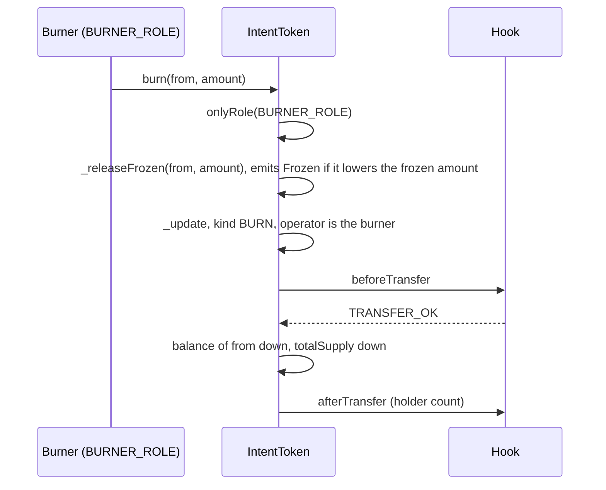
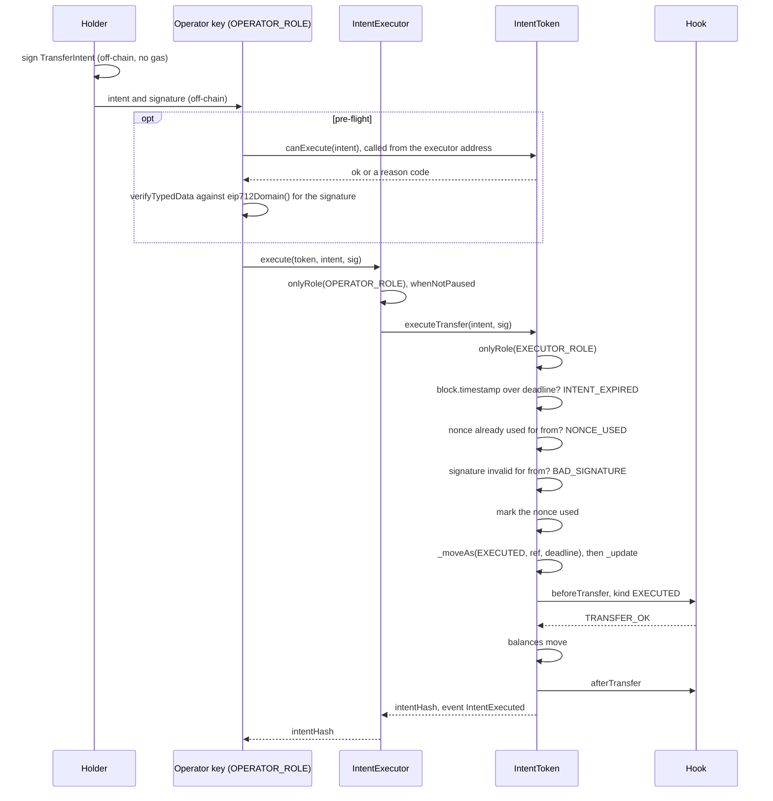
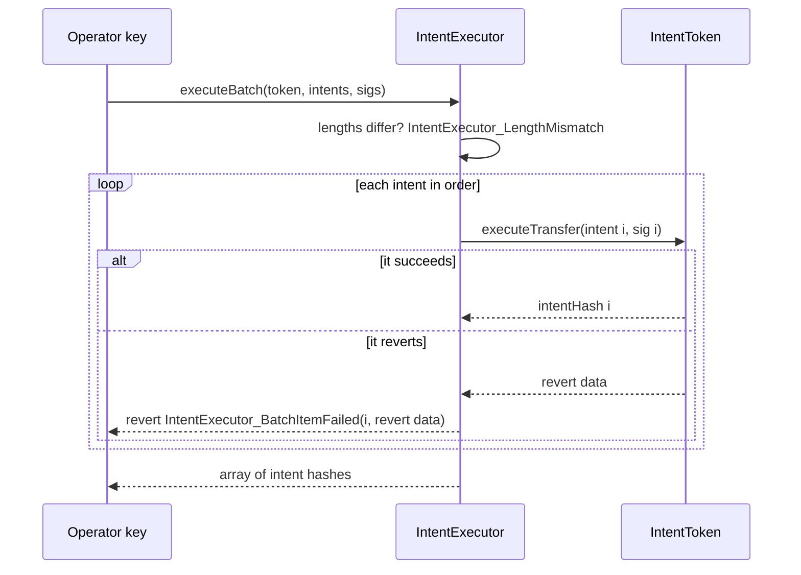
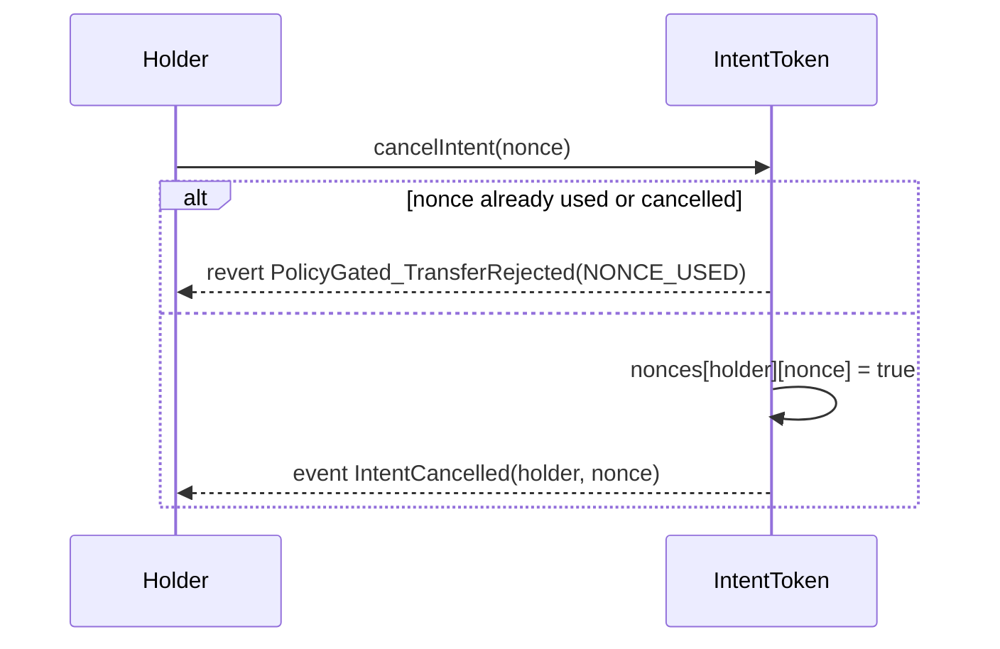
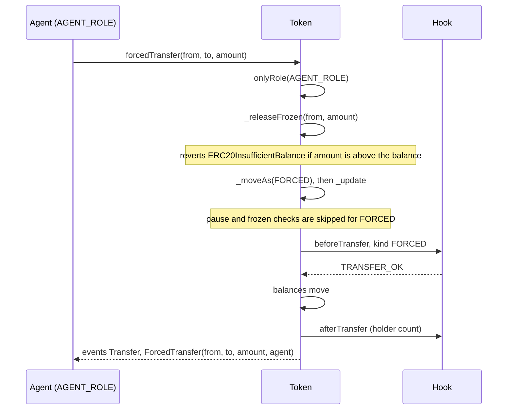
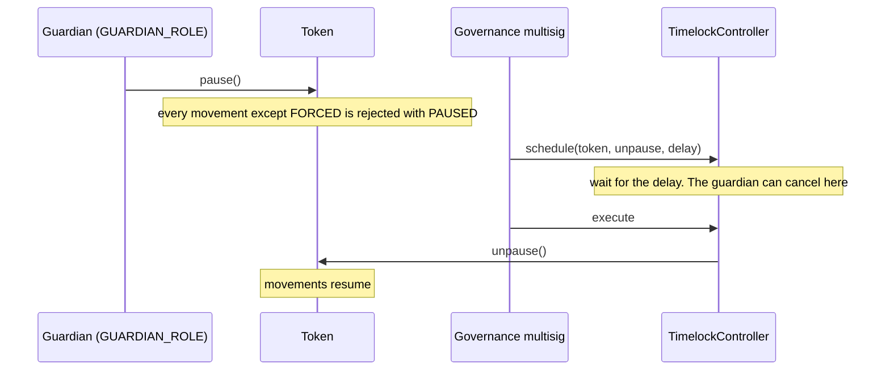

# Token flows

Step-by-step flows for `IntentToken`. Transfer, forced transfer, freeze, lockup and pause work the same way on both vaults, because they come from the base. Mint, burn and signed intents exist only on `IntentToken`. Vault flows are in [flows-vaults.md](flows-vaults.md).

In every diagram, "Hook" stands for `ComplianceHook` and the rules it calls. The checks that matter for each flow are listed under it. How the hook reaches a decision is in [transfer-checks.md](transfer-checks.md).

## Mint

The issuer's minter creates tokens for a verified holder.



Checks with the standard rules: `IdentityRule` needs `to` verified. `MaxHoldersRule` rejects if `to` is a new holder and the cap is full. Paused rejects it.

Reverts: `AccessControlUnauthorizedAccount` without the role. Otherwise `PolicyGated_TransferRejected(PAUSED | RECEIVER_NOT_VERIFIED | MAX_HOLDERS)`.

Code: `PolicyGatedERC20Upgradeable.mint`, `_update`.

## Burn

The burner destroys tokens held by any account. The holder does not take part.



Checks: `IdentityRule` needs `from` verified. `LockupRule` skips the lock because the operator holds `BURNER_ROLE`. A paused token rejects the burn. If `amount` is more than the balance, `_releaseFrozen` reverts with `ERC20InsufficientBalance`.

Code: `PolicyGatedERC20Upgradeable.burn`, `_releaseFrozen`; `LockupRule.check`.

## Transfer, approval and permit

A holder sends tokens with `transfer`. A spender with allowance uses `transferFrom`. Both arrive at the hook as `TRANSFER`. For `transferFrom` the operator in the context is the spender. The spender is never checked by any rule. Only `from` and `to` are.

`approve` and `permit` change an allowance. They do not move tokens and do not call the hook, so they work while the token is paused. `permit` is ERC-2612 and uses the same EIP-712 domain as signed intents.

Checks with the standard rules: pause, `balance - frozen >= amount`, `IdentityRule` on both parties, `LockupRule` on the sender, `MaxHoldersRule` if the receiver is a new holder. `SettlementWindowRule` does not apply to a direct transfer.

Code: ERC-20 functions inherited from OpenZeppelin, `_update`.

## Signed intent

A holder authorises a transfer with a signature. A bank key submits it. The holder does not send a transaction and needs no gas.

### What the holder signs

EIP-712 typed data:

```
TransferIntent(address from,address to,uint256 amount,bytes32 nonce,uint256 deadline,bytes32 ref)
```

| Field | Meaning |
|---|---|
| `from` | the signer and the sender of the tokens |
| `to` | the receiver |
| `amount` | token amount |
| `nonce` | 32 random bytes chosen by the signer. Each signer has its own set of nonces |
| `deadline` | last valid unix timestamp, inclusive |
| `ref` | a 32-byte reference to an off-chain message, for example the hash of an ISO 20022 message id. The token emits it and puts it in the context. None of the four standard rules reads it |

Domain: `name` is the token name, `version` is `"1"`, `chainId` is the chain, `verifyingContract` is the token proxy. The token reports it through `eip712Domain()` (ERC-5267), and `intentHash(intent)` returns the digest. A signature is valid for one token on one chain.

An EOA signs with ECDSA, and only low-`s` signatures are accepted. A contract wallet signs by ERC-1271. The token uses OpenZeppelin's `SignatureChecker` for both.

### Execution



Checks in `executeTransfer`, in this order:

1. The caller holds `EXECUTOR_ROLE`. After `Activate` that is the `IntentExecutor` contract.
2. `block.timestamp > deadline` returns `INTENT_EXPIRED`.
3. The nonce was already used by `from` returns `NONCE_USED`.
4. The signature does not match `from` returns `BAD_SIGNATURE`.
5. The nonce is marked used.
6. The movement goes through `_update` as `EXECUTED`: pause, frozen balance, then the hook. With the standard rules that means `IdentityRule` on both parties, `LockupRule` on the sender, `SettlementWindowRule` (the window must be open), and `MaxHoldersRule`.
7. `IntentExecuted(intentHash, from, to, amount, executor, ref)` is emitted. `executor` is the account that called the token, so it is the `IntentExecutor` contract when the call came through it.

A revert anywhere undoes the nonce write. An intent rejected for being outside the settlement window can be submitted again when the window opens, until its deadline.

The executor passes the intent to the token unchanged. It holds no funds and no state. It has `OPERATOR_ROLE` for callers and a `GUARDIAN_ROLE` that can pause it, in which case `execute` reverts with OpenZeppelin's `EnforcedPause`.

Code: `IntentSettledUpgradeable.executeTransfer`, `canExecute`, `intentHash`, `_intentPreflight`; `IntentExecutor.execute`.

## Batch

An operator settles several intents on one token in one transaction. All settle or none does.



The revert names the index of the failing intent and carries the token's revert data, for example `PolicyGated_TransferRejected(reason)`. The operator can drop that intent and resubmit the rest. Intents execute in array order, so an earlier intent in the batch can change what a later one sees, such as a balance or the holder count.

Code: `IntentExecutor.executeBatch`.

## Cancel

A holder invalidates a nonce before anyone executes the intent that uses it.



`cancelIntent` marks a nonce of the caller. It needs no other field of the intent, and the nonce does not have to have been used for a real intent yet. It does not check pause. If the operator's transaction is mined before the cancel, the intent executes. There is no way to cancel after execution.

Code: `IntentSettledUpgradeable.cancelIntent`.

## Forced transfer

The agent moves tokens between accounts without the holder's consent: a clawback, a recovery, a court order.



The hook still decides. With the standard rules: `IdentityRule` needs `to` verified and does not look at `from`. `LockupRule` passes. `MaxHoldersRule` does not apply the cap, but counts the new holder. Pause and the frozen amount do not stop it.

If the forced amount cuts into the frozen amount, `_releaseFrozen` lowers the frozen amount to what is left and emits `Frozen`. The order of events is `Frozen`, then `Transfer`, then `ForcedTransfer`.

Code: `PolicyGatedERC20Upgradeable.forcedTransfer`, `_releaseFrozen`, `_moveAs`.

## Freeze

The agent holds back part of a holder's balance.

`setFrozen(user, amount)` sets the frozen amount to `amount`. It is an absolute value, not an increase. It cannot be above the balance: `PolicyGated_FrozenExceedsBalance(user, amount, balance)`. It emits `Frozen(user, amount)`.

While `amount` is frozen, any movement from the holder that is not `FORCED` can use only `balanceOf - frozen`. That covers transfers, executed intents and burns by the holder or a vault. Tokens received later do not raise the frozen amount. `setFrozen(user, 0)` lifts the freeze. It does not check pause.

Code: `PolicyGatedERC20Upgradeable.setFrozen`, `getFrozen`.

## Lockup

The agent blocks a holder from sending until a time.

The agent calls the rule, not the token: `LockupRule.setLockup(token, holder, unlockTime)`. The rule asks the token whether the caller holds `AGENT_ROLE`. A time in the past or present clears the lockup. While locked, the holder's `transfer` and executed intents are rejected with `LOCKED`. On the vaults a redemption by the holder is rejected too, because it is a holder burn. See [transfer-checks.md](transfer-checks.md) for the full rule.

Code: `LockupRule.setLockup`.

## Pause and unpause



`pause()` works at once. `unpause()` needs `DEFAULT_ADMIN_ROLE`, which is the timelock, so it takes the full delay. The guardian holds `CANCELLER_ROLE` on the timelock and can cancel the scheduled unpause. See [roles.md](roles.md#what-the-guardian-can-do).

While paused, these still work: `approve`, `permit`, `cancelIntent`, `setFrozen`, `setLockup`, `forcedTransfer`, role changes and every view function.

`IntentExecutor` has its own pause. The guardian calls `pause()` on it and the timelock calls `unpause()`. It stops `execute` and `executeBatch` without touching the token.

Code: `PolicyGatedERC20Upgradeable.pause`, `unpause`; `IntentExecutor.pause`, `unpause`.
