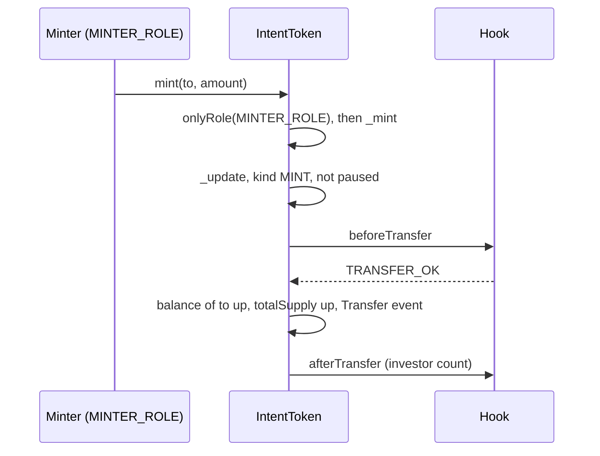
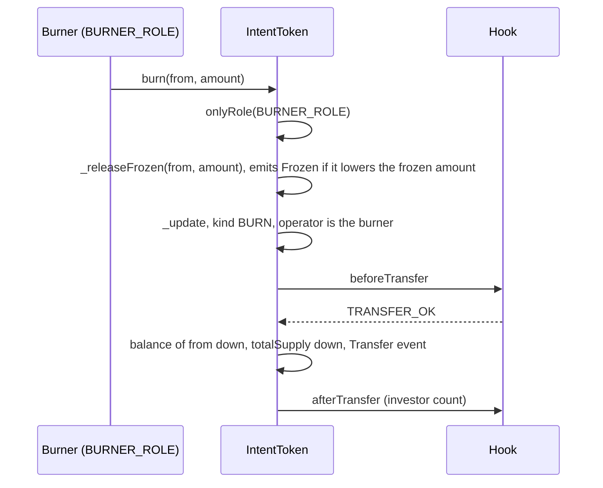
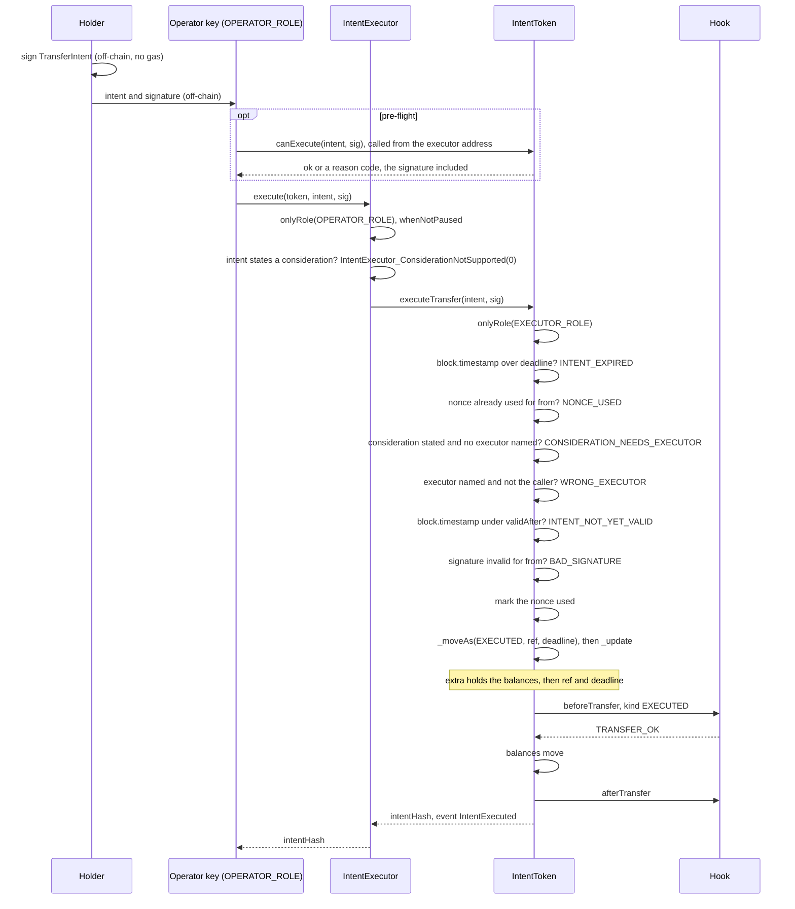
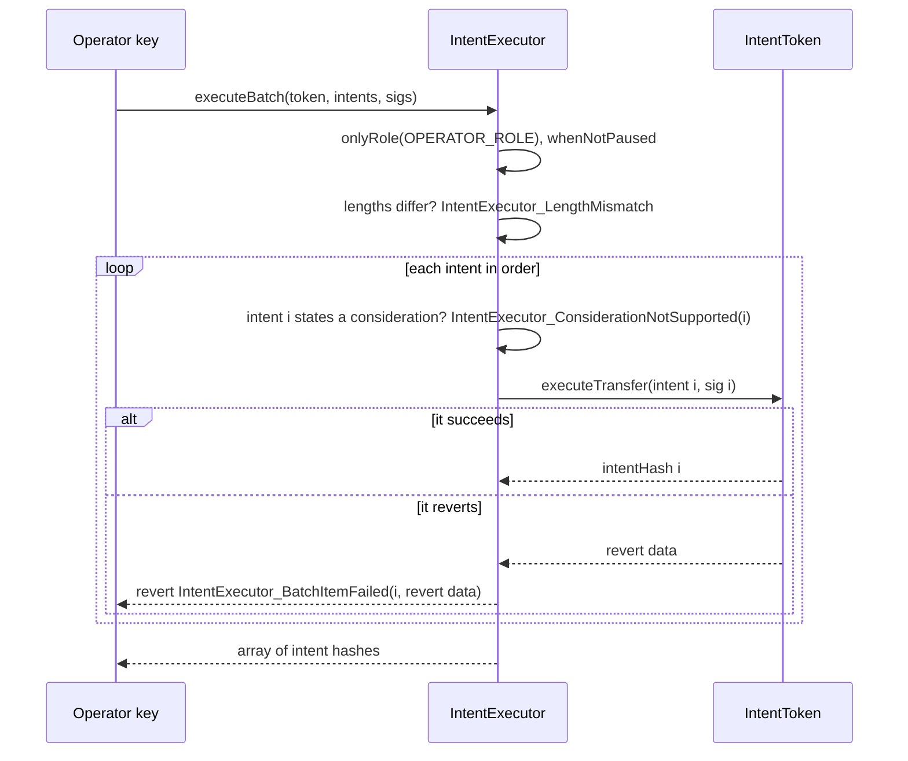
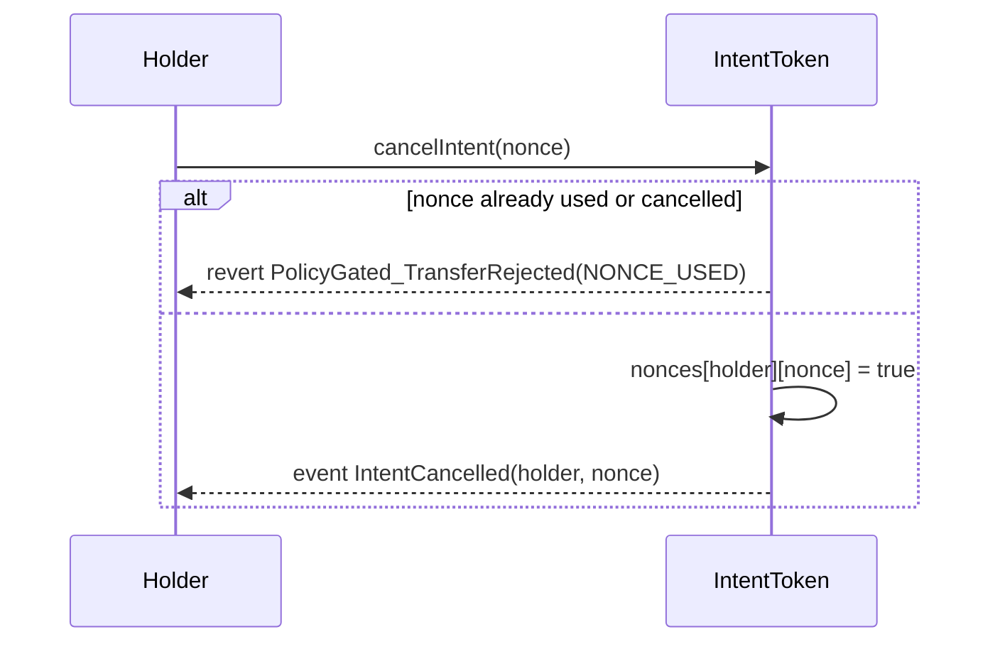
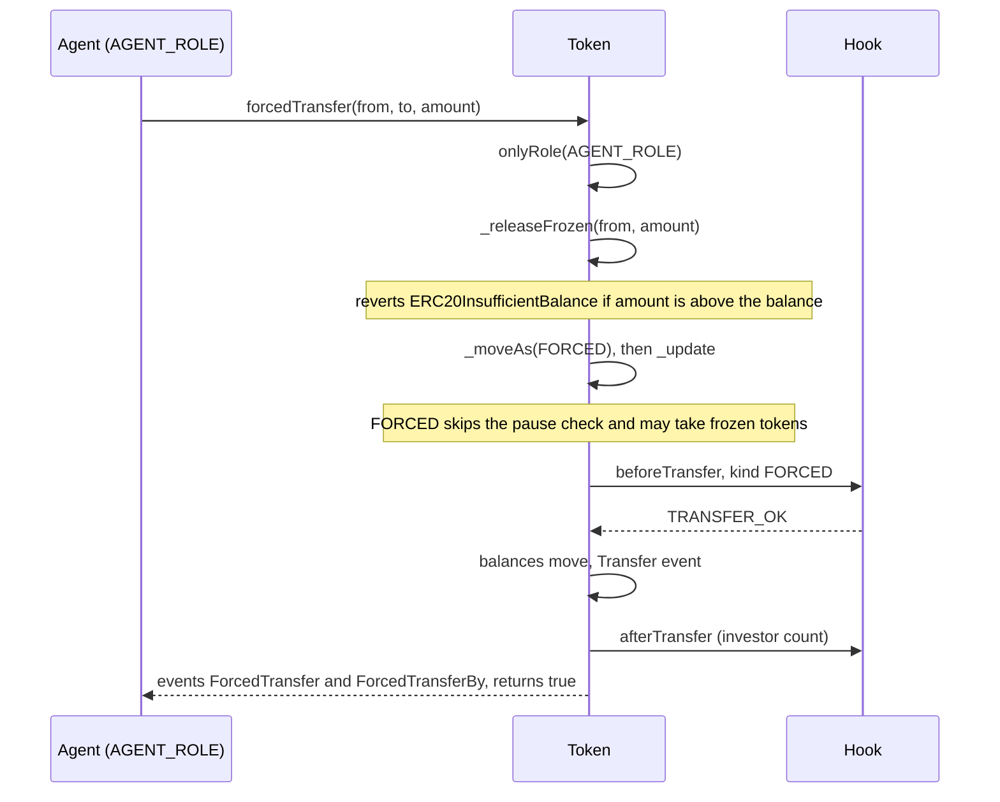
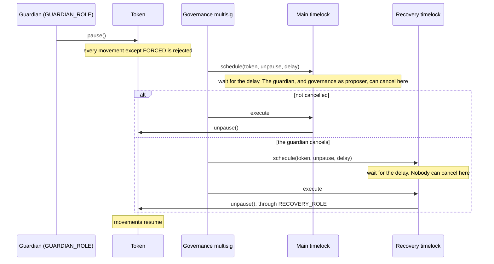

# Token flows

Step-by-step flows for `IntentToken`. Transfer, forced transfer, freeze and pause apply to vault shares the same way, because they come from the base. The lockup and the address freeze apply the same way because the vaults' rule lists include `HolderRestrictionRule`. How a redemption meets them differs per vault. Role-gated `mint` and `burn`, and signed intents, work only on `IntentToken`. Both vaults reject `mint(address,uint256)` and `burn(address,uint256)`. Vault flows are in [flows-vaults.md](flows-vaults.md).

In every diagram, "Hook" stands for the `ComplianceHook` the token names and the rules it holds for that token. The checks that matter for each flow are listed under it. How the hook reaches a decision is in [transfer-checks.md](transfer-checks.md).

"The standard rules" below are the rules `Activate` puts in each token's list, in this order: `CredentialRule`, `MinPositionRule`, `HolderRestrictionRule`, then `SettlementWindowRule` on `IntentToken` only, then `FundHoldersRule`. `MaxHoldersRule` is deployed and attested but is in no token's list, so a flow mentions it only where it would add an event. `MinPositionRule` does nothing until the token's admin sets a minimum, and `Activate` sets none by default.

## Mint

The issuer's minter creates tokens for a holder with a credential.



Checks with the standard rules: `CredentialRule` needs `to` to hold an `ACTIVE` credential that the token's policy accepts. `MinPositionRule` rejects if a minimum is set and `to` would end up holding less than it. `HolderRestrictionRule` rejects a frozen `to`. `FundHoldersRule` rejects if `to` would be a new investor of a full fund, and with `NOT_FUND_CLASS` if the token is not a registered class of its fund. Paused rejects it.

Reverts: `AccessControlUnauthorizedAccount` without the role. A zero `to` reverts with `ERC20InvalidReceiver(address(0))` before `_update`. Otherwise `PolicyGated_TransferRejected(PAUSED | RECEIVER_NOT_VERIFIED | CREDENTIAL_EXPIRED | RECEIVER_NOT_ELIGIBLE | BELOW_MIN_POSITION | RECEIVER_FROZEN | MAX_HOLDERS | NOT_FUND_CLASS)`.

Code: `PolicyGatedERC20Upgradeable.mint`, `_update`.

## Burn

The burner destroys tokens held by any account, without the holder taking part.



The burn is an enforcement action, so it may take frozen tokens. `_releaseFrozen` first lowers the frozen amount by the part of `amount` that comes out of frozen tokens, and the burn then needs only the balance. See [Freeze](#freeze).

Checks: `CredentialRule` does not stop the burner, whatever the holder's standing, so the burner can burn from a blocked holder, a lapsed one or one with no credential. `HolderRestrictionRule` refuses a frozen `from` with `SENDER_FROZEN`, burner or not. It does not stop the burn for a lockup, because the operator holds `BURNER_ROLE`. `MinPositionRule` does not require `from` to keep a minimum, for the same reason. A paused token rejects the burn, because only a forced transfer is exempt from pause. If `amount` is more than the balance, `_releaseFrozen` reverts with `ERC20InsufficientBalance`.

Code: `PolicyGatedERC20Upgradeable.burn`, `_releaseFrozen`; `HolderRestrictionRule.check`.

## Transfer, approval and permit

A holder sends tokens with `transfer`. A spender with allowance uses `transferFrom`. Both arrive at the hook as `TRANSFER`. For `transferFrom` the operator in the context is the spender. None of the standard rules checks the spender. They look at `from` and `to`. `HolderRestrictionRule` and `MinPositionRule` read the operator only on a `BURN`, to see whether it holds `BURNER_ROLE`.

`approve` and `permit` change an allowance. They do not move tokens and do not call the hook, so they work while the token is paused. `permit` is ERC-2612 and uses the same EIP-712 domain as signed intents.

Checks with the standard rules: pause, then `amount <= balance - frozen` (zero when the frozen amount is the larger), `CredentialRule` on both parties (the sender must be able to leave, the receiver must be eligible), `MinPositionRule` (neither party may be left above zero and below the minimum, if one is set), `HolderRestrictionRule` (a frozen sender or receiver, and a lockup on the sender), `FundHoldersRule` if the receiver would be a new investor of the fund. `SettlementWindowRule` does not apply to a direct transfer.

Reverts: an amount within the balance but above the unfrozen balance reverts with `ERC7943InsufficientUnfrozenBalance(account, amount, unfrozen)`, and an amount above the balance with OpenZeppelin's `ERC20InsufficientBalance(account, balance, amount)`. Every rejection by the hook reverts with `PolicyGated_TransferRejected(reason)`.

Before sending, an integrator can ask `canTransferWithReason(from, to, amount)`, which runs these checks without the write and returns the reason code, or `canTransfer`, the ERC-7943 function, which returns only a bool. They differ on a balance shortfall. ERC-7943 forbids `canTransfer` to fail on a balance check, so an amount above the balance reads true when the hook accepts it and no frozen amount is in the way (nothing frozen, or a burn by a sender that holds `BURNER_ROLE`), where `canTransferWithReason` says `(false, INSUFFICIENT_UNFROZEN)` and the write reverts with `ERC20InsufficientBalance`. To learn whether a transfer will succeed, use `canTransferWithReason`. `canSend(account)` and `canReceive(account)` ask the account-level question only ([architecture.md](architecture.md#account-level-questions)). They carry no amount, so they do not see a holder cap or an investor cap: a full cap does not make `canReceive` false for a new account, and `canTransferWithReason` shows whether the movement passes.

Code: ERC-20 functions inherited from OpenZeppelin; `PolicyGatedERC20Upgradeable._update`, `canTransfer`, `canTransferWithReason`, `canSend`, `canReceive`.

## Signed intent

A holder authorises a transfer with a signature. A bank key submits it. The holder does not send a transaction and needs no gas.

### What the holder signs

EIP-712 typed data:

```
TransferIntent(address from,address to,uint256 amount,bytes32 nonce,uint256 deadline,bytes32 ref,address executor,uint256 validAfter,address considerationToken,uint256 considerationAmount)
```

| Field | Meaning |
|---|---|
| `from` | the signer and the sender of the tokens |
| `to` | the receiver |
| `amount` | token amount |
| `nonce` | 32 random bytes chosen by the signer. Each signer has its own set of nonces |
| `deadline` | last valid unix timestamp, inclusive |
| `ref` | a 32-byte reference to an off-chain message, for example the hash of an ISO 20022 message id. The token emits it and puts it in the context, in `extra` after the two balances. None of the standard rules reads it |
| `executor` | the only account allowed to execute the intent. Zero means any holder of `EXECUTOR_ROLE` |
| `validAfter` | first valid unix timestamp, inclusive. Zero means no lower bound |
| `considerationToken`, `considerationAmount` | what the signer is to receive for this leg. The token hashes them into the digest the holder signs and reads them only for step 4 below. Only the executor named in `executor` can enforce the payment, if its code does |

Domain: `name` is the token name, `version` is `"1"`, `chainId` is the chain, `verifyingContract` is the token proxy. The token reports it through `eip712Domain()` (ERC-5267), and `intentHash(intent)` returns the digest. A signature is valid for one token on one chain.

The token uses OpenZeppelin's `SignatureChecker`, which picks the method by whether `from` has code. If `from` has no code, the signature is checked with ECDSA, and only low-`s` signatures are accepted. If `from` has code, the check goes through ERC-1271. That covers a contract wallet, and also an EOA with an EIP-7702 delegation. A delegated EOA whose delegate does not implement `isValidSignature` cannot sign intents: its ECDSA signature is rejected with `BAD_SIGNATURE`.

### Execution



Checks in `executeTransfer`, in this order. Step 1 reverts with `AccessControlUnauthorizedAccount`. Steps 2 to 7, and the pause and hook checks inside step 9, revert with `PolicyGated_TransferRejected(reason)`. An amount within the balance but above the unfrozen balance, checked inside step 9 before the hook, reverts with `ERC7943InsufficientUnfrozenBalance(from, amount, unfrozen)`, and an amount above the balance with `ERC20InsufficientBalance(from, balance, amount)`. A zero `to` reverts with `ERC20InvalidReceiver(address(0))` at the start of step 9, before the pause, frozen and hook checks. `canExecute` returns the reason instead of reverting for steps 2 to 7, and for the pause, frozen and hook checks of step 9. For a shortfall it returns `INSUFFICIENT_UNFROZEN`, an amount above the balance included. It does not check step 1, and it does not reproduce the zero-`to` revert. For a zero `to` it returns the result of the pause, frozen and hook checks; with `CredentialRule` and nothing else failing, that is `RECEIVER_NOT_VERIFIED` for an address with no credential:

1. The caller holds `EXECUTOR_ROLE`. After `Activate` that is the `IntentExecutor` contract or the `DvPExecutor` contract.
2. `block.timestamp > deadline`: reason `INTENT_EXPIRED`.
3. The nonce was already used by `from`: reason `NONCE_USED`.
4. The intent states a consideration (a non-zero `considerationToken` or `considerationAmount`) and `executor` is zero: reason `CONSIDERATION_NEEDS_EXECUTOR`.
5. `executor` is non-zero and is not the caller: reason `WRONG_EXECUTOR`.
6. `block.timestamp < validAfter`: reason `INTENT_NOT_YET_VALID`.
7. The signature does not match `from`: reason `BAD_SIGNATURE`.
8. The nonce is marked used.
9. The movement goes through `_update` as `EXECUTED`: pause, frozen balance, then the hook. With the standard rules that means `CredentialRule` on both parties, `MinPositionRule`, `HolderRestrictionRule` (a frozen sender or receiver, and a lockup on the sender), `SettlementWindowRule` (the window must be open), and `FundHoldersRule`.
10. `IntentExecuted(intentHash, from, to, amount, executor, ref)` is emitted. `executor` is the account that called the token, so it is the `IntentExecutor` contract when the call came through it.

An intent can be bound to an executor, and it can state what its signer is to receive for it. The token enforces the binding, and that a stated consideration comes with a named executor. It does not enforce the payment: it never reads `considerationToken` or `considerationAmount` beyond that check. An executor that moves the other leg, and that the intent names, is what makes the payment happen. `IntentExecutor` does not move another leg, so it refuses any intent that states a consideration, whoever the intent names, with `IntentExecutor_ConsiderationNotSupported(index)` before the token is called: otherwise the shares would move without the payment the signer read in the message. `DvPExecutor` is the executor that does enforce a payment ([flows-dvp.md](flows-dvp.md)). The token's own `canExecute` does not see this refusal, because it is the executor's check, not the token's.

A revert anywhere undoes the nonce write. An intent rejected for being outside the settlement window can be submitted again when the window opens, until its deadline.

The executor passes the intent to the token unchanged, after one check of its own: the intent must state no consideration (a zero `considerationToken` and a zero `considerationAmount`). It holds no funds and keeps no intent or nonce state. It stores only its roles and its pause flag. It has `OPERATOR_ROLE` for callers and a `GUARDIAN_ROLE` that can pause it, in which case `execute` reverts with OpenZeppelin's `EnforcedPause`.

Code: `IntentSettledUpgradeable.executeTransfer`, `canExecute`, `intentHash`, `_intentPreflight`; `IntentExecutor.execute`.

## Batch

An operator settles several intents on one token in one transaction. All settle or none does.



The revert names the index of the failing intent and carries the token's revert data, for example `PolicyGated_TransferRejected(reason)`. The operator can drop that intent and resubmit the rest. Intents execute in array order, so an earlier intent in the batch can change what a later one sees, such as a balance or the fund's investor count.

Code: `IntentExecutor.executeBatch`.

## Several calls on one token

Any account can batch calls to one token with `multicall(bytes[] data)`. The token runs each call against itself with a `delegatecall`, so `msg.sender` stays the account that called `multicall`, and the role check of every call inside applies to it. If one call reverts, the whole batch reverts. `multicall` is not payable. An agent that holds `AGENT_ROLE` can use it to set a frozen amount and force a transfer in one transaction, and a minter to mint to several accounts. The tokens have no bespoke batch functions. Each balance movement inside the batch still goes through the hook as its own movement, with the account that called `multicall` as the operator.

Code: `PolicyGatedERC20Upgradeable` (inherits OpenZeppelin's `MulticallUpgradeable`).

## Cancel

A holder invalidates a nonce before anyone executes the intent that uses it.



`cancelIntent` marks a nonce of the caller. It needs no other field of the intent, and the nonce does not have to have been used for a real intent yet. It does not check pause. If the operator's transaction is mined before the cancel, the intent executes. There is no way to cancel after execution.

Code: `IntentSettledUpgradeable.cancelIntent`.

## Forced transfer

The agent moves tokens between accounts without the holder's consent: a clawback, a recovery, a court order.



The hook still decides. With the standard rules: `CredentialRule` needs `to` eligible and does not look at `from`. `MinPositionRule` passes, because a forced transfer is exempt. `HolderRestrictionRule` ignores the sender's freeze and lockup, but refuses a frozen `to` with `RECEIVER_FROZEN`. `FundHoldersRule` does not apply the cap, but counts the new investor, and still rejects with `NOT_FUND_CLASS` if the token is not a registered class. Pause, the frozen amount and the sender's address freeze do not stop it. A frozen `to` does, so a quarantine account used for enforcement must not be address-frozen.

The forced amount can include frozen tokens, never more than the balance. `_releaseFrozen` works out the unfrozen part of the balance and lowers the frozen amount by whatever part of `amount` is above it. With balance 100 and frozen 40, forcing 70 leaves frozen 30. A frozen amount may exceed the balance, so with balance 10 and frozen 100, forcing 10 leaves frozen 90. `Frozen` is emitted only if the frozen amount changes. The token emits `Frozen`, then `Transfer`, then `ForcedTransfer` (the ERC-7943 event), then `ForcedTransferBy`, which also carries the agent. `FundHoldersRule` is in every standard list, so the fund's `HolderClassesUpdated` and `HolderCountUpdated` events can appear between `Transfer` and `ForcedTransfer`. If governance adds `MaxHoldersRule` to a token's list, the rule's own `HolderCountUpdated` event can too.

Code: `PolicyGatedERC20Upgradeable.forcedTransfer`, `_releaseFrozen`, `_moveAs`.

## Freeze

The agent holds back part of a holder's balance.

`setFrozenTokens(account, amount)` sets the frozen amount to `amount` and returns `true`. It is an absolute value, not an increase. The amount can be above the balance, and the token does not cap it. It emits `Frozen(account, amount)`. `getFrozenTokens(account)` reads it.

The unfrozen balance is `balanceOf - frozen`, or zero when the frozen amount is the larger. A movement from the holder can use only that. It covers transfers, executed intents and burns by the holder or a vault. For a transfer, an executed intent or a 7540 redemption fulfilment, an amount above it but within the balance reverts with `ERC7943InsufficientUnfrozenBalance(account, amount, unfrozen)`. An amount above the whole balance reverts with `ERC20InsufficientBalance(account, balance, amount)`, frozen or not, because the balance is then the cause and ERC-7943 leaves that to the base standard. A 4626 `redeem` or `withdraw` for more than `maxRedeem` or `maxWithdraw` is stopped earlier, with `ERC4626ExceededMaxRedeem` or `ERC4626ExceededMaxWithdraw`.

The exceptions are enforcement: a forced transfer and a role `burn` by the burner on any token, plus `recoverRedeemRequest` on `Gated7540Vault`, which moves the vault's own escrow. Each may take frozen tokens, never more than the balance. Before the move, `_releaseFrozen` lowers the frozen amount by exactly the part of the amount that was frozen, and emits `Frozen` before the `Transfer` event. With balance 10 and frozen 100, a forced transfer of 10 leaves frozen 90. The vaults have no role `burn`. Tokens received later do not raise the frozen amount. `setFrozenTokens(account, 0)` lifts the freeze. It does not check pause.

The pre-flights `canTransfer` and `canTransferWithReason` model a holder-driven movement, so frozen tokens count against the amount: once an account has a frozen amount, an amount above its unfrozen balance reads false in both, above the balance too, except for a burn by a `BURNER_ROLE` sender, below. They do not model a forced transfer. A balance shortfall with no frozen amount in the way is where they differ. With nothing frozen, an amount above the balance reads true in `canTransfer` when the hook accepts it, because ERC-7943 forbids it to fail on a balance check. `canTransferWithReason` says `(false, INSUFFICIENT_UNFROZEN)`, as the write reverts. A pre-flight of a burn whose sender itself holds `BURNER_ROLE` may take frozen tokens, so `canTransferWithReason` bounds it by the balance, as the write by the burner is, and `canTransfer` reads true above the balance too, because no frozen amount stands in a burner's way. [transfer-checks.md](transfer-checks.md#pre-flight-calls) has the cases.

This freezes an amount. To block an address, see [Address freeze](#address-freeze).

Code: `PolicyGatedERC20Upgradeable.setFrozenTokens`, `getFrozenTokens`, `_releaseFrozen`, `_check`, `canTransfer`, `canTransferWithReason`.

## Lockup

The agent blocks a holder from sending until a time.

The agent calls the rule, not the token: `HolderRestrictionRule.setLockup(token, holder, unlockTime)`. The rule asks the token whether the caller holds `AGENT_ROLE`. A time at or before the current block time clears the lockup. A future time that does not fit in 64 bits reverts with `HolderRestrictionRule_UnlockTimeTooLarge`. Setting a lockup leaves the holder's address freeze as it was. While locked, the holder's `transfer` and executed intents are rejected with `LOCKED`. On `Gated4626Vault`, a holder's `redeem` or `withdraw` is a holder burn and is blocked too. `maxRedeem` and `maxWithdraw` drop to 0, so a non-zero call reverts with `ERC4626ExceededMaxRedeem` or `ERC4626ExceededMaxWithdraw`. On `Gated7540Vault`, `requestRedeem` is rejected with `LOCKED`, because it moves the shares to the vault as a `TRANSFER`. A locked controller also cannot collect a fulfilled redemption: the claim reverts with `Gated7540Vault_ControllerNotEligible(LOCKED)`. A forced transfer, a mint and a burn by the burner are not stopped by a lockup. `canSend(holder)` is false while the lockup runs, and `canReceive(holder)` is not affected: a locked account can still be paid. See [transfer-checks.md](transfer-checks.md) for the full rule.

Code: `HolderRestrictionRule.setLockup`, `check`, `checkSend`.

## Address freeze

The agent blocks an address from sending and from receiving. This is not the frozen amount of [Freeze](#freeze), which holds back part of a balance.

The agent calls the rule, as for the lockup: `HolderRestrictionRule.setFrozen(token, holder, frozen)`. The rule asks the token whether the caller holds `AGENT_ROLE`. Setting the freeze leaves the holder's lockup as it was. The rule emits `HolderFrozenSet`.

While the address is frozen, a movement from it is rejected with `SENDER_FROZEN` for every kind except a forced transfer, and a movement to it is rejected with `RECEIVER_FROZEN` for every kind except a burn. So a mint to a frozen address, and a forced transfer into one, are refused. A burn from a frozen address is refused too, even by the burner. The way out of a frozen address is a forced transfer to a quarantine account, which therefore must not be address-frozen. The sender is judged before the receiver. `canSend(holder)` and `canReceive(holder)` are both false (the reason, `SENDER_FROZEN` or `RECEIVER_FROZEN`, comes from the hook's `checkSend` and `checkReceive`, and a rule earlier in the list can answer first: for a holder with no credential `CredentialRule` does). Setting and clearing it work while the token is paused.

Code: `HolderRestrictionRule.setFrozen`, `check`, `checkSend`, `checkReceive`.

## Pause and unpause



`pause()` works at once. Inside `_update` the rejection reason is `PAUSED`. Checks that run before `_update` can revert first with their own error, such as an intent check, a zero address, or a vault's `max*` limit. `unpause()` needs `DEFAULT_ADMIN_ROLE`, held by the main timelock, or `RECOVERY_ROLE`, held by the recovery timelock, so it takes the full delay of either. The guardian and governance both hold `CANCELLER_ROLE` on the main timelock, so either can cancel an unpause scheduled there. As deployed, nobody can cancel on the recovery timelock, which can also remove the guardian. See [roles.md](roles.md#what-the-guardian-can-do).

Enforcement while paused. A pause refuses `mint` and `burn` as it refuses every kind except `FORCED`, so the issuer's mint and the burner's burn stop with `PAUSED`. `forcedTransfer` still works. During a pause the agent's route is `forcedTransfer(from, quarantine, amount)`. The hook still decides on the receiver: `quarantine` must hold an `ACTIVE` credential that the token's policy accepts, and must not be address-frozen. A `burn` of what sits in the quarantine account waits for the unpause. The burner cannot go at the holder directly instead. Once the pause is lifted, a `burn` from a blocked holder goes through, because `CredentialRule` does not stop the burner. One from an address-frozen holder is still refused by `HolderRestrictionRule` with `SENDER_FROZEN`. A forced transfer ignores both on the sender side.

This differs from the ERC-3643 reference token (`Token.sol` in the ERC-3643 repository, branch `main`, checked on 2026-10-23). There `whenNotPaused` is on `transfer` and `transferFrom` only, and `mint`, `burn` and `forcedTransfer` carry `onlyAgent` alone, so its agents can mint, burn and force while paused. Its `setAddressFrozen` blocks `transfer` and `transferFrom` in both directions, but mint, burn and `forcedTransfer` ignore the flag. Here the pause also blocks the issuer's mint, and the address freeze also blocks a mint to the frozen address and a forced transfer into it. This compares the two tokens' code. It is not a claim about the ERC-3643 text.

While paused, these still work: `approve`, `permit`, `cancelIntent`, `setFrozenTokens`, `HolderRestrictionRule.setLockup` and `setFrozen`, `forcedTransfer`, role changes and every view function. `mint` and `burn` do not.

`IntentExecutor` and `DvPExecutor` each have their own pause. The guardian calls `pause()` on one, and the main or the recovery timelock calls `unpause()`. It stops `execute` and `executeBatch`, or `executeDvPGated` and `executeDvP3009`, without touching the token.

Code: `PolicyGatedERC20Upgradeable.pause`, `unpause`; `IntentExecutor.pause`, `unpause`; `DvPExecutor.pause`, `unpause`; `ignition/modules/Activate.ts`.
