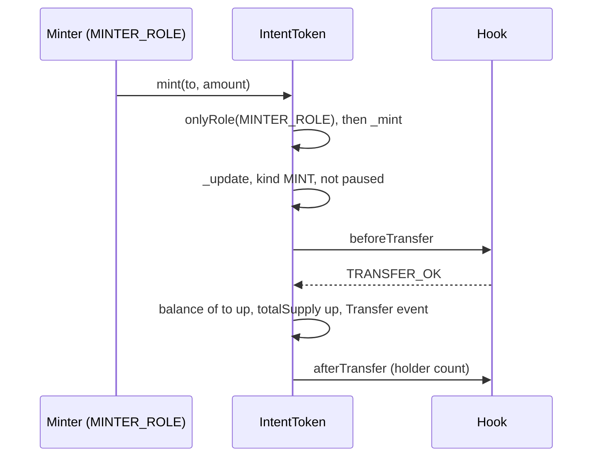
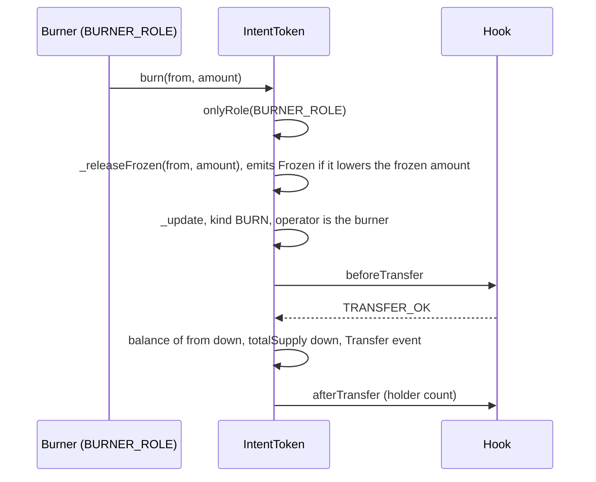
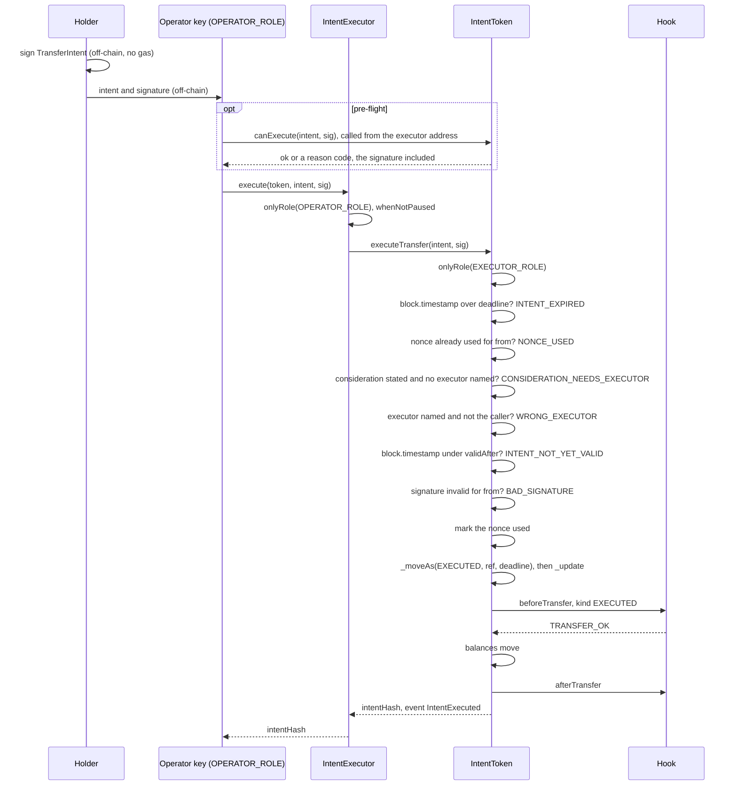
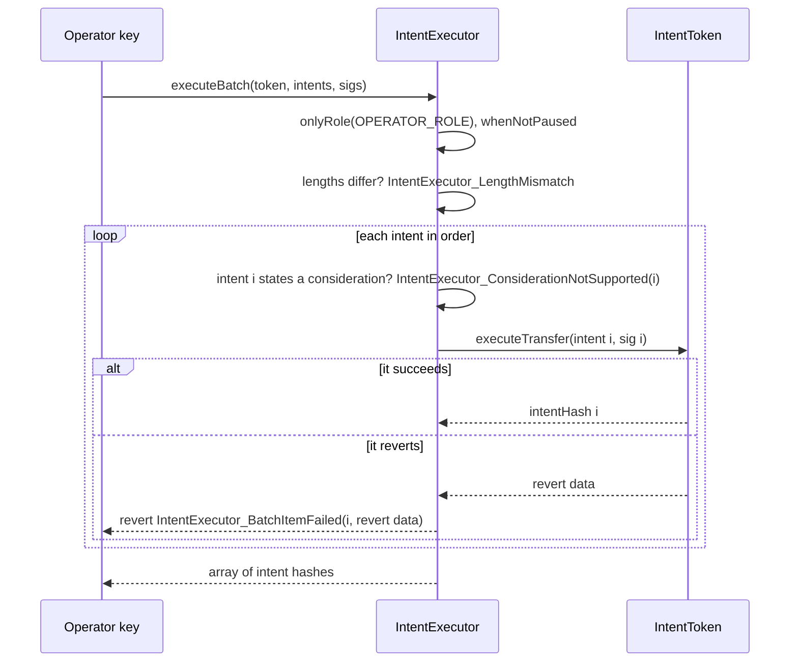
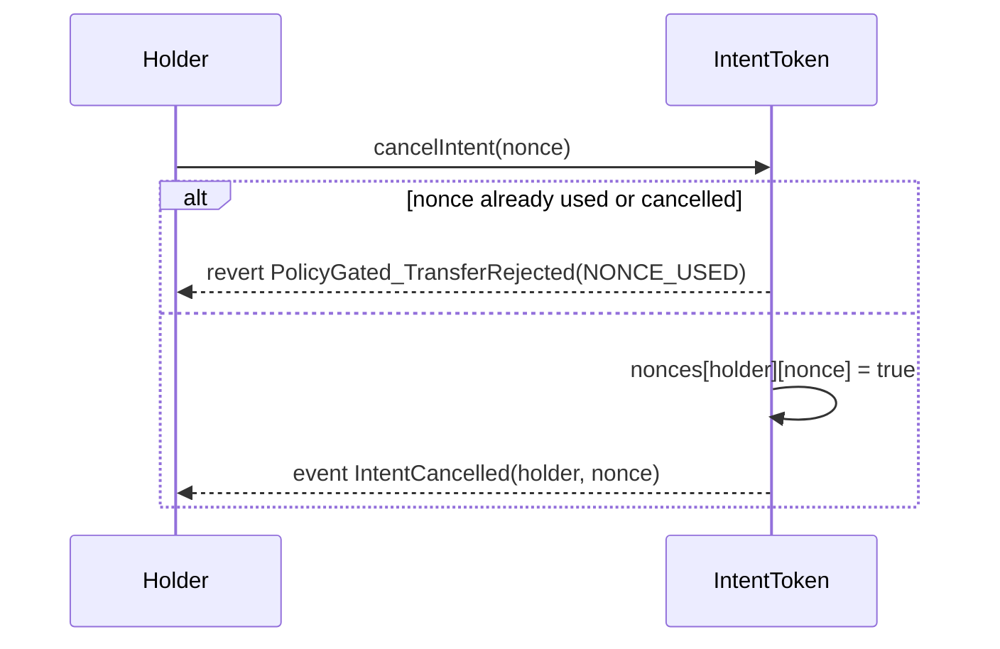
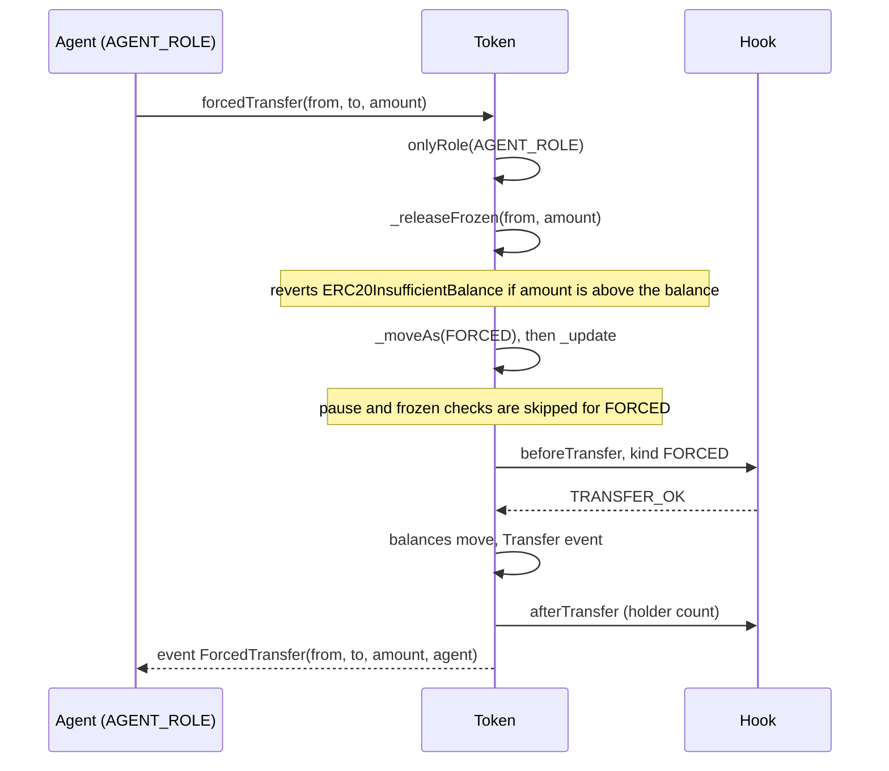
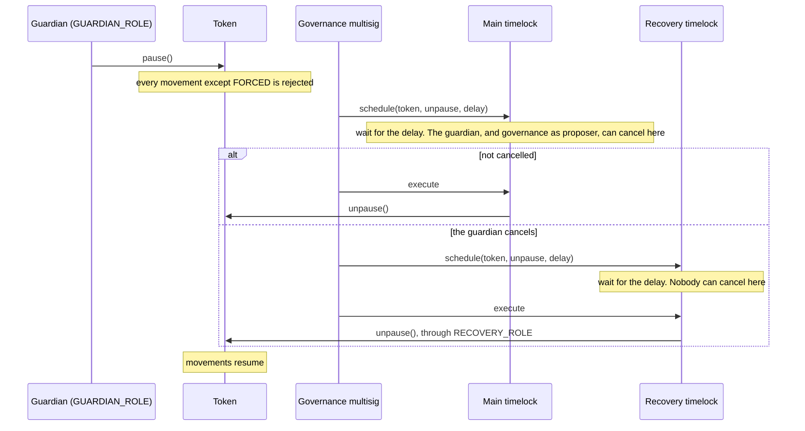

# Token flows

Step-by-step flows for `IntentToken`. Transfer, forced transfer, freeze and pause apply to vault shares the same way, because they come from the base. Lockup applies the same way because the vaults' hooks include `LockupRule`. How a redemption meets them differs per vault. Role-gated `mint` and `burn`, and signed intents, work only on `IntentToken`. Both vaults reject `mint(address,uint256)` and `burn(address,uint256)`. Vault flows are in [flows-vaults.md](flows-vaults.md).

In every diagram, "Hook" stands for `ComplianceHook` and the rules it calls. The checks that matter for each flow are listed under it. How the hook reaches a decision is in [transfer-checks.md](transfer-checks.md).

## Mint

The issuer's minter creates tokens for a verified holder.



Checks with the standard rules: `IdentityRule` needs `to` verified. `MaxHoldersRule` rejects if `to` is a new holder and the cap is full. `FundHoldersRule` rejects if `to` would be a new investor of a full fund, and with `NOT_FUND_CLASS` if the token is not a registered class of its fund. Paused rejects it.

Reverts: `AccessControlUnauthorizedAccount` without the role. A zero `to` reverts with `ERC20InvalidReceiver(address(0))` before `_update`. Otherwise `PolicyGated_TransferRejected(PAUSED | RECEIVER_NOT_VERIFIED | MAX_HOLDERS)`.

Code: `PolicyGatedERC20Upgradeable.mint`, `_update`.

## Burn

The burner destroys tokens held by any verified account, without the holder taking part.



Checks: `IdentityRule` needs `from` verified. `LockupRule` skips the lock because the operator holds `BURNER_ROLE`. A paused token rejects the burn. If `amount` is more than the balance, `_releaseFrozen` reverts with `ERC20InsufficientBalance`.

Code: `PolicyGatedERC20Upgradeable.burn`, `_releaseFrozen`; `LockupRule.check`.

## Transfer, approval and permit

A holder sends tokens with `transfer`. A spender with allowance uses `transferFrom`. Both arrive at the hook as `TRANSFER`. For `transferFrom` the operator in the context is the spender. None of the standard rules checks the spender. They look at `from` and `to`, and `LockupRule` reads the operator only on a `BURN`.

`approve` and `permit` change an allowance. They do not move tokens and do not call the hook, so they work while the token is paused. `permit` is ERC-2612 and uses the same EIP-712 domain as signed intents.

Checks with the standard rules: pause, `balance - frozen >= amount`, `IdentityRule` on both parties, `LockupRule` on the sender, `MaxHoldersRule` if the receiver is a new holder, `FundHoldersRule` if the receiver would be a new investor of the fund. `SettlementWindowRule` does not apply to a direct transfer.

Code: ERC-20 functions inherited from OpenZeppelin; `PolicyGatedERC20Upgradeable._update`.

## Signed intent

A holder authorises a transfer with a signature. A bank key submits it. The holder does not send a transaction and needs no gas.

### What the holder signs

EIP-712 typed data:

```
TransferIntent(address from,address to,uint256 amount,bytes32 nonce,uint256 deadline,bytes32 ref,address executor,uint256 validAfter,address considerationToken,uint256 considerationAmount)
```

| Field | Meaning |
|---|---|
| `from` | the signer and the sender of the tokens |
| `to` | the receiver |
| `amount` | token amount |
| `nonce` | 32 random bytes chosen by the signer. Each signer has its own set of nonces |
| `deadline` | last valid unix timestamp, inclusive |
| `ref` | a 32-byte reference to an off-chain message, for example the hash of an ISO 20022 message id. The token emits it and puts it in the context. None of the five standard rules reads it |
| `executor` | the only account allowed to execute the intent. Zero means any holder of `EXECUTOR_ROLE` |
| `validAfter` | first valid unix timestamp, inclusive. Zero means no lower bound |
| `considerationToken`, `considerationAmount` | what the signer is to receive for this leg. The token hashes them into the digest the holder signs and reads them only for step 4 below. Only the executor named in `executor` can enforce the payment, if its code does |

Domain: `name` is the token name, `version` is `"1"`, `chainId` is the chain, `verifyingContract` is the token proxy. The token reports it through `eip712Domain()` (ERC-5267), and `intentHash(intent)` returns the digest. A signature is valid for one token on one chain.

The token uses OpenZeppelin's `SignatureChecker`, which picks the method by whether `from` has code. If `from` has no code, the signature is checked with ECDSA, and only low-`s` signatures are accepted. If `from` has code, the check goes through ERC-1271. That covers a contract wallet, and also an EOA with an EIP-7702 delegation. A delegated EOA whose delegate does not implement `isValidSignature` cannot sign intents: its ECDSA signature is rejected with `BAD_SIGNATURE`.

### Execution



Checks in `executeTransfer`, in this order. Step 1 reverts with `AccessControlUnauthorizedAccount`. Steps 2 to 7, and the pause, frozen and hook checks inside step 9, revert with `PolicyGated_TransferRejected(reason)`. A zero `to` reverts with `ERC20InvalidReceiver(address(0))` at the start of step 9, before the pause, frozen and hook checks. `canExecute` returns the reason instead of reverting for steps 2 to 7, and for the pause, frozen and hook checks of step 9. It does not check step 1, and it does not reproduce the zero-`to` revert. For a zero `to` it returns the result of the pause, frozen and hook checks; with `IdentityRule` and nothing else failing, that is `RECEIVER_NOT_VERIFIED`:

1. The caller holds `EXECUTOR_ROLE`. After `Activate` that is the `IntentExecutor` contract or the `DvPExecutor` contract.
2. `block.timestamp > deadline`: reason `INTENT_EXPIRED`.
3. The nonce was already used by `from`: reason `NONCE_USED`.
4. The intent states a consideration (a non-zero `considerationToken` or `considerationAmount`) and `executor` is zero: reason `CONSIDERATION_NEEDS_EXECUTOR`.
5. `executor` is non-zero and is not the caller: reason `WRONG_EXECUTOR`.
6. `block.timestamp < validAfter`: reason `INTENT_NOT_YET_VALID`.
7. The signature does not match `from`: reason `BAD_SIGNATURE`.
8. The nonce is marked used.
9. The movement goes through `_update` as `EXECUTED`: pause, frozen balance, then the hook. With the standard rules that means `IdentityRule` on both parties, `LockupRule` on the sender, `SettlementWindowRule` (the window must be open), `MaxHoldersRule`, and `FundHoldersRule`.
10. `IntentExecuted(intentHash, from, to, amount, executor, ref)` is emitted. `executor` is the account that called the token, so it is the `IntentExecutor` contract when the call came through it.

An intent can be bound to an executor, and it can state what its signer is to receive for it. The token enforces the binding, and that a stated consideration comes with a named executor. It does not enforce the payment: it never reads `considerationToken` or `considerationAmount` beyond that check. An executor that moves the other leg, and that the intent names, is what makes the payment happen. `IntentExecutor` does not move another leg, so it refuses any intent that states a consideration, whoever the intent names, with `IntentExecutor_ConsiderationNotSupported(index)` before the token is called: otherwise the shares would move without the payment the signer read in the message. `DvPExecutor` is the executor that does enforce a payment ([flows-dvp.md](flows-dvp.md)). The token's own `canExecute` does not see this refusal, because it is the executor's check, not the token's.

A revert anywhere undoes the nonce write. An intent rejected for being outside the settlement window can be submitted again when the window opens, until its deadline.

The executor passes the intent to the token unchanged, after one check of its own: the intent must state no consideration (a zero `considerationToken` and a zero `considerationAmount`). It holds no funds and keeps no intent or nonce state. It stores only its roles and its pause flag. It has `OPERATOR_ROLE` for callers and a `GUARDIAN_ROLE` that can pause it, in which case `execute` reverts with OpenZeppelin's `EnforcedPause`.

Code: `IntentSettledUpgradeable.executeTransfer`, `canExecute`, `intentHash`, `_intentPreflight`; `IntentExecutor.execute`.

## Batch

An operator settles several intents on one token in one transaction. All settle or none does.



The revert names the index of the failing intent and carries the token's revert data, for example `PolicyGated_TransferRejected(reason)`. The operator can drop that intent and resubmit the rest. Intents execute in array order, so an earlier intent in the batch can change what a later one sees, such as a balance or the holder count.

Code: `IntentExecutor.executeBatch`.

## Cancel

A holder invalidates a nonce before anyone executes the intent that uses it.



`cancelIntent` marks a nonce of the caller. It needs no other field of the intent, and the nonce does not have to have been used for a real intent yet. It does not check pause. If the operator's transaction is mined before the cancel, the intent executes. There is no way to cancel after execution.

Code: `IntentSettledUpgradeable.cancelIntent`.

## Forced transfer

The agent moves tokens between accounts without the holder's consent: a clawback, a recovery, a court order.



The hook still decides. With the standard rules: `IdentityRule` needs `to` verified and does not look at `from`. `LockupRule` passes. `MaxHoldersRule` does not apply the cap, but counts the new holder. `FundHoldersRule` does the same for the fund, and still rejects with `NOT_FUND_CLASS` if the token is not a registered class. Pause and the frozen amount do not stop it.

If the forced amount cuts into the frozen amount, `_releaseFrozen` lowers the frozen amount to what is left and emits `Frozen`. The token emits `Frozen`, then `Transfer`, then `ForcedTransfer`. With `MaxHoldersRule` installed, the rule's own `HolderCountUpdated` event can appear between `Transfer` and `ForcedTransfer`, and with `FundHoldersRule` installed the fund's `HolderClassesUpdated` and `HolderCountUpdated` events can too.

Code: `PolicyGatedERC20Upgradeable.forcedTransfer`, `_releaseFrozen`, `_moveAs`.

## Freeze

The agent holds back part of a holder's balance.

`setFrozen(user, amount)` sets the frozen amount to `amount`. It is an absolute value, not an increase. It cannot be above the balance: `PolicyGated_FrozenExceedsBalance(user, amount, balance)`. It emits `Frozen(user, amount)`.

While `amount` is frozen, a movement from the holder can use only `balanceOf - frozen`. That covers transfers, executed intents and burns by the holder or a vault. The exceptions are a forced transfer and a role `burn` by the burner on any token, plus `recoverRedeemRequest` on `Gated7540Vault`, which moves the vault's own escrow. Each first lowers the frozen amount as far as it needs (see [Burn](#burn)) and then moves the tokens. The vaults have no role `burn`. Tokens received later do not raise the frozen amount. `setFrozen(user, 0)` lifts the freeze. It does not check pause.

Code: `PolicyGatedERC20Upgradeable.setFrozen`, `getFrozen`.

## Lockup

The agent blocks a holder from sending until a time.

The agent calls the rule, not the token: `LockupRule.setLockup(token, holder, unlockTime)`. The rule asks the token whether the caller holds `AGENT_ROLE`. A time in the past or present clears the lockup. While locked, the holder's `transfer` and executed intents are rejected with `LOCKED`. On `Gated4626Vault`, a holder's `redeem` or `withdraw` is a holder burn and is blocked too. `maxRedeem` and `maxWithdraw` drop to 0, so a non-zero call reverts with `ERC4626ExceededMaxRedeem` or `ERC4626ExceededMaxWithdraw`. On `Gated7540Vault`, `requestRedeem` is rejected with `LOCKED`, because it moves the shares to the vault as a `TRANSFER`. A locked controller also cannot collect a fulfilled redemption: the claim reverts with `Gated7540Vault_ControllerNotEligible(LOCKED)`. See [transfer-checks.md](transfer-checks.md) for the full rule.

Code: `LockupRule.setLockup`.

## Pause and unpause



`pause()` works at once. Inside `_update` the rejection reason is `PAUSED`. Checks that run before `_update` can revert first with their own error, such as an intent check, a zero address, or a vault's `max*` limit. `unpause()` needs `DEFAULT_ADMIN_ROLE`, held by the main timelock, or `RECOVERY_ROLE`, held by the recovery timelock, so it takes the full delay of either. The guardian and governance both hold `CANCELLER_ROLE` on the main timelock, so either can cancel an unpause scheduled there. As deployed, nobody can cancel on the recovery timelock, which can also remove the guardian. See [roles.md](roles.md#what-the-guardian-can-do).

While paused, these still work: `approve`, `permit`, `cancelIntent`, `setFrozen`, `setLockup`, `forcedTransfer`, role changes and every view function.

`IntentExecutor` and `DvPExecutor` each have their own pause. The guardian calls `pause()` on one, and the main or the recovery timelock calls `unpause()`. It stops `execute` and `executeBatch`, or `executeDvPGated` and `executeDvP3009`, without touching the token.

Code: `PolicyGatedERC20Upgradeable.pause`, `unpause`; `IntentExecutor.pause`, `unpause`; `DvPExecutor.pause`, `unpause`; `ignition/modules/Activate.ts`.
