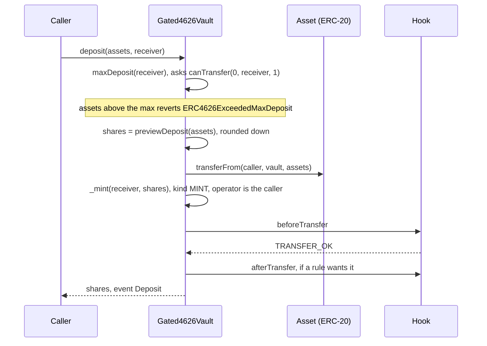
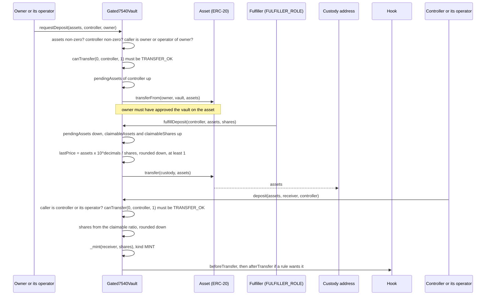
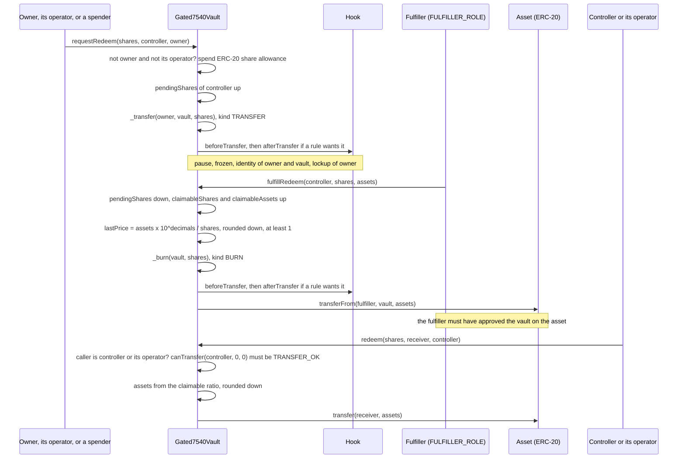
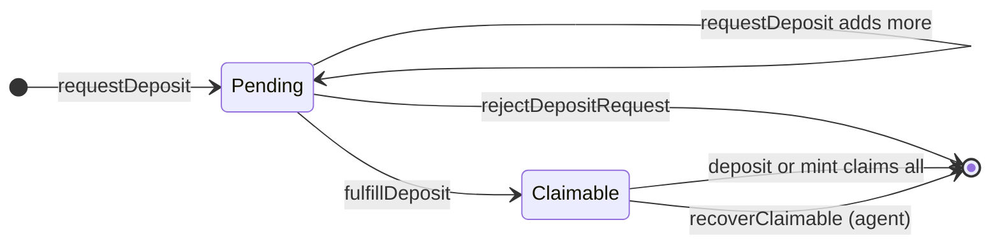
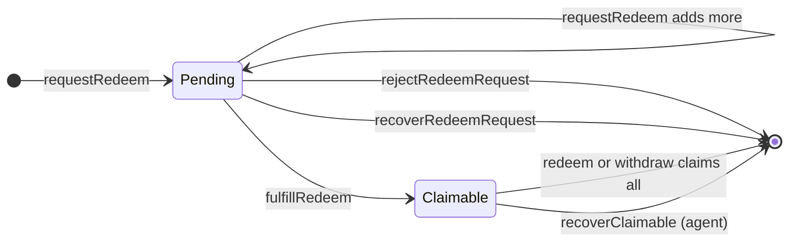

# Vault flows

Two vaults hold an ERC-20 asset and issue shares. The shares are gated tokens, so every share movement goes through the hook like any other balance change. The asset leg is an ordinary ERC-20 transfer and is never sent to the hook.

| | `Gated4626Vault` | `Gated7540Vault` |
|---|---|---|
| Pattern | ERC-4626, synchronous | ERC-7540, request then fulfil then claim |
| Who sets the price | OpenZeppelin's formula from the vault's asset balance and share supply | the fulfiller, per fulfilment, as an assets-to-shares pair |
| Share decimals | asset decimals + 6 | asset decimals |
| Assets sit in | the vault | the vault while a deposit is pending, then custody. For redemptions the vault holds the fulfiller's assets until the controller claims them or the agent recovers them with `recoverClaimable` |

Money movements are laid out step by step in [money.md](money.md).

## `Gated4626Vault`

### Deposit and mint

`mint(shares, receiver)` is the same with `maxMint`, `previewMint` (assets rounded up) and the same MINT step.

Only the receiver of the shares is checked by `IdentityRule`. The caller who pays the assets is not. `MaxHoldersRule` applies if the receiver is a new holder. The caller must have approved the vault on the asset. The asset is pulled before the shares are minted, so a rejection by the hook reverts the whole call, asset transfer included.

### Withdraw and redeem

`withdraw(assets, receiver, owner)` is the same with `maxWithdraw` and `previewWithdraw` (shares rounded up).

`IdentityRule` needs `owner` verified. `LockupRule` rejects a locked owner. Its `BURNER_ROLE` exemption looks at the operator. The `max*` probe uses the owner as the operator, and the burn uses the caller. So a non-zero redemption for a locked owner needs both to hold the vault's `BURNER_ROLE`, or only the owner if the owner is the caller. `Activate` grants that role on neither vault. The frozen amount cannot be redeemed. The `receiver` of the assets is not checked by anything.

### The `max*` functions

These are how the vault reports what the hook will allow. Integrators are expected to call them before depositing or redeeming. `deposit`, `mint`, `withdraw` and `redeem` check the matching `max*` first, so for a non-zero amount a policy rejection appears as `ERC4626ExceededMaxDeposit`, `ERC4626ExceededMaxMint`, `ERC4626ExceededMaxWithdraw` or `ERC4626ExceededMaxRedeem` with a max of 0, not as `PolicyGated_TransferRejected`. The probe treats the owner as the operator, while the real burn's operator is the caller. The two agree unless an account holds the vault's `BURNER_ROLE`, which `Activate` never grants. A zero-amount call passes the max check. It reverts with `PolicyGated_TransferRejected` if the token is paused, or if the hook rejects a zero-amount movement: an unverified party (`IdentityRule`), or a locked owner on `redeem` or `withdraw` (`LockupRule`). `MaxHoldersRule` passes zero amounts, so a receiver blocked only by a full holder cap succeeds with a zero-amount `deposit` or `mint`. An allowed party also succeeds and moves nothing.

| Function | Returns |
|---|---|
| `maxDeposit(receiver)`, `maxMint(receiver)` | 0 if `canTransfer(0, receiver, 1)` is not `TRANSFER_OK` (so also 0 when paused). Otherwise `type(uint256).max` |
| `maxRedeem(owner)` | 0 if `canTransfer(owner, 0, 1)` is not `TRANSFER_OK`. Otherwise `balanceOf(owner) - getFrozen(owner)` |
| `maxWithdraw(owner)` | `convertToAssets(maxRedeem(owner))`, rounded down. It never promises more than `withdraw` can burn |

The probe uses amount 1, so it answers about the account's status. It does not test the exact amount. The `preview*` functions stay pure conversions and do not consult the hook.

`mint(address,uint256)` and `burn(address,uint256)` from the base always revert with `Gated4626Vault_Unsupported`. Shares come only from deposits and go only through redemptions. `forcedTransfer` and `setFrozen` still work on shares for the agent.

Code: `Gated4626Vault.maxDeposit`, `maxMint`, `maxRedeem`, `maxWithdraw`, `_decimalsOffset`; OpenZeppelin `ERC4626Upgradeable.deposit`, `_deposit`, `_withdraw`.

## `Gated7540Vault`

A controller's requests add up under one entry. The request id is always 0. For each controller the vault keeps:

| | Deposit side | Redemption side |
|---|---|---|
| waiting | `pendingAssets` | `pendingShares` |
| fulfilled, waiting for the claim | `claimableAssets` and `claimableShares` | `claimableShares` and `claimableAssets` |

A controller can have both pending and claimable amounts at the same time.

### Deposit: request, fulfil, claim

- **Request.** The caller must be `owner` or an operator `owner` approved with `setOperator`. Checks run in this order: assets not zero, controller not zero, caller allowed, then the controller must be able to receive shares (`Gated7540Vault_ControllerNotEligible(reason)` otherwise). There is no cancel, so the vault refuses a request whose controller could not hold the shares. That includes a full holder cap: if the controller is not exempt from the cap, holds no shares, and the cap is reached, the request reverts with reason `MAX_HOLDERS`. Assets are pulled from `owner`, whose identity is not checked. They sit in the vault until the fulfiller acts.
- **Fulfil.** The fulfiller picks both numbers: how many pending assets it fulfils and how many shares they buy. The checks run in this order: both numbers non-zero (`Gated7540Vault_ZeroAmount`), something pending for the controller (`Gated7540Vault_NothingPending`), then `assets` not above `pendingAssets` (`Gated7540Vault_ExceedsPending`). It can fulfil a request in several parts. The vault emits `Fulfilled(controller, true, price, assets, shares, fulfiller)`, then sends the assets straight to `custody`. No hook call happens here and pause does not block it.
- **Claim.** Only the controller or an operator of it can claim (`Gated7540Vault_Unauthorized` otherwise). Next, the controller must still be able to receive shares: the claim runs the request's check, `canTransfer(0, controller, 1)`, again and reverts with `Gated7540Vault_ControllerNotEligible(reason)` if it fails. That covers pause, a de-verified controller and a full holder cap. The caller picks the `receiver` of the shares. The shares are minted through the hook as `MINT` with `receiver` as `to`, so the receiver is checked too.

Claim arithmetic, with `full` meaning the request equals everything claimable on that side. These reverts come after the caller and controller checks above:

| Call | Reverts if | Result |
|---|---|---|
| `deposit(assets, receiver, controller)` | `assets` is 0 or the computed shares are 0 (`Gated7540Vault_ZeroAmount`); `assets > claimableAssets` (`Gated7540Vault_ExceedsClaimable`) | shares = `claimableShares` if full, else `floor(assets x claimableShares / claimableAssets)` |
| `mint(shares, receiver, controller)` | `shares` is 0 (`Gated7540Vault_ZeroAmount`); `shares > claimableShares` (`Gated7540Vault_ExceedsClaimable`) | assets used = `claimableAssets` if full, else `ceil(shares x claimableAssets / claimableShares)` |

`deposit(assets, receiver)` and `mint(shares, receiver)` with two arguments claim with the caller as controller.

Each partial claim rounds against the caller. The difference stays in the controller's claimable pair, and a full claim clears it exactly, so over all its claims a controller receives exactly what was fulfilled.

### Deposit: reject

`rejectDepositRequest(controller)` by the fulfiller sets the controller's `pendingAssets` to 0, emits `DepositRequestRejected(controller, assets)`, then sends those assets back with an asset `transfer` to the controller. The assets go to the controller, not to the owner who paid. It does not touch amounts that are already claimable. It reverts with `Gated7540Vault_NothingPending` if there is nothing pending.

### Redemption: request, fulfil, claim

- **Request.** `shares` and `controller` must be non-zero. If the caller is neither `owner` nor an operator of `owner`, the vault spends the caller's ERC-20 share allowance from `owner`. The shares move from `owner` to the vault as an ordinary `TRANSFER`, so the same checks apply as for a transfer: pause, frozen balance, `IdentityRule` on the owner and on the vault, `LockupRule` on the owner. The vault must therefore be verified by the identity registry. That is the identity provider's step; `Activate` does not do it. `Activate` exempts the vault from the holder cap, so escrow never fills a slot.
- **Fulfil.** The fulfiller picks `shares` and the `assets` they pay. The checks are the same as for a deposit fulfilment: both non-zero, something pending, and `shares` not above `pendingShares`. The escrowed shares are burned as `BURN` from the vault. Then the vault pulls `assets` from the fulfiller's wallet with `transferFrom`. While the token is paused the burn is rejected, so fulfilment waits. The burn is checked against the vault, not the controller, so a request can be fulfilled even if its controller has lost verification since. The claim check below then stops that controller from collecting.
- **Claim.** `redeem` and `withdraw` revert with `EnforcedPause` while paused. Only the controller or an operator of it can claim (`Gated7540Vault_Unauthorized` otherwise). The controller must then pass a payout check, a zero-amount burn pre-flight `canTransfer(controller, 0, 0)`: `IdentityRule` needs the controller verified and `LockupRule` rejects a locked controller. The pre-flight treats the controller as the operator, so a controller holding the vault's `BURNER_ROLE` would pass the lock; `Activate` never grants that role on a vault. Because the amount is 0, the frozen check never fails. If the pre-flight fails, the claim reverts with `Gated7540Vault_ControllerNotEligible(reason)`. The assets go to a `receiver` the caller picks, and the receiver is not checked. No shares move, because the burn already happened.

| Call | Reverts if | Result |
|---|---|---|
| `redeem(shares, receiver, controller)` | `shares` is 0 or the computed assets are 0 (`Gated7540Vault_ZeroAmount`); `shares > claimableShares` (`Gated7540Vault_ExceedsClaimable`) | assets = `claimableAssets` if full, else `floor(shares x claimableAssets / claimableShares)` |
| `withdraw(assets, receiver, controller)` | `assets` is 0 (`Gated7540Vault_ZeroAmount`); `assets > claimableAssets` (`Gated7540Vault_ExceedsClaimable`) | shares used = `claimableShares` if full, else `ceil(assets x claimableShares / claimableAssets)` |

### Redemption: reject and recover

Both return the escrowed shares without a fulfilment, and both clear the controller's whole `pendingShares`. They move the shares differently.

| | `rejectRedeemRequest(controller)` | `recoverRedeemRequest(controller, to)` |
|---|---|---|
| Caller | `FULFILLER_ROLE` | `AGENT_ROLE` |
| Shares go to | the controller | `to`, which must not be the zero address |
| Kind | `TRANSFER` from the vault, inferred | `FORCED`, announced |
| Event | `RedeemRequestRejected(controller, shares)` | `RedeemRequestRecovered(controller, to, shares, agent)` |
| Use | the bank declines the request | the controller cannot receive the shares back, for example after losing verification |

`rejectRedeemRequest` is an ordinary transfer, so the full policy applies:
- pause;
- the frozen amount of the vault's own balance;
- `IdentityRule` on the vault and on the controller;
- `LockupRule` on the vault;
- `MaxHoldersRule` if the controller would become a new holder.

If any check fails, the reject reverts with `PolicyGated_TransferRejected(reason)`, nothing changes, and the shares stay in escrow.

`recoverRedeemRequest` is `FORCED`. It ignores pause and `LockupRule`, and `MaxHoldersRule` does not apply its cap. `IdentityRule` still needs `to` verified. If the agent has frozen part of the vault's own balance and the remaining balance would fall below that amount, the frozen amount is first lowered to the remaining balance, as `forcedTransfer` does.

The controller is named by the person who made the request, and it can be a different account from the owner who escrowed the shares. A reject returns the shares to the controller, under the same checks as any transfer to it, so a reject cannot be used to move shares to a new holder past a full cap or while paused (owner decision M-2).

When a request's controller loses verification, the reject reverts with `RECEIVER_NOT_VERIFIED` and the shares stay in escrow. While the controller stays unverified, the escrow can still end in two ways:
- the agent recovers it to a verified account;
- the fulfiller fulfils it, since the burn checks the vault, not the controller.

In the second case the controller cannot collect the payout, and the agent can recover it with `recoverClaimable` (see below).

### What pause stops

| Call | While paused |
|---|---|
| `requestDeposit` | rejected: `Gated7540Vault_ControllerNotEligible(PAUSED)` |
| `requestRedeem` | rejected: `PolicyGated_TransferRejected(PAUSED)` |
| `fulfillDeposit` | works. No hook call and no pause check |
| `fulfillRedeem` | rejected: `PolicyGated_TransferRejected(PAUSED)` |
| `rejectDepositRequest` | works. It is an asset transfer |
| `rejectRedeemRequest` | rejected: `PolicyGated_TransferRejected(PAUSED)`. It is an ordinary transfer |
| `recoverRedeemRequest` | works. `FORCED` ignores pause |
| `recoverClaimable` | works. The share delivery is `FORCED`, and the asset leg is not hooked |
| `deposit`, `mint` (claims) | rejected: `Gated7540Vault_ControllerNotEligible(PAUSED)`, from the controller check before the mint |
| `redeem`, `withdraw` (claims) | rejected: `EnforcedPause` |
| `setOperator`, `setCustody` | work |

### Operators

`setOperator(operator, approved)` records that the caller approves `operator`. The same approval is used in two places:

- as `owner`: the operator can call `requestDeposit` and `requestRedeem` for that account. For `requestDeposit` it moves the owner's assets into the vault, which still needs the owner's asset allowance to the vault. For `requestRedeem` it needs no share allowance.
- as `controller`: the operator can claim with `deposit`, `mint`, `redeem` and `withdraw`, and chooses the `receiver`.

The code treats an approved operator as fully trusted for that account: it can make requests and claims, and it chooses the receiver. So an operator of `owner` can open a request that pulls the owner's assets or shares under any controller, its own included. The project brief records this as intended: operators are full delegates, as in ERC-7540 (owner decision L-5), and a test pins it. Owners should approve only accounts they would trust with the assets.

### Prices and views

- `lastPrice()` is assets per `10**decimals()` shares at the last fulfilment, rounded down and never below 1. It starts at `10**decimals()`, which is 1:1.
- `convertToShares` and `convertToAssets` use `lastPrice`. `totalAssets()` is `convertToAssets(totalSupply)`, rounded down. It is indicative: the assets are in custody, not in the vault.
- Claims do not use `lastPrice`. They use each controller's own claimable ratio.
- `previewDeposit`, `previewMint`, `previewRedeem` and `previewWithdraw` always revert with `Gated7540Vault_AsyncOnly`, as ERC-7540 requires.
- `maxDeposit` and `maxMint` return the controller's claimable assets and shares, or 0 if the controller could not receive shares (`canTransfer(0, controller, 1)` fails). `maxRedeem` and `maxWithdraw` return the claimable shares and assets, or 0 if the payout check (`canTransfer(controller, 0, 0)`) fails: paused, controller not verified, or controller locked (with the `BURNER_ROLE` exception noted under the redemption claim).
- `pendingDepositRequest`, `claimableDepositRequest`, `pendingRedeemRequest` and `claimableRedeemRequest` ignore the request id.
- `mint(address,uint256)` and `burn(address,uint256)` from the base always revert with `Gated7540Vault_Unsupported`.

### States

Deposit side, for one controller:

Redemption side, for one controller:

A partial fulfilment, or a new request after a fulfilment, leaves a controller with both pending and claimable amounts. A partial claim leaves the rest claimable.

### After fulfilment

The reject functions and `recoverRedeemRequest` act only on pending amounts. Once `fulfillDeposit` or `fulfillRedeem` has run, the amounts are claimable, and two things can happen to them.

- **The controller, or an operator of it, claims them.** Each claim re-checks the controller. A deposit claim needs the controller to be able to receive shares, and the mint also checks the `receiver`. A redemption claim needs the controller to pass the payout check described above: verified and not locked. The `receiver` of redemption assets is not checked. If a check fails, the claim reverts and the amounts stay claimable.
- **The agent calls `recoverClaimable(controller, to)`.** After the `AGENT_ROLE` check, `to` must not be the zero address (`Gated7540Vault_ZeroAddress`). Then it must pass the policy as the receiver of an enforcement move, which in practice is `IdentityRule`; otherwise the call reverts `Gated7540Vault_RecipientNotEligible(reason)`. If the controller has nothing claimable, it reverts `Gated7540Vault_NothingClaimable`. Otherwise it:
  1. clears all four of the controller's claimable amounts;
  2. emits `ClaimableRecovered(controller, to, assets, shares, agent)`;
  3. mints the claimable deposit shares to `to` as `FORCED` with `from` = 0, which ignores pause and the holder cap but still runs `IdentityRule` on `to`;
  4. pays the claimable redemption assets to `to`.

  It works while the token is paused.

The assets of a fulfilled deposit went to custody at fulfilment, and nothing on chain returns them. `recoverClaimable` delivers the shares they bought instead. This also covers a stranded deposit: if the holder cap fills up after the deposit request (before or after its fulfilment), and the controller is not already a holder or exempt, the controller's own claim reverts with `Gated7540Vault_ControllerNotEligible(MAX_HOLDERS)`, while the agent's enforcement mint ignores the cap (the new holder is still counted).

Code: `Gated7540Vault.requestDeposit`, `requestRedeem`, `fulfillDeposit`, `fulfillRedeem`, `rejectDepositRequest`, `rejectRedeemRequest`, `recoverRedeemRequest`, `recoverClaimable`, `_claimDeposit`, `_claimMint`, `redeem`, `withdraw`, `maxRedeem`, `maxWithdraw`, `_requireDepositClaimEligible`, `_requirePayoutEligible`, `_payoutReason`, `_recordPrice`, `setOperator`.
