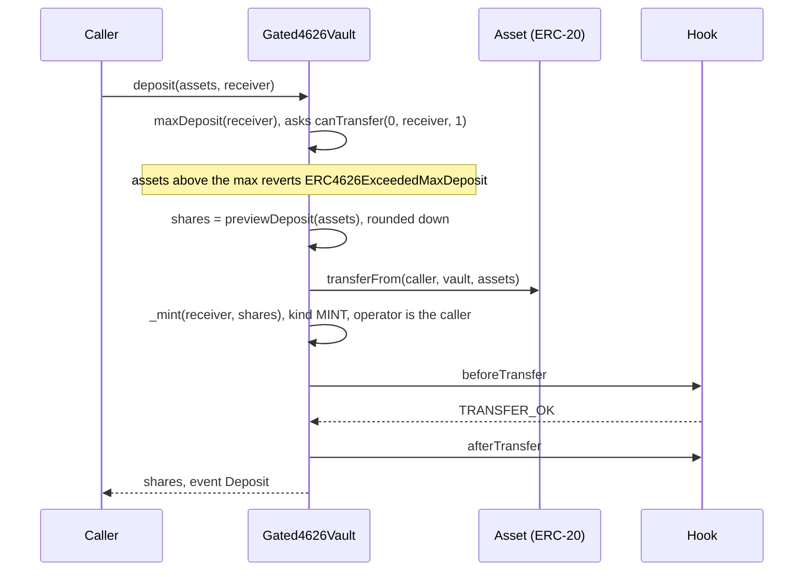
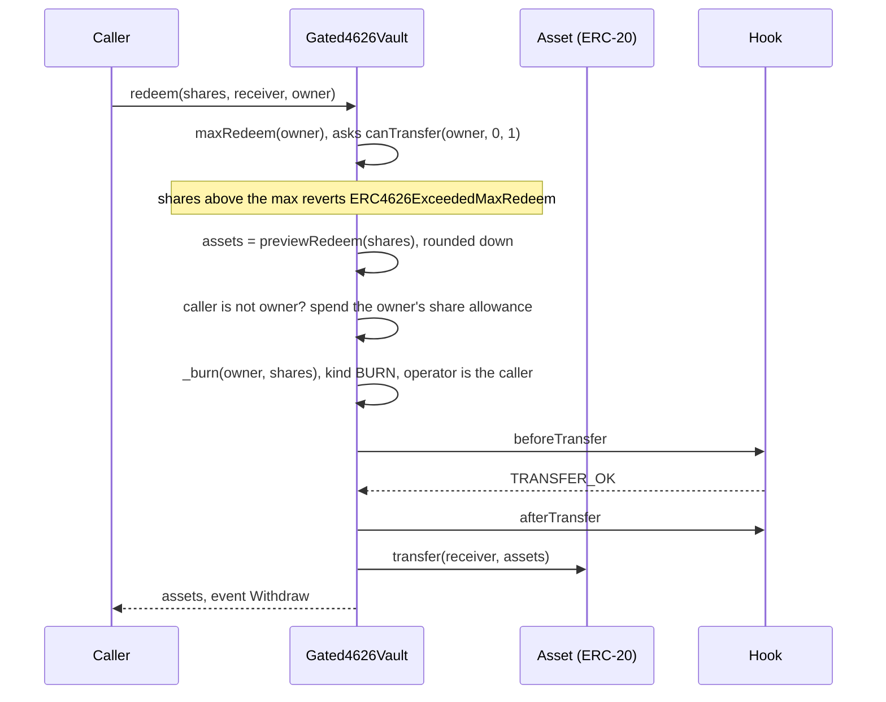
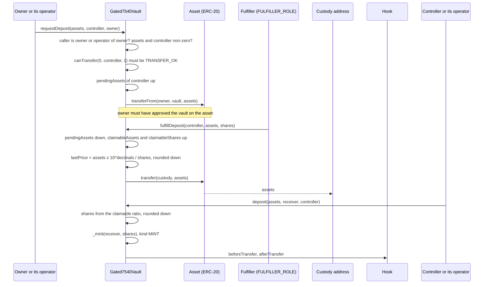
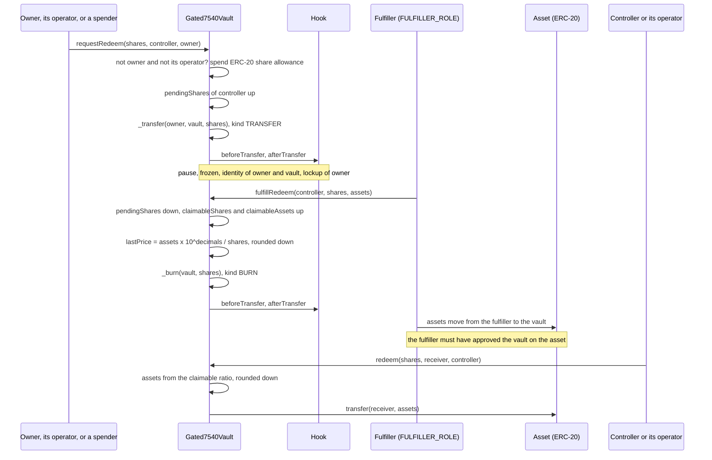
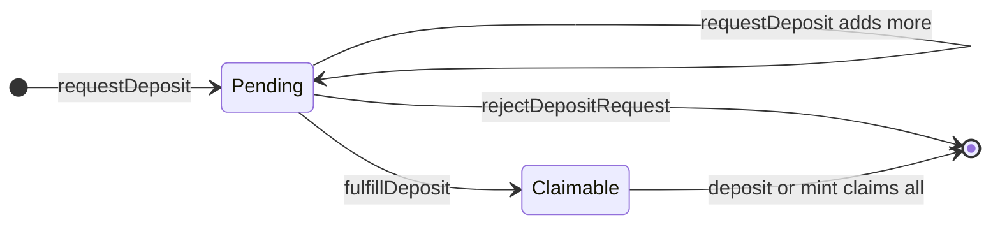
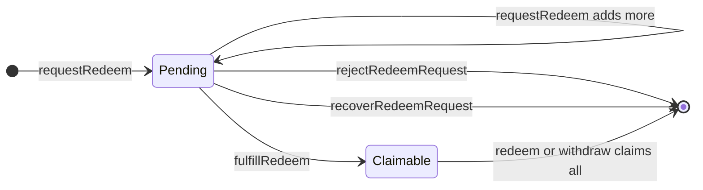

# Vault flows

Two vaults hold an ERC-20 asset and issue shares. The shares are gated tokens, so every share movement goes through the hook like any other balance change. The asset leg is an ordinary ERC-20 transfer and is never sent to the hook.

| | `Gated4626Vault` | `Gated7540Vault` |
|---|---|---|
| Pattern | ERC-4626, synchronous | ERC-7540, request then fulfil then claim |
| Who sets the price | OpenZeppelin's formula from the vault's asset balance and share supply | the fulfiller, per fulfilment, as an assets-to-shares pair |
| Share decimals | asset decimals + 6 | asset decimals |
| Assets sit in | the vault | the vault while a deposit is pending, then custody. For redemptions the vault holds the fulfiller's assets until the controller claims |

Money movements are laid out step by step in [money.md](money.md).

## `Gated4626Vault`

### Deposit and mint

`mint(shares, receiver)` is the same with `maxMint`, `previewMint` (assets rounded up) and the same MINT step.

Only the receiver of the shares is checked by `IdentityRule`. The caller who pays the assets is not. `MaxHoldersRule` applies if the receiver is a new holder. The caller must have approved the vault on the asset. The asset is pulled before the shares are minted, so a rejection by the hook reverts the whole call, asset transfer included.

### Withdraw and redeem

`withdraw(assets, receiver, owner)` is the same with `maxWithdraw` and `previewWithdraw` (shares rounded up).

`IdentityRule` needs `owner` verified. `LockupRule` rejects a locked owner. The frozen amount cannot be redeemed. The `receiver` of the assets is not checked by anything.

### The `max*` functions

These are how the vault reports what the hook will allow. Integrators are expected to call them before depositing or redeeming.

| Function | Returns |
|---|---|
| `maxDeposit(receiver)`, `maxMint(receiver)` | 0 if `canTransfer(0, receiver, 1)` is not `TRANSFER_OK` (so also 0 when paused). Otherwise `type(uint256).max` |
| `maxRedeem(owner)` | 0 if `canTransfer(owner, 0, 1)` is not `TRANSFER_OK`. Otherwise `balanceOf(owner) - getFrozen(owner)` |
| `maxWithdraw(owner)` | `convertToAssets(maxRedeem(owner))`, rounded down. It never promises more than `withdraw` can burn |

The probe uses amount 1, so it answers about the account's status. It does not test the exact amount. The `preview*` functions stay pure conversions and do not consult the hook.

`mint(address,uint256)` and `burn(address,uint256)` from the base always revert with `Gated4626Vault_Unsupported`. Shares come only from deposits and go only through redemptions. `forcedTransfer` and `setFrozen` still work on shares for the agent.

Code: `Gated4626Vault.maxDeposit`, `maxMint`, `maxRedeem`, `maxWithdraw`, `_decimalsOffset`; OpenZeppelin `ERC4626Upgradeable.deposit`, `_deposit`, `_withdraw`.

## `Gated7540Vault`

A controller's requests add up under one entry. The request id is always 0. For each controller the vault keeps:

| | Deposit side | Redemption side |
|---|---|---|
| waiting | `pendingAssets` | `pendingShares` |
| fulfilled, waiting for the claim | `claimableAssets` and `claimableShares` | `claimableShares` and `claimableAssets` |

A controller can have both pending and claimable amounts at the same time.

### Deposit: request, fulfil, claim

- **Request.** The caller must be `owner` or an operator `owner` approved with `setOperator`. Checks run in this order: assets not zero, controller not zero, caller allowed, then the controller must be able to receive shares (`Gated7540Vault_ControllerNotEligible(reason)` otherwise). There is no cancel, so the vault refuses assets from a controller that could not hold the shares. That includes a full holder cap: if the controller holds no shares and the cap is reached, the request reverts with reason `MAX_HOLDERS`. Assets are pulled from `owner`. They sit in the vault until the fulfiller acts.
- **Fulfil.** The fulfiller picks both numbers: how many pending assets it fulfils and how many shares they buy. Both must be non-zero and `assets` must not exceed `pendingAssets` (`Gated7540Vault_ExceedsPending`). It can fulfil a request in several parts. The assets go straight to `custody`. The vault emits `Fulfilled(controller, true, price, assets, shares, fulfiller)`. No hook call happens here and pause does not block it.
- **Claim.** Only the controller or an operator of it can claim (`Gated7540Vault_Unauthorized` otherwise). The caller picks the `receiver` of the shares. The shares are minted through the hook as `MINT` with `receiver` as `to`.

Claim arithmetic, with `full` meaning the request equals everything claimable on that side:

| Call | Reverts if | Result |
|---|---|---|
| `deposit(assets, receiver, controller)` | `assets > claimableAssets` (`Gated7540Vault_ExceedsClaimable`); computed shares are 0 (`Gated7540Vault_ZeroAmount`) | shares = `claimableShares` if full, else `floor(assets x claimableShares / claimableAssets)` |
| `mint(shares, receiver, controller)` | `shares > claimableShares` | assets used = `claimableAssets` if full, else `ceil(shares x claimableAssets / claimableShares)` |

`deposit(assets, receiver)` and `mint(shares, receiver)` with two arguments claim with the caller as controller.

Rounding favours the vault. A full claim clears the amounts exactly.

### Deposit: reject

`rejectDepositRequest(controller)` by the fulfiller sends the controller's whole `pendingAssets` back with an asset `transfer` to the controller, emits `DepositRequestRejected`, and sets `pendingAssets` to 0. The assets go to the controller, not to the owner who paid. It does not touch amounts that are already claimable. It reverts with `Gated7540Vault_NothingPending` if there is nothing pending.

### Redemption: request, fulfil, claim

- **Request.** `shares` and `controller` must be non-zero. If the caller is neither `owner` nor an operator of `owner`, the vault spends the caller's ERC-20 share allowance from `owner`. The shares move from `owner` to the vault as an ordinary `TRANSFER`, so the same checks apply as for a transfer: pause, frozen balance, `IdentityRule` on the owner and on the vault, `LockupRule` on the owner. The vault must therefore be verified by the identity registry. `Activate` also exempts the vault from the holder cap, so escrow never fills a slot.
- **Fulfil.** The fulfiller picks `shares` (at most `pendingShares`) and the `assets` they pay. The escrowed shares are burned as `BURN` from the vault. Then the vault pulls `assets` from the fulfiller's wallet with `transferFrom`. Both amounts must be non-zero. While the token is paused the burn is rejected, so fulfilment waits.
- **Claim.** `redeem` and `withdraw` pay the assets to a `receiver` the caller picks. They do not call the hook and move no shares, because the burn already happened. They revert with `EnforcedPause` while paused.

| Call | Reverts if | Result |
|---|---|---|
| `redeem(shares, receiver, controller)` | `shares > claimableShares` (`Gated7540Vault_ExceedsClaimable`); computed assets are 0 (`Gated7540Vault_ZeroAmount`) | assets = `claimableAssets` if full, else `floor(shares x claimableAssets / claimableShares)` |
| `withdraw(assets, receiver, controller)` | `assets > claimableAssets` | shares used = `claimableShares` if full, else `ceil(assets x claimableShares / claimableAssets)` |

### Redemption: reject and recover

Both return the escrowed shares without a fulfilment. Both clear the controller's whole `pendingShares`, and both move the shares out of the vault as `FORCED`.

| | `rejectRedeemRequest(controller)` | `recoverRedeemRequest(controller, to)` |
|---|---|---|
| Caller | `FULFILLER_ROLE` | `AGENT_ROLE` |
| Shares go to | the controller | `to`, which must not be the zero address |
| Event | `RedeemRequestRejected` | `RedeemRequestRecovered(controller, to, shares, agent)` |
| Use | the bank declines the request | the controller lost verification and cannot receive the shares back |

Because the move is `FORCED`, it ignores pause and `LockupRule`, and `MaxHoldersRule` does not apply its cap. `IdentityRule` still needs the receiving account verified. If the controller is no longer verified, `rejectRedeemRequest` reverts with `PolicyGated_TransferRejected(RECEIVER_NOT_VERIFIED)`, nothing changes, and the shares stay in escrow until the agent recovers them to a verified account. If the agent has frozen part of the vault's own balance, the move lowers that frozen amount first, as `forcedTransfer` does.

The controller is named by the person who made the request, and it can be a different account from the owner who escrowed the shares. A reject returns the shares to the controller.

### What pause stops

| Call | While paused |
|---|---|
| `requestDeposit` | rejected: `Gated7540Vault_ControllerNotEligible(PAUSED)` |
| `requestRedeem` | rejected: `PolicyGated_TransferRejected(PAUSED)` |
| `fulfillDeposit` | works. No hook call and no pause check |
| `fulfillRedeem` | rejected: `PolicyGated_TransferRejected(PAUSED)` |
| `rejectDepositRequest` | works. It is an asset transfer |
| `rejectRedeemRequest`, `recoverRedeemRequest` | work. `FORCED` ignores pause |
| `deposit`, `mint` (claims) | rejected: `PolicyGated_TransferRejected(PAUSED)` |
| `redeem`, `withdraw` (claims) | rejected: `EnforcedPause` |
| `setOperator`, `setCustody` | work |

### Operators

`setOperator(operator, approved)` records that the caller approves `operator`. The same approval is used in two places:

- as `owner`: the operator can call `requestDeposit` and `requestRedeem` for that account. For `requestDeposit` it moves the owner's assets into the vault, which still needs the owner's asset allowance to the vault. For `requestRedeem` it needs no share allowance.
- as `controller`: the operator can claim with `deposit`, `mint`, `redeem` and `withdraw`, and chooses the `receiver`.

The ERC-7540 standard treats operators as trusted, and so does the code.

### Prices and views

- `lastPrice()` is assets per `10**decimals()` shares at the last fulfilment, rounded down and never below 1. It starts at `10**decimals()`, which is 1:1.
- `convertToShares` and `convertToAssets` use `lastPrice`. `totalAssets()` is `convertToAssets(totalSupply)`, rounded down. It is indicative: the assets are in custody, not in the vault.
- Claims do not use `lastPrice`. They use each controller's own claimable ratio.
- `previewDeposit`, `previewMint`, `previewRedeem` and `previewWithdraw` always revert with `Gated7540Vault_AsyncOnly`, as ERC-7540 requires.
- `maxDeposit` and `maxMint` return the controller's claimable assets and shares, or 0 if the controller could not receive shares. `maxRedeem` and `maxWithdraw` return the claimable shares and assets, or 0 while paused.
- `pendingDepositRequest`, `claimableDepositRequest`, `pendingRedeemRequest` and `claimableRedeemRequest` ignore the request id.
- `mint(address,uint256)` and `burn(address,uint256)` from the base always revert with `Gated7540Vault_Unsupported`.

### States

Deposit side, for one controller:

Redemption side, for one controller:

Partial fulfilments and partial claims leave a controller with amounts in more than one state.

### What cannot be undone once fulfilled

The reject and recover functions act only on pending amounts. After `fulfillDeposit` or `fulfillRedeem` the amounts are claimable, and only the controller or an operator can use them:

- A deposit claim mints through the hook. If the receiver cannot receive shares when the claim is made (not verified, holder cap full, token paused), the claim reverts and the claimable amounts stay where they are until it can.
- A redemption claim calls no hook. A controller who lost verification after the fulfilment can still collect the assets, and the receiver address is not checked.

[PLAN.md](../PLAN.md) lists these behaviours as review items waiting for an owner decision.

Code: `Gated7540Vault.requestDeposit`, `requestRedeem`, `fulfillDeposit`, `fulfillRedeem`, `rejectDepositRequest`, `rejectRedeemRequest`, `recoverRedeemRequest`, `_claimDeposit`, `_claimMint`, `redeem`, `withdraw`, `_recordPrice`, `setOperator`.
