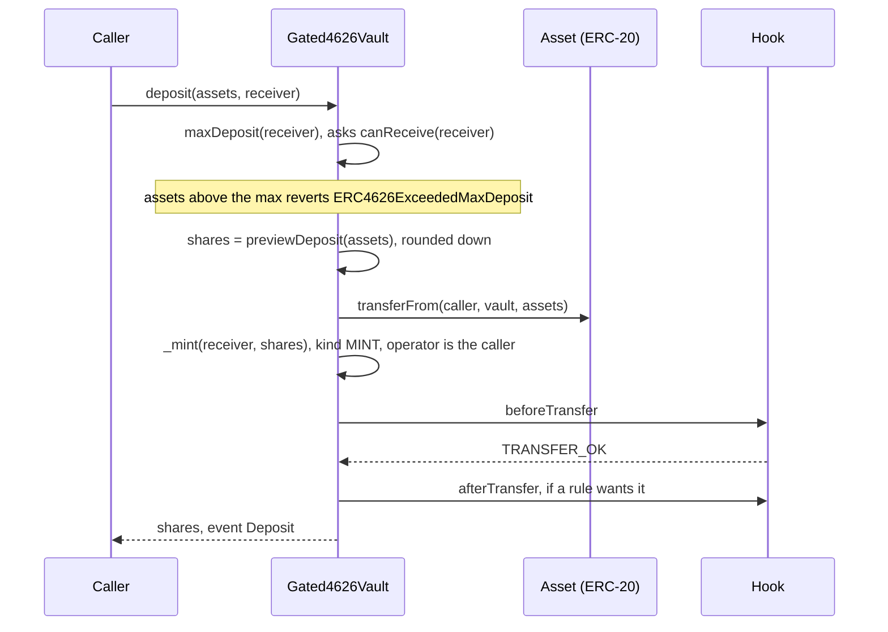
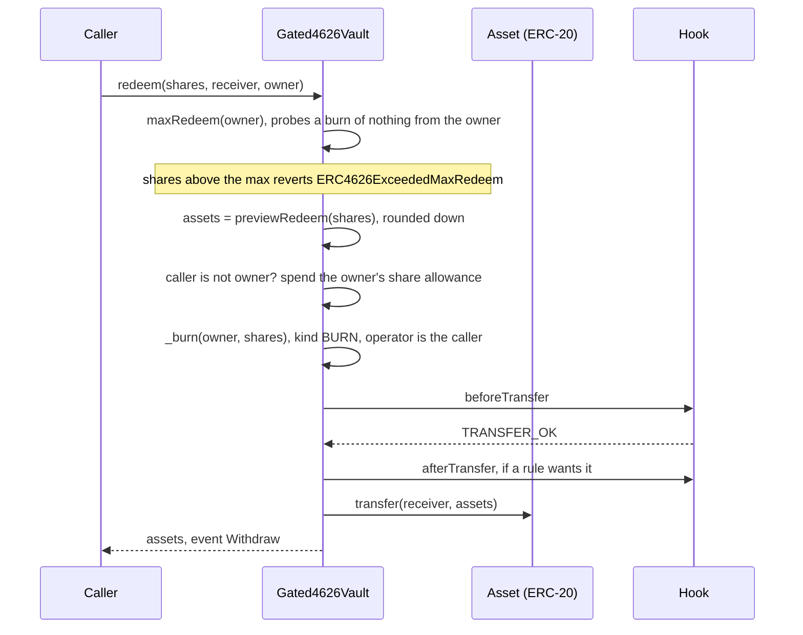
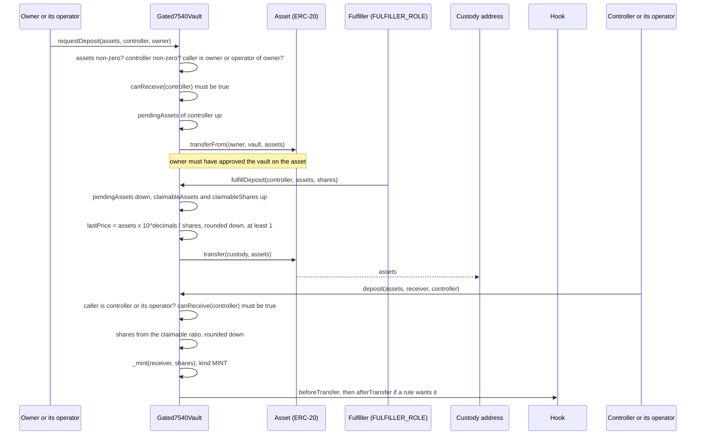
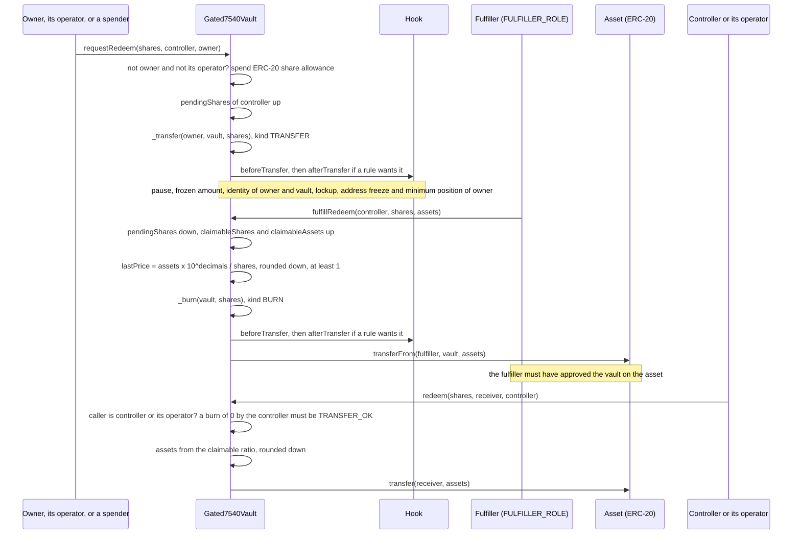
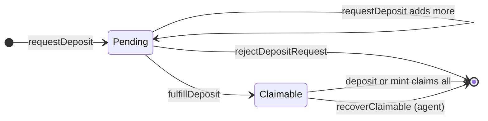
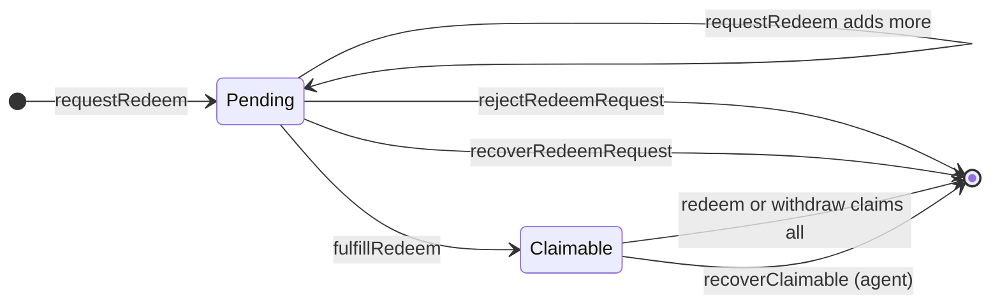

# Vault flows

Two vaults hold an ERC-20 asset and issue shares. The shares are gated tokens, so every share movement goes through the hook like any other balance change. The asset leg is an ordinary ERC-20 transfer and is never sent to the hook.

| | `Gated4626Vault` | `Gated7540Vault` |
|---|---|---|
| Pattern | ERC-4626, synchronous | ERC-7540, request then fulfil then claim |
| Who sets the price | OpenZeppelin's formula from the vault's asset balance and share supply | the fulfiller, per fulfilment, as an assets-to-shares pair |
| Share decimals | asset decimals + 6 | asset decimals |
| Assets sit in | the vault | the vault while a deposit is pending, then custody. For redemptions the vault holds the fulfiller's assets until the controller claims them or the agent recovers them with `recoverClaimable` |

Money movements are laid out step by step in [money.md](money.md).

## `Gated4626Vault`

### Deposit and mint

`mint(shares, receiver)` is the same with `maxMint`, `previewMint` (assets rounded up) and the same MINT step.

Only the receiver of the shares is checked by `IdentityRule`. The caller who pays the assets is not. `HolderRestrictionRule` refuses a receiver whose address is frozen, `MinPositionRule` refuses a mint that would leave the receiver below the minimum position ([below](#a-minimum-position)), and `FundHoldersRule` applies if the receiver would be a new investor of the fund. A class whose list also has `MaxHoldersRule` gets its own per-class cap on a new holder, but the lists `Activate` deploys do not include that rule. The caller must have approved the vault on the asset. The asset is pulled before the shares are minted, so a rejection by the hook reverts the whole call, asset transfer included.

### Withdraw and redeem

`withdraw(assets, receiver, owner)` is the same with `maxWithdraw` and `previewWithdraw` (shares rounded up).

`IdentityRule` needs `owner` verified. `HolderRestrictionRule` rejects an owner whose address is frozen (`SENDER_FROZEN`) and an owner who is locked (`LOCKED`). The lockup has a `BURNER_ROLE` exemption that looks at the operator, and the address freeze has none. The `max*` probe uses the owner as the operator, and the burn uses the caller. So a non-zero redemption for a locked owner needs both to hold the vault's `BURNER_ROLE`, or only the owner if the owner is the caller. `Activate` grants that role on neither vault. `MinPositionRule` rejects a redemption that would leave the owner with more than nothing and less than the minimum position ([below](#a-minimum-position)). The frozen amount (set with `setFrozenTokens`) cannot be redeemed. `FundHoldersRule` passes a redemption, apart from `NOT_FUND_CLASS` for a vault that is not a registered class or whose list names a rule the fund has replaced. The `receiver` of the assets is not checked by anything.

### The `max*` functions

These are how the vault reports what the hook will allow. Integrators are expected to call them before depositing or redeeming. They ask about the account and carry no amount: the deposit side asks `canReceive(receiver)`, and the redeem side probes a burn of nothing from the owner. `deposit`, `mint`, `withdraw` and `redeem` check the matching `max*` first, so for a non-zero amount a rejection those probes see appears as `ERC4626ExceededMaxDeposit`, `ERC4626ExceededMaxMint`, `ERC4626ExceededMaxWithdraw` or `ERC4626ExceededMaxRedeem` with a max of 0, not as `PolicyGated_TransferRejected`. A rejection that depends on the amount is not in the max. It reaches the caller as `PolicyGated_TransferRejected` when the call runs, and the minimum position (`BELOW_MIN_POSITION`) is the one in the deployed rule lists. The probe treats the owner as the operator, while the real burn's operator is the caller. The two agree unless an account holds the vault's `BURNER_ROLE`, which `Activate` never grants. A zero-amount call passes the max check. It reverts with `PolicyGated_TransferRejected` if the token is paused, or if the hook rejects a zero-amount movement: an unverified party (`IdentityRule`), a party whose address is frozen, or a locked owner on `redeem` or `withdraw` (`HolderRestrictionRule`). `MinPositionRule` judges no zero amount, and `FundHoldersRule` passes zero amounts for a registered class (so does `MaxHoldersRule`, for a class that lists it), so a receiver blocked only by a full fund cap succeeds with a zero-amount `deposit` or `mint`. For a vault that is not a registered class, or whose hook lists a replaced fund rule, `FundHoldersRule` rejects even a zero amount with `NOT_FUND_CLASS`. An allowed party also succeeds and moves nothing.

| Function | Returns |
|---|---|
| `maxDeposit(receiver)`, `maxMint(receiver)` | 0 if `canReceive(receiver)` is false, for example when the token is paused, the receiver is not verified, its address is frozen, or the fund has no room for it as a new investor. Otherwise `type(uint256).max` |
| `maxRedeem(owner)` | 0 if a burn of 0 from the owner would be rejected, for example when the token is paused, the owner is not verified, its address is frozen, or it is locked (see the `BURNER_ROLE` note above). Otherwise the unfrozen balance, `balanceOf(owner) - getFrozenTokens(owner)`, or 0 where the frozen amount is the larger |
| `maxWithdraw(owner)` | `convertToAssets(maxRedeem(owner))`, rounded down. It never promises more than `withdraw` can burn |

The probes answer about the account's status. They do not test the exact amount, which is judged when the call moves it. An amount-1 probe would read a minimum position as dust, which is why neither probe uses one. The `preview*` functions stay pure conversions and do not consult the hook.

`mint(address,uint256)` and `burn(address,uint256)` from the base always revert with `Gated4626Vault_Unsupported`. Shares come only from deposits and go only through redemptions. `forcedTransfer` and `setFrozenTokens` still work on shares for the agent.

### A minimum position

The deployed lists include `MinPositionRule` with a minimum of 0, which switches it off. The token's admin turns it on with `setMinPosition(vault, shares)`. The rule then judges the balances after a movement: a receiver must end with at least the minimum, and a sender with nothing or at least the minimum. A minimum is in shares, and the vault has 6 more decimals than its asset.

- **Deposit and mint.** A receiver who would end below the minimum makes the call revert with `PolicyGated_TransferRejected(BELOW_MIN_POSITION)`, and the asset pull is rolled back with it. `maxDeposit` and `maxMint` do not show this: they carry no amount, so they stay at `type(uint256).max` for a receiver that can take shares at all. A receiver who already holds enough passes the rule with any amount.
- **Redeem and withdraw.** A redemption that would leave the owner with more than nothing and less than the minimum reverts the same way. Redeeming the whole balance leaves nothing and passes, and `maxRedeem` is the unfrozen balance, not a figure cut down for the minimum. The one case where the two disagree: if a frozen amount below the minimum would stay behind, redeeming all of `maxRedeem` leaves that remainder and reverts with `BELOW_MIN_POSITION`, because the minimum judges the whole balance and `maxRedeem` counts only the unfrozen part. The owner redeems less, or the agent lowers the frozen amount first.
- **Exempt.** A burn whose caller holds the vault's `BURNER_ROLE` (`Activate` grants it on no vault), accounts the admin lists with `setExempt`, and `forcedTransfer`.

Code: `Gated4626Vault.maxDeposit`, `maxMint`, `maxRedeem`, `maxWithdraw`, `_decimalsOffset`; `PolicyGatedERC20Upgradeable._accountReason`, `_canTransfer`; `MinPositionRule.check`; OpenZeppelin `ERC4626Upgradeable.deposit`, `_deposit`, `_withdraw`.

## `Gated7540Vault`

A controller's requests add up under one entry. The request id is always 0. For each controller the vault keeps:

| | Deposit side | Redemption side |
|---|---|---|
| waiting | `pendingAssets` | `pendingShares` |
| fulfilled, waiting for the claim | `claimableAssets` and `claimableShares` | `claimableShares` and `claimableAssets` |

A controller can have both pending and claimable amounts at the same time.

### Deposit: request, fulfil, claim

- **Request.** The caller must be `owner` or an operator `owner` approved with `setOperator`. Checks run in this order: assets not zero, controller not zero, caller allowed, then the controller must be able to receive shares (`Gated7540Vault_ControllerNotEligible(reason)` otherwise). The test is `canReceive(controller)`, which carries no amount, because a request cannot know how many shares it will buy. There is no cancel, so the vault refuses a request whose controller could not hold the shares at all. That covers pause, a controller who is not verified, a controller whose address is frozen, and a full fund: if the controller is not yet an investor of the fund, is not exempt there, and the fund has no room, the request reverts with reason `MAX_HOLDERS`. It does not cover the size of a minimum position ([below](#a-minimum-position-requests-and-claims)). Assets are pulled from `owner`, whose identity is not checked. They sit in the vault until the fulfiller acts.
- **Fulfil.** The fulfiller picks both numbers: how many pending assets it fulfils and how many shares they buy. The checks run in this order: both numbers non-zero (`Gated7540Vault_ZeroAmount`), something pending for the controller (`Gated7540Vault_NothingPending`), then `assets` not above `pendingAssets` (`Gated7540Vault_ExceedsPending`). It can fulfil a request in several parts. The vault emits `Fulfilled(controller, true, price, assets, shares, fulfiller)`, then sends the assets straight to `custody`. No hook call happens here and pause does not block it.
- **Claim.** Only the controller or an operator of it can claim (`Gated7540Vault_Unauthorized` otherwise). Next, the controller must still be able to receive shares: the claim runs the request's check, `canReceive(controller)`, again and reverts with `Gated7540Vault_ControllerNotEligible(reason)` if it fails. That covers pause, a de-verified controller, a controller whose address is frozen, and a fund with no room for a new investor. The caller picks the `receiver` of the shares. The shares are minted through the hook as `MINT` with `receiver` as `to`, so the receiver is checked too, and so is the minimum position, which only the mint can judge: a claim that would leave the receiver below it reverts with `PolicyGated_TransferRejected(BELOW_MIN_POSITION)` and consumes nothing ([below](#a-minimum-position-requests-and-claims)).

Claim arithmetic, with `full` meaning the request equals everything claimable on that side. These reverts come after the caller and controller checks above:

| Call | Reverts if | Result |
|---|---|---|
| `deposit(assets, receiver, controller)` | `assets` is 0 or the computed shares are 0 (`Gated7540Vault_ZeroAmount`); `assets > claimableAssets` (`Gated7540Vault_ExceedsClaimable`) | shares = `claimableShares` if full, else `floor(assets x claimableShares / claimableAssets)` |
| `mint(shares, receiver, controller)` | `shares` is 0 (`Gated7540Vault_ZeroAmount`); `shares > claimableShares` (`Gated7540Vault_ExceedsClaimable`) | assets used = `claimableAssets` if full, else `ceil(shares x claimableAssets / claimableShares)` |

`deposit(assets, receiver)` and `mint(shares, receiver)` with two arguments claim with the caller as controller.

Each partial claim rounds against the caller. The difference stays in the controller's claimable pair, and a full claim clears it exactly, so over all its claims a controller receives exactly what was fulfilled.

### Deposit: reject

`rejectDepositRequest(controller)` by the fulfiller sets the controller's `pendingAssets` to 0, emits `DepositRequestRejected(controller, assets)`, then sends those assets back with an asset `transfer` to the controller. The assets go to the controller, not to the owner who paid. It does not touch amounts that are already claimable. It reverts with `Gated7540Vault_NothingPending` if there is nothing pending.

### Redemption: request, fulfil, claim

- **Request.** `shares` and `controller` must be non-zero. If the caller is neither `owner` nor an operator of `owner`, the vault spends the caller's ERC-20 share allowance from `owner`. The shares move from `owner` to the vault as an ordinary `TRANSFER`, so the same checks apply as for a transfer: pause, the frozen amount (a request for more shares than the owner's unfrozen balance reverts with `ERC7943InsufficientUnfrozenBalance`), `IdentityRule` on the owner and on the vault, `HolderRestrictionRule` on the owner (address freeze and lockup), and `MinPositionRule` on the owner, who must be left with nothing or at least the minimum. The vault must therefore be verified by the identity registry. That is the identity provider's step; `Activate` does not do it. The vault is the token itself, which `FundHoldersRule` never counts and `MinPositionRule` exempts, so neither the fund rule nor the minimum needs anything set for the escrow: it never fills an investor slot, and an escrow below the minimum is allowed. `FundHoldersRule` passes the vault as the receiver, because a class never counts itself, and an owner whose whole balance moves into escrow stops being counted as an investor of the fund until the shares come back.
- **Fulfil.** The fulfiller picks `shares` and the `assets` they pay. The checks are the same as for a deposit fulfilment: both non-zero, something pending, and `shares` not above `pendingShares`. The escrowed shares are burned as `BURN` from the vault. Then the vault pulls `assets` from the fulfiller's wallet with `transferFrom`. While the token is paused the burn is rejected, so fulfilment waits. The burn is checked against the vault, not the controller, so a request can be fulfilled even if its controller has lost verification since. The claim check below then stops that controller from collecting.
- **Claim.** `redeem` and `withdraw` revert with `EnforcedPause` while paused. Only the controller or an operator of it can claim (`Gated7540Vault_Unauthorized` otherwise). The controller must then pass a payout check, a zero-amount burn pre-flight (the answer `canTransferWithReason(controller, address(0), 0)` gives): `IdentityRule` needs the controller verified, `HolderRestrictionRule` rejects a controller whose address is frozen and one who is locked, `MinPositionRule` passes it (a zero amount is never judged), and `FundHoldersRule` passes it for a registered class whose list names the fund's installed rule. The pre-flight treats the controller as the operator, so a controller holding the vault's `BURNER_ROLE` would pass the lock but not the address freeze; `Activate` never grants that role on a vault. Because the amount is 0, the frozen-amount check never fails. If the pre-flight fails, the claim reverts with `Gated7540Vault_ControllerNotEligible(reason)`. The assets go to a `receiver` the caller picks, and the receiver is not checked. No shares move, because the burn already happened.

| Call | Reverts if | Result |
|---|---|---|
| `redeem(shares, receiver, controller)` | `shares` is 0 or the computed assets are 0 (`Gated7540Vault_ZeroAmount`); `shares > claimableShares` (`Gated7540Vault_ExceedsClaimable`) | assets = `claimableAssets` if full, else `floor(shares x claimableAssets / claimableShares)` |
| `withdraw(assets, receiver, controller)` | `assets` is 0 (`Gated7540Vault_ZeroAmount`); `assets > claimableAssets` (`Gated7540Vault_ExceedsClaimable`) | shares used = `claimableShares` if full, else `ceil(assets x claimableShares / claimableAssets)` |

### Redemption: reject and recover

Both return the escrowed shares without a fulfilment, and both clear the controller's whole `pendingShares`. They move the shares differently.

| | `rejectRedeemRequest(controller)` | `recoverRedeemRequest(controller, to)` |
|---|---|---|
| Caller | `FULFILLER_ROLE` | `AGENT_ROLE` |
| Shares go to | the controller | `to`, which must not be the zero address |
| Kind | `TRANSFER` from the vault, inferred | `FORCED`, announced |
| Event | `RedeemRequestRejected(controller, shares)` | `RedeemRequestRecovered(controller, to, shares, agent)` |
| Use | the bank declines the request | the controller cannot receive the shares back, for example after losing verification |

`rejectRedeemRequest` is an ordinary transfer, so the full policy applies:
- pause;
- the frozen amount of the vault's own balance;
- `IdentityRule` on the vault and on the controller;
- `HolderRestrictionRule` on the vault (lockup and address freeze) and on the controller (address freeze);
- `MinPositionRule` on the controller, who must end holding at least the minimum (the vault, as the sender, is exempt);
- `FundHoldersRule` if the controller would become a new investor of the fund;
- a per-class cap, if the class lists `MaxHoldersRule` (the deployed lists do not) and the controller would become a new holder.

If a policy check fails, the reject reverts with `PolicyGated_TransferRejected(reason)`. If the vault's unfrozen balance is short, it reverts with `ERC7943InsufficientUnfrozenBalance`. Either way nothing changes and the shares stay in escrow.

`recoverRedeemRequest` is `FORCED`. It ignores pause, the lockup, the vault's address freeze and the minimum position, and `FundHoldersRule` does not apply its cap (it still counts the new investor, as `MaxHoldersRule` would for a class that lists it). `IdentityRule` still needs `to` verified, and `HolderRestrictionRule` still refuses an address-frozen `to` (`RECEIVER_FROZEN`). If the shares reach into a frozen part of the vault's own balance, the frozen amount is first lowered by the part that was frozen, and `Frozen` is emitted, as `forcedTransfer` does.

The controller is named by the person who made the request, and it can be a different account from the owner who escrowed the shares. A reject returns the shares to the controller, under the same checks as any transfer to it, so a reject cannot be used to move shares to a new investor past a full fund cap or while paused (owner decision M-2).

When a request's controller loses verification, the reject reverts with `RECEIVER_NOT_VERIFIED` and the shares stay in escrow. While the controller stays unverified, the escrow can still end in two ways:
- the agent recovers it to a verified account;
- the fulfiller fulfils it, since the burn checks the vault, not the controller.

In the second case the controller cannot collect the payout, and the agent can recover it with `recoverClaimable` (see below).

### What pause stops

| Call | While paused |
|---|---|
| `requestDeposit` | rejected: `Gated7540Vault_ControllerNotEligible(PAUSED)` |
| `requestRedeem` | rejected: `PolicyGated_TransferRejected(PAUSED)` |
| `fulfillDeposit` | works. No hook call and no pause check |
| `fulfillRedeem` | rejected: `PolicyGated_TransferRejected(PAUSED)` |
| `rejectDepositRequest` | works. It is an asset transfer |
| `rejectRedeemRequest` | rejected: `PolicyGated_TransferRejected(PAUSED)`. It is an ordinary transfer |
| `recoverRedeemRequest` | works. `FORCED` ignores pause |
| `recoverClaimable` | works. The share delivery is `FORCED`, and the asset leg is not hooked |
| `deposit`, `mint` (claims) | rejected: `Gated7540Vault_ControllerNotEligible(PAUSED)`, from the controller check before the mint |
| `redeem`, `withdraw` (claims) | rejected: `EnforcedPause` |
| `setOperator`, `setCustody` | work |

### Operators

`setOperator(operator, approved)` records that the caller approves `operator`. The same approval is used in two places:

- as `owner`: the operator can call `requestDeposit` and `requestRedeem` for that account. For `requestDeposit` it moves the owner's assets into the vault, which still needs the owner's asset allowance to the vault. For `requestRedeem` it needs no share allowance.
- as `controller`: the operator can claim with `deposit`, `mint`, `redeem` and `withdraw`, and chooses the `receiver`.

The code treats an approved operator as fully trusted for that account: it can make requests and claims, and it chooses the receiver. So an operator of `owner` can open a request that pulls the owner's assets or shares under any controller, its own included. The project brief records this as intended: operators are full delegates, as in ERC-7540 (owner decision L-5), and a test pins it. Owners should approve only accounts they would trust with the assets.

### Prices and views

- `lastPrice()` is assets per `10**decimals()` shares at the last fulfilment, rounded down and never below 1. It starts at `10**decimals()`, which is 1:1.
- `convertToShares` and `convertToAssets` use `lastPrice`. `totalAssets()` is `convertToAssets(totalSupply)`, rounded down. It is indicative: the assets are in custody, not in the vault.
- Claims do not use `lastPrice`. They use each controller's own claimable ratio.
- `previewDeposit`, `previewMint`, `previewRedeem` and `previewWithdraw` always revert with `Gated7540Vault_AsyncOnly`, as ERC-7540 requires.
- `maxDeposit` and `maxMint` return the controller's claimable assets and shares, or 0 if the controller could not receive shares (`canReceive(controller)` is false, for example when paused, controller not verified, address frozen, or no room in the fund for a new investor). `maxRedeem` and `maxWithdraw` return the claimable shares and assets, or 0 if the payout check (a burn of 0 by the controller) fails, for example when paused, controller not verified, address frozen, or locked (with the `BURNER_ROLE` exception noted under the redemption claim, which does not cover the address freeze). A minimum position changes none of them.
- `pendingDepositRequest`, `claimableDepositRequest`, `pendingRedeemRequest` and `claimableRedeemRequest` ignore the request id.
- `mint(address,uint256)` and `burn(address,uint256)` from the base always revert with `Gated7540Vault_Unsupported`.

### States

Deposit side, for one controller:

Redemption side, for one controller:

A partial fulfilment, or a new request after a fulfilment, leaves a controller with both pending and claimable amounts. A partial claim leaves the rest claimable.

### After fulfilment

The reject functions and `recoverRedeemRequest` act only on pending amounts. Once `fulfillDeposit` or `fulfillRedeem` has run, the amounts are claimable, and two things can happen to them.

- **The controller, or an operator of it, claims them.** Each claim re-checks the controller. A deposit claim needs the controller to be able to receive shares, and the mint also checks the `receiver` and the minimum position. A redemption claim needs the controller to pass the payout check described above: verified, not address-frozen and not locked. The `receiver` of redemption assets is not checked. If a check fails, the claim reverts and the amounts stay claimable.
- **The agent calls `recoverClaimable(controller, to)`.** After the `AGENT_ROLE` check, `to` must not be the zero address (`Gated7540Vault_ZeroAddress`). Then it must pass the policy as the receiver of an enforcement move, which in practice is `IdentityRule`, `HolderRestrictionRule` (an address-frozen `to` gives `RECEIVER_FROZEN`), and `FundHoldersRule` if the token is not a registered class or its rule is retired; otherwise the call reverts `Gated7540Vault_RecipientNotEligible(reason)`. If the controller has nothing claimable, it reverts `Gated7540Vault_NothingClaimable`. Otherwise it:
  1. clears all four of the controller's claimable amounts;
  2. emits `ClaimableRecovered(controller, to, assets, shares, agent)`;
  3. mints the claimable deposit shares to `to` as `FORCED` with `from` = 0, which ignores pause, the minimum position and the fund's investor cap (the fund still counts the new investor) but still runs `IdentityRule` and the address freeze of `HolderRestrictionRule` on `to`;
  4. pays the claimable redemption assets to `to`.

  It works while the token is paused.

The assets of a fulfilled deposit went to custody at fulfilment, and nothing on chain returns them. `recoverClaimable` delivers the shares they bought instead. This also covers a stranded deposit: if the fund's investor cap fills up after the deposit request (before or after its fulfilment), and the controller is not already an investor of the fund or exempt there, the controller's own claim reverts with `Gated7540Vault_ControllerNotEligible(MAX_HOLDERS)`, while the agent's enforcement mint ignores the cap (the new investor is still counted).

### A minimum position, requests and claims

With a minimum set on the vault (`MinPositionRule.setMinPosition`, by the token's admin), the rule judges each share movement by the balances after it: a receiver must end with at least the minimum, and a sender with nothing or at least the minimum. The deployed list includes the rule with a minimum of 0, which switches it off. The rule exempts the vault itself, so the escrow can hold any number of shares.

| Step | With a minimum set |
|---|---|
| `requestDeposit` | Not refused for size. A request cannot know how many shares it will buy, so a fresh controller is only asked `canReceive(controller)`. |
| Deposit claim, `deposit` or `mint` | The receiver must end with at least the minimum. If the minted shares fall short of it, the claim reverts with `PolicyGated_TransferRejected(BELOW_MIN_POSITION)`, nothing is consumed, and `maxDeposit` and `maxMint` still show the claimable amounts. A claim that brings the receiver up to the minimum (a larger claim, or a receiver who already holds some) passes the rule. |
| `requestRedeem` | The owner must be left with nothing or at least the minimum. A request that would leave dust reverts with `PolicyGated_TransferRejected(BELOW_MIN_POSITION)`. |
| `fulfillRedeem`, redemption claim | Not judged: the burn is from the vault, and the claim moves no shares. |
| `rejectRedeemRequest` | An ordinary transfer from the vault. The controller must end with at least the minimum, or the reject reverts with `BELOW_MIN_POSITION` and the shares stay in escrow. The agent's `recoverRedeemRequest` is exempt. |
| `recoverRedeemRequest`, `recoverClaimable` | `FORCED`: exempt. |

After the fulfilment, a deposit claim below the minimum can be cleared in these ways. The claim names a receiver who already holds enough that the shares claimed, added to its balance, reach the minimum (the controller itself, if it already holds shares). The agent calls `recoverClaimable`, which delivers the claimable shares as an enforcement mint and clears the controller's claimable amounts on both sides. The timelock lowers the minimum or exempts the receiver. Before the fulfilment there is another: the fulfiller calls `rejectDepositRequest`, which returns the pending assets.

Code: `Gated7540Vault.requestDeposit`, `requestRedeem`, `fulfillDeposit`, `fulfillRedeem`, `rejectDepositRequest`, `rejectRedeemRequest`, `recoverRedeemRequest`, `recoverClaimable`, `_claimDeposit`, `_claimMint`, `redeem`, `withdraw`, `maxRedeem`, `maxWithdraw`, `_requireDepositClaimEligible`, `_requirePayoutEligible`, `_payoutReason`, `_recordPrice`, `setOperator`; `MinPositionRule.check`.

## Vaults as fund classes

Either vault can be a class of a `Fund`, and `Activate` registers both. `Fund.registerClass` accepts a token only when the token is new, the fund has room (32 classes) and its rule is set, the token reports ERC-165 support for `IPolicyGated`, its hook lists the fund's rule, and its supply is zero. `FundHoldersRule` is in the lists `Activate` deploys for both vaults, and those lists have no per-class holder cap: the investor count that matters is the fund's. The 7540 escrow, which is the vault itself, is never counted.

A class stays capped only while its hook's list for that token names the fund's installed rule. The hook accepts any attested list, and the fund cannot see a list change. `Fund` therefore offers two views for a monitor, and neither reverts when a token fails to name its hook or a hook fails to list rules, which counts as broken (a hook address with no code is not covered, and an attested hook always has code):

- `isClassIntact(token)` is true when the token is a registered class and its hook's `rules(token)` lists the fund's installed rule.
- `firstBrokenClass()` returns the first registered class, in registration order, that is not intact, or the zero address.

Three changes make a class not intact. The fund's rule is dropped from the vault's list: the vault is then not capped, the fund stops hearing of its movements, and its investor count goes stale. The fund's rule is replaced while the vault's list still names the old one: `FundHoldersRule` rejects every movement of the vault's shares with `NOT_FUND_CLASS`, so every `max*` function returns 0, on the 7540 vault `requestDeposit` reverts with `ControllerNotEligible(NOT_FUND_CLASS)`, and the vault stays closed until its list names the new rule. The vault's hook is swapped for one whose list for the vault does not name the rule: with other rules listed that is the first case, and with an empty list the vault rejects every movement with `NO_RULES`. The views report these and prevent none of them. The post-deploy check `assertHandedOver` in `test/nodejs/fixtures.ts` asserts that every class is intact and that `firstBrokenClass()` is the zero address. [governance-and-deployment.md](governance-and-deployment.md#changing-the-funds-rule) has the one timelock batch that replaces the rule without the closed window.

Code: `Fund.registerClass`, `isClassIntact`, `firstBrokenClass`; `FundHoldersRule.check`, `checkReceive`; `ComplianceHook.rules`.
