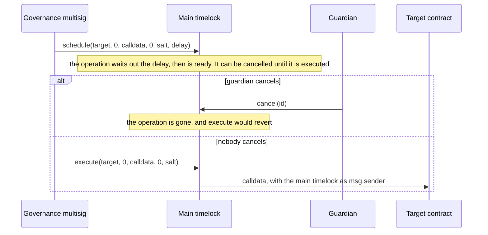
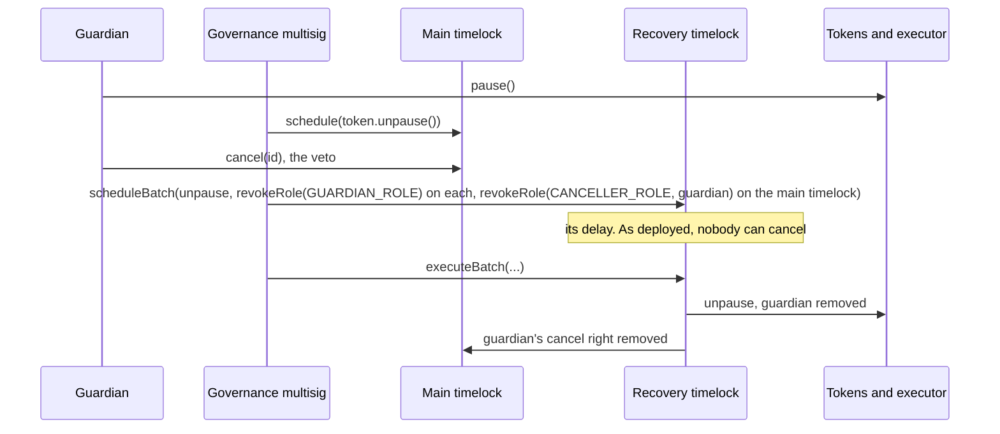
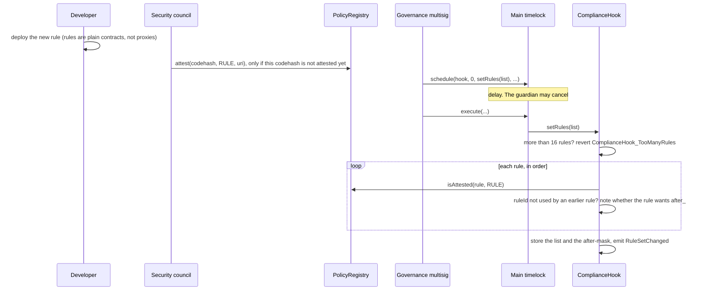
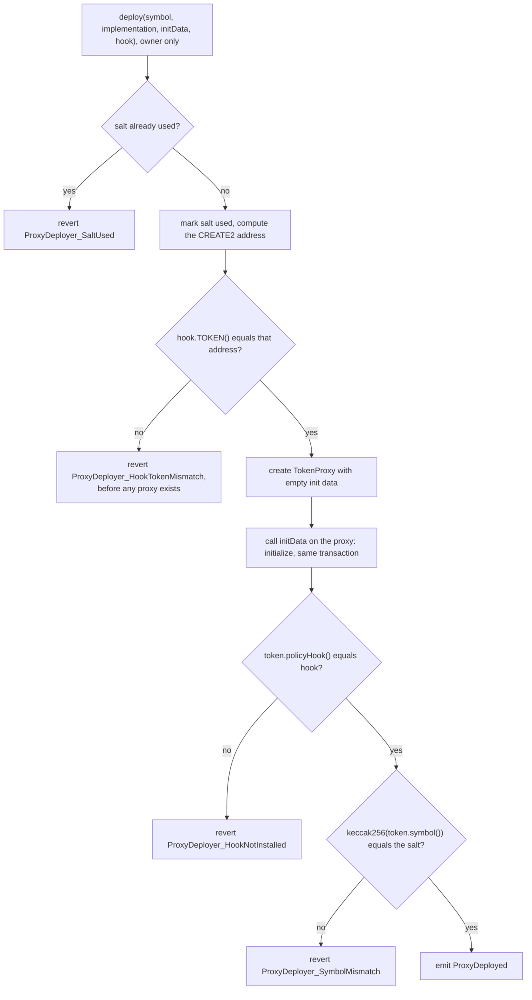
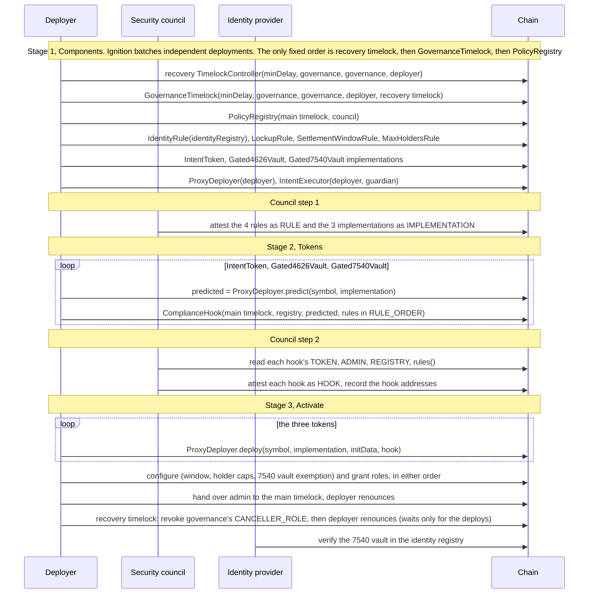

# Governance and deployment

How the policy around a token changes after it is live, and how a token gets live in the first place. The council's reproducible-build procedure and the post-deploy checklist are in the [README runbook](../README.md#deployment-runbook). This page explains the order of calls and why the order is what it is.

## The timelocks

There are two timelocks.

**The main timelock** holds the admin powers: `DEFAULT_ADMIN_ROLE` on the tokens, the executor, the registry and itself, `UPGRADER_ROLE` on the tokens, `ADMIN` of every hook, and ownership of `ProxyDeployer`. It is `GovernanceTimelock`: OpenZeppelin's `TimelockController` unchanged, except that the holder of `RECOVERY_ROLE` on it may revoke `CANCELLER_ROLE` (and do nothing else).

**The recovery timelock** is a plain OpenZeppelin `TimelockController`. It holds `RECOVERY_ROLE` on the main timelock, granted by that contract's constructor, and, after `Activate`, on the three tokens and the executor. A token placed later does not get it from its initialiser: whoever holds `DEFAULT_ADMIN_ROLE` on that token (the main timelock, if it is initialised that way) must grant it. As deployed, nobody can cancel the recovery timelock's operations.

A timelock is itself the account that calls the target contract, so the target sees that timelock as `msg.sender`.

| Timelock function | Who may call it | What it does |
|---|---|---|
| `schedule(target, value, data, predecessor, salt, delay)` | `PROPOSER_ROLE` | Queues a call. `delay` must be at least `getMinDelay()` |
| `execute(target, value, payload, predecessor, salt)` | `EXECUTOR_ROLE` | Runs a queued call once its time has come |
| `cancel(id)` | `CANCELLER_ROLE` | Removes a queued call that has not been executed, whether or not its delay has passed |

On both timelocks `Components` gives the governance multisig `PROPOSER_ROLE` and `EXECUTOR_ROLE`, and OpenZeppelin's constructor gives that initial proposer `CANCELLER_ROLE` too. A proposer granted later does not get it. On the main timelock, `Activate` adds the guardian as a second canceller. On the recovery timelock, `Activate` revokes governance's `CANCELLER_ROLE`, so nobody holds it there. The guardian cannot schedule or execute on either, and holds nothing on the recovery timelock.

Both delays come from the `minDelay` parameter of `Components`, default 7 days. See [roles.md](roles.md#the-delay).

## What the main timelock does

| Change | Call, with the main timelock as caller | Checked on the way in |
|---|---|---|
| Unpause a token | `token.unpause()` | the token must be paused (`ExpectedPause` otherwise) |
| Replace the hook | `token.setPolicyHook(newHook)` | `newHook` codehash is attested as `HOOK` |
| Replace the rule list | `hook.setRules(rules)` | each rule is attested as `RULE`, at most 16, no two share a `ruleId` |
| Upgrade a token | `token.upgradeToAndCall(newImplementation, data)` | caller holds `UPGRADER_ROLE`; `newImplementation` is attested as `IMPLEMENTATION`. OpenZeppelin also requires the call to go through the proxy and `newImplementation` to be a UUPS implementation (`proxiableUUID`) |
| Grant or revoke a role | `grantRole`, `revokeRole` on a token, the executor, the registry or the main timelock itself | none |
| Window, holder cap, holder-count seed, holder exemption | `SettlementWindowRule` and `MaxHoldersRule` functions | the rule asks the token whether the caller holds `DEFAULT_ADMIN_ROLE`. `setWindow` also rejects an invalid window, and `setExemptHolder` a zero account |
| Change the 7540 custody address | `vault.setCustody(newCustody)` | non-zero address |
| Unpause the executor | `executor.unpause()` | the executor must be paused |
| Place a new token | `proxyDeployer.deploy(...)` | see below |
| Change the main timelock's delay | `timelock.updateDelay(newDelay)` | only the timelock itself can call it. OpenZeppelin sets no lower bound |

The main timelock's operations can be cancelled by the guardian and by governance until they are executed.

## What the recovery timelock does

Governance schedules and executes on the recovery timelock after its delay, and as deployed nobody can cancel. Through `RECOVERY_ROLE` it can make only these kinds of call:

| Change | Call, with the recovery timelock as caller |
|---|---|
| Unpause a token or the executor | `token.unpause()`, `executor.unpause()` |
| Remove `GUARDIAN_ROLE` from an account on a token or the executor | `revokeRole(GUARDIAN_ROLE, account)` on it |
| Remove `CANCELLER_ROLE` from an account on the main timelock: the guardian's, or any other canceller's, governance included | `timelock.revokeRole(CANCELLER_ROLE, account)` |

Any other privileged call to a token, the executor or the main timelock reverts. Role-gated functions fail their role check, and `updateDelay` fails `TimelockUnauthorizedCaller`. Permissionless calls, such as `approve` or renouncing its own role, still succeed and give it nothing. It cannot grant roles there, revoke any other role, upgrade, change a hook or rule list, or schedule, execute or cancel on the main timelock. This path exists because the guardian can cancel these same calls on the main timelock ([roles.md](roles.md#what-the-guardian-can-do)). It bounds the guardian. It does not protect against a compromised governance multisig, which proposes on both timelocks.

`RECOVERY_ROLE` is not a role admin, because a role admin could also grant the role. Instead, the tokens, the executor and `GovernanceTimelock` let its holder through for exactly those revocations (their `revokeRole` overrides), and the tokens and the executor accept it in `unpause()`.

Each `unpause` in such a batch must target a contract that is paused when the batch executes; otherwise `ExpectedPause` reverts the whole batch. The guardian keeps its powers until recovery runs: it can still pause at once and cancel other operations on the main timelock. The brief rules out an expiring pause, because it would turn a security control into a timer.

The recovery timelock also administers itself. Changing its own roles or delay is one of its own operations.

Code: `GovernanceTimelock.revokeRole`, `PolicyGatedERC20Upgradeable.unpause` and `revokeRole`, `IntentExecutor.unpause` and `revokeRole`.

Things that wait for neither timelock: a guardian pause, a `cancel` on the main timelock, a council attestation or revocation, and the work of the agent, minter, burner, operator and fulfiller.

## What attestation covers

`PolicyRegistry` stores a kind for each runtime codehash. `isAttested(target, kind)` returns whether the kind stored for `target.codehash` equals `kind`, and is always false for `NONE`. The council (`ATTESTER_ROLE`) calls `attest(codehash, kind, uri)`, where `uri` points to the review. Attesting something already attested reverts, so changing a kind means revoking first. The empty-code hashes cannot be attested.

| Where it is checked | Kind required | When |
|---|---|---|
| Token `initialize` (through `_setHook`) | `HOOK` | at deployment |
| `setPolicyHook` | `HOOK` | when the hook is replaced |
| `ComplianceHook` constructor and `setRules` | `RULE` for each rule | when a rule list is installed |
| `_authorizeUpgrade` | `IMPLEMENTATION` | when a token is upgraded |

Attestation is checked at install time only. `revoke(codehash)` does not change a token that already runs the revoked code. The guardian can pause meanwhile, and the main timelock can then remove the component. Pause does not stop `FORCED` movements, and those still run the hook and its rules. Removal is a scheduled operation of the main timelock, which the guardian can cancel. If it does, the recovery timelock can strip the guardian of that cancel right first ([roles.md](roles.md#what-the-guardian-can-do)).

The codehash covers the runtime code, including immutable values. That has three consequences:

- A hook's `ADMIN`, `REGISTRY` and `TOKEN` are immutables. The council attests a hook for one token. A hook for another token has a different codehash.
- A hook's rule list lives in storage, so it is not part of the codehash. Two hooks with the same immutables share a codehash whatever rules they hold. This is why the runbook has the council read `rules()` before attesting a hook, and why the post-deploy check compares `rules()` with `RULE_ORDER`. [SECURITY.md](../SECURITY.md) item 3 covers it.
- Every deployment of a UUPS implementation has its own codehash, because `UUPSUpgradeable` stores `address(this)` in an immutable. Each new implementation needs its own attestation, even for identical source.

## Changing the rule list

`setRules` replaces the whole ordered list in one call. If any rule fails a check, the call reverts and the old list stays. An empty list is accepted, and a hook with no rules rejects every movement with `NO_RULES`.

A redeployed copy of an existing rule shares its codehash if its constructor arguments are the same, and so does any copy of a rule that has no immutables. Such a copy is already attested, so `attest` would revert with `PolicyRegistry_AlreadyAttested`. Only new rule code, new immutable values, or a codehash the council has since revoked needs the council's attestation.

## Replacing the hook

1. Deploy a new `ComplianceHook(admin = main timelock, registry, token, initialRules)`. The constructor runs the same rule checks as `setRules`.
2. The council reviews it: it reads `TOKEN()`, `ADMIN()`, `REGISTRY()` and `rules()`. A hook with the same `ADMIN`, `REGISTRY` and `TOKEN` as an attested hook has the same codehash, so it is already attested; the council records the reviewed address, and `attest` would revert with `PolicyRegistry_AlreadyAttested`. A hook with new code or new immutables, or whose codehash the council has revoked, must be attested as `HOOK`.
3. Governance schedules `token.setPolicyHook(newHook)` on the main timelock and executes it after the delay.
4. The token emits `PolicyHookChanged(oldHook, newHook)`. From the next movement on, the new hook decides.

The rules need no change. They accept `after_` from whichever hook `ctx.token` currently reports.

## Upgrading a token

1. Deploy the new implementation.
2. The council attests its codehash as `IMPLEMENTATION`.
3. Governance schedules `token.upgradeToAndCall(newImplementation, data)`. After the delay, the main timelock executes it.
4. `_authorizeUpgrade` requires `UPGRADER_ROLE` on the caller (the main timelock) and the attestation.

State is kept in ERC-7201 namespaces so the new implementation keeps reading the old fields. `npm run validate:upgrades` runs OpenZeppelin's upgrade-safety check over the build.

## Why deployment has three stages

A hook stores its token's address in an immutable (`TOKEN`). The council attests the hook by codehash, so the token address must be known before the hook is deployed. But a token is initialised with an attested hook. Each needs the other first.

`ProxyDeployer` breaks the loop. It places each token proxy with CREATE2, with init code `TokenProxy(implementation, "")` and salt `keccak256(bytes(symbol))`. The address then depends on the `ProxyDeployer` contract's own address, the symbol and the implementation. It does not depend on the init data, which is where the hook address goes. `predict(symbol, implementation)` is a view on the deployed `ProxyDeployer`. Once the `ProxyDeployer` and the implementation exist, it returns the address before the hook or the proxy does.

`deploy(symbol, implementation, initData, hook)` does these steps, and any revert undoes all of them, including the symbol being marked used:

`deploy` is owner-only. The address does not cover the init data, so without the gate anyone could take it with the same symbol and implementation but their own admin. A symbol can be used once, with any implementation. `deploy` does not check that `implementation` is attested. It checks the hook, through the token's `initialize`. On chain, an implementation's attestation is enforced only when a token is upgraded, so for a first deployment it is a council step in the runbook.

`TokenProxy` is OpenZeppelin's `ERC1967Proxy` with one override, `_unsafeAllowUninitialized`, so it can be created without init data. `ProxyDeployer` initialises it in the same transaction.

Code: `ProxyDeployer.deploy`, `predict`, `TokenProxy`, `ComplianceHook` constructor.

## The deployment sequence

### What each stage creates

`Components` (deployer account):

- The recovery timelock, a plain `TimelockController(minDelay, [governance], [governance], deployer)`, deployed before the main timelock so the main timelock can name it.
- The main timelock, `GovernanceTimelock(minDelay, [governance], [governance], deployer, recoveryTimelock)`. Its constructor grants the recovery timelock `RECOVERY_ROLE`. The deployer is the admin of both timelocks until `Activate`.
- `PolicyRegistry(mainTimelock, council)`.
- The four rules, `IdentityRule` with the identity registry address as its constructor argument.
- One implementation per template: `IntentToken`, `Gated4626Vault`, `Gated7540Vault`.
- `ProxyDeployer(deployer)` and `IntentExecutor(deployer, guardian)`.

`Tokens`: one `ComplianceHook` per token, with `ADMIN` = the main timelock and `TOKEN` = the predicted address. The constructor checks each rule against the registry, so council step 1 must be done first. The rule lists:

| Token | Rules, in order |
|---|---|
| `IntentToken` (symbol `INT`) | `IdentityRule`, `LockupRule`, `SettlementWindowRule`, `MaxHoldersRule` |
| `Gated4626Vault` (`gFUND`) | `IdentityRule`, `LockupRule`, `MaxHoldersRule` |
| `Gated7540Vault` (`gASYNC`) | `IdentityRule`, `LockupRule`, `MaxHoldersRule` |

The symbols above, and the token names in `TOKENS` ("Intent Token", "Gated Fund", "Gated Async Fund"), are the defaults in `roles.ts`. The parameters `<key>Symbol` and `<key>Name` can override them. `Tokens` and `Activate` must use the same symbol, the same implementation and the same `ProxyDeployer`, because together they fix the CREATE2 address; otherwise `deploy` reverts with `ProxyDeployer_HookTokenMismatch`.

`Activate` runs in these stages. Ignition orders calls by their dependencies: the futures they use, plus the `after` lists in this module:

1. Deploy the three tokens through `ProxyDeployer`. The tokens are initialised with the deployer as admin and the guardian as guardian. Every later call waits for all three deploys, so a hook bound to the wrong address stops the whole stage before anything is configured or granted.
2. Configure, after the deploys and while the deployer still holds `DEFAULT_ADMIN_ROLE` on the tokens: `SettlementWindowRule.setWindow` for `IntentToken` (`windowOpen`, `windowClose`, `windowDays`), `MaxHoldersRule.setCap` for all three tokens (`holderCap`), and `MaxHoldersRule.setExemptHolder(asyncFund, asyncFund, true)` so the 7540 vault's escrow never counts as a holder.
3. Grant roles: `MINTER_ROLE` and `BURNER_ROLE` on `IntentToken`; `EXECUTOR_ROLE` on `IntentToken` to the executor; `FULFILLER_ROLE` on the 7540 vault; `AGENT_ROLE` on all three tokens; `UPGRADER_ROLE` on all three tokens to the main timelock; `OPERATOR_ROLE` on the executor; `CANCELLER_ROLE` on the main timelock to the guardian; `RECOVERY_ROLE` on all three tokens and on the executor to the recovery timelock. This also waits only for the deploys, so steps 2 and 3 have no order between them.
4. Hand over: once configuration and the role grants are done, grant `DEFAULT_ADMIN_ROLE` on each token and on the executor to the main timelock, then the deployer renounces it there. The deployer also renounces `DEFAULT_ADMIN_ROLE` on the main timelock once configuration and the grants are done. On the recovery timelock, after the deploys, `Activate` revokes governance's `CANCELLER_ROLE` (OpenZeppelin gave it as a proposer), then the deployer renounces `DEFAULT_ADMIN_ROLE` there. `ProxyDeployer` ownership goes to the main timelock after the deploys, with no order against the other hand-over calls, so any later token is placed through governance.

The identity provider has to verify the 7540 vault, because the vault holds shares in escrow and `IdentityRule` checks it on both legs. `Activate` does not do this. It can happen any time once the vault's address can be computed, which is after `Components` (`ProxyDeployer.predict`), and must happen before the first redemption request. The runbook and the test fixture do it after `Activate`.

### After `Activate`

The roles are in [roles.md](roles.md#who-holds-what-after-activate). The test fixture's `assertHandedOver` checks that:

- the deployer holds no role on either timelock, the registry, the tokens or the executor;
- the main timelock holds `DEFAULT_ADMIN_ROLE` on itself, the registry, the tokens and the executor, and is the only `UPGRADER_ROLE` holder among the known accounts;
- the recovery timelock holds exactly `RECOVERY_ROLE` on the main timelock, each token and the executor, nothing on the registry, and `DEFAULT_ADMIN_ROLE` on itself;
- no known account can cancel on the recovery timelock, the guardian holds nothing there, and governance is its proposer and executor;
- `ProxyDeployer` is owned by the main timelock;
- each token runs the hook the council recorded, with the intended rules in order, and no rule has its own access control;
- the guardian can cancel on the main timelock but not propose or execute;
- both delays are at least 7 days.

Code: `ignition/modules/Components.ts`, `Tokens.ts`, `Activate.ts`, `roles.ts`; `test/nodejs/fixtures.ts`.
