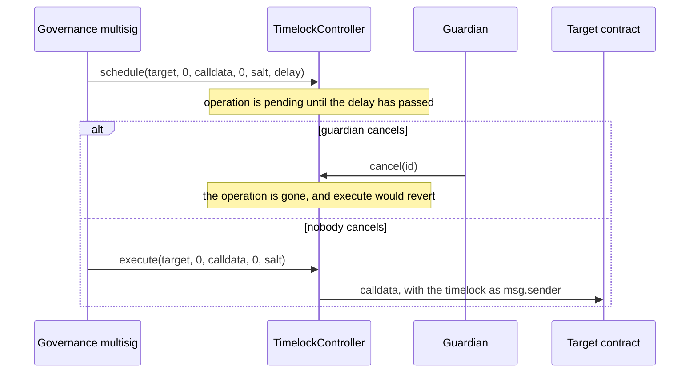
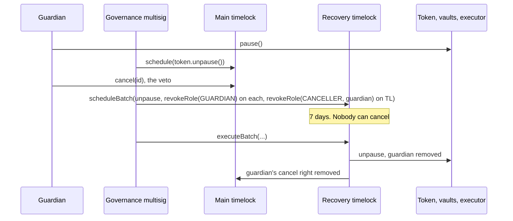
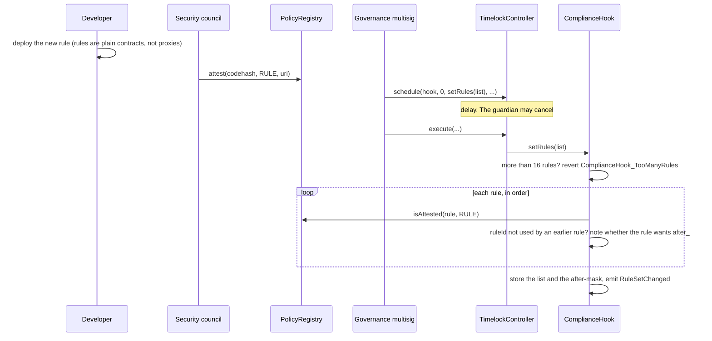
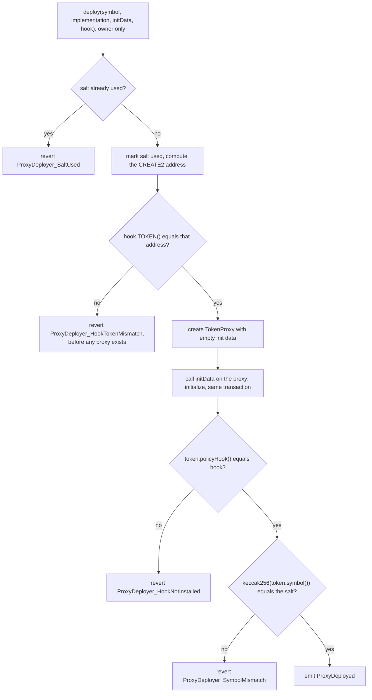
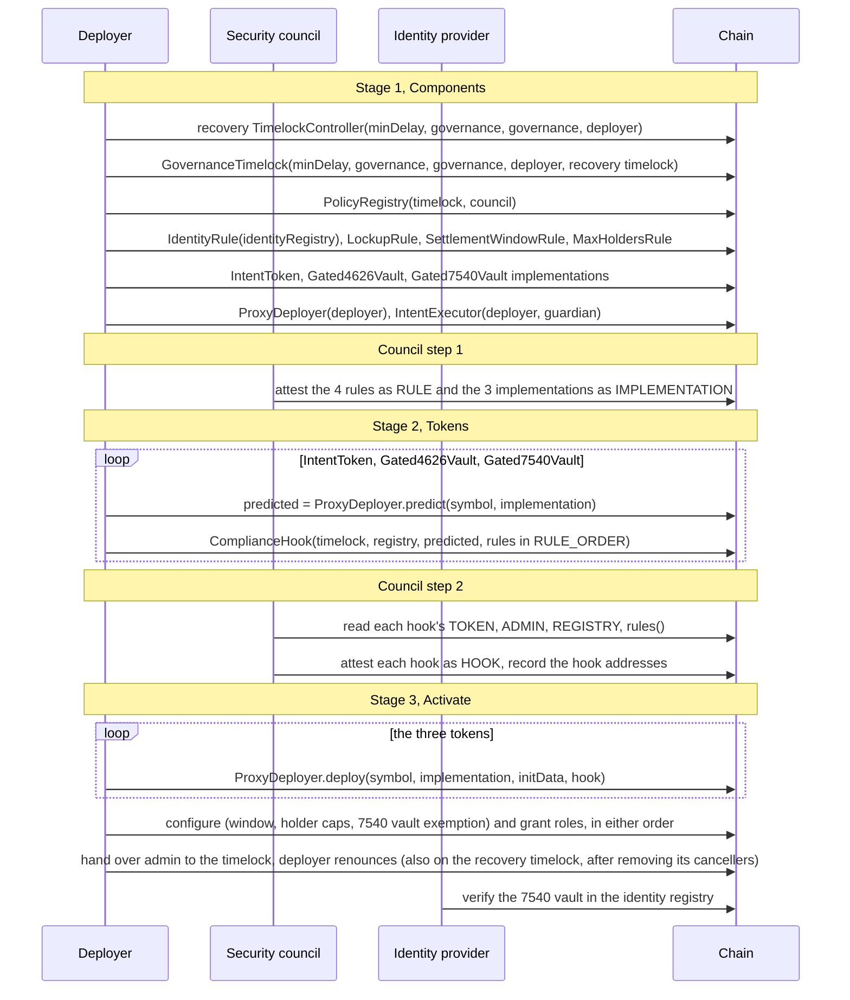

# Governance and deployment

How the policy around a token changes after it is live, and how a token gets live in the first place. Commands, the council's reproducible-build procedure and the post-deploy checklist are in the [README runbook](../README.md#deployment-runbook). This page explains the order of calls and why the order is what it is.

## The timelock

All admin powers sit behind the main timelock, `GovernanceTimelock`: OpenZeppelin's `TimelockController` with one addition, a `RECOVERY_ROLE` that can only revoke `CANCELLER_ROLE` (see [the recovery timelock](#the-recovery-timelock)). The timelock itself is the account that calls the target contract, so the target sees the timelock as `msg.sender`.

| Timelock function | Who may call it | What it does |
|---|---|---|
| `schedule(target, value, data, predecessor, salt, delay)` | `PROPOSER_ROLE` | Queues a call. `delay` must be at least `getMinDelay()` |
| `execute(target, value, payload, predecessor, salt)` | `EXECUTOR_ROLE` | Runs a queued call once its time has come |
| `cancel(id)` | `CANCELLER_ROLE` | Removes a queued call that has not run |

`Components` gives the governance multisig `PROPOSER_ROLE` and `EXECUTOR_ROLE`. OpenZeppelin also gives every proposer `CANCELLER_ROLE`. `Activate` adds the guardian as a second canceller. The guardian cannot schedule or execute.

The minimum delay is the `minDelay` parameter of `Components`, default 7 days. See [roles.md](roles.md#the-delay).

## The recovery timelock

The guardian can cancel any operation on the main timelock. Before v0.2.0 that included the operations that would unpause a token or remove the guardian, so a guardian with bad intent or stolen keys could freeze the system for good. A guardian that can veto its own removal is not "stop-only" (owner decision M-1).

A second timelock, the recovery timelock, gives governance a path the guardian cannot block. It is a plain OpenZeppelin `TimelockController` with the same minimum delay, the governance multisig as proposer and executor, and no cancellers. The guardian holds nothing on it. It holds `RECOVERY_ROLE`, which allows exactly:

| On | Allowed | Everything else |
|---|---|---|
| each token, vault and the executor | `unpause()`, `revokeRole(GUARDIAN_ROLE, account)` | reverts: it cannot grant roles, revoke other roles, change the hook or upgrade |
| the main timelock (`GovernanceTimelock`) | `revokeRole(CANCELLER_ROLE, account)` | reverts: it cannot grant roles, propose, execute or cancel |

`RECOVERY_ROLE` is not a role admin, because a role admin could also grant the role. The contracts instead let its holder through for exactly those revocations (`revokeRole` overrides) and accept it in `unpause()`.

The guardian keeps its powers until recovery runs: it can still pause instantly and cancel anything else on the main timelock. A compromised governance multisig is out of scope for this control, by design. Recovery bounds the guardian, not governance. There is no expiring pause: it would turn a security control into a timer and give an attacker a deadline to plan around.

Code: `GovernanceTimelock`, `PolicyGatedERC20Upgradeable.unpause` and `revokeRole`, `IntentExecutor.unpause` and `revokeRole`.

## What the timelock does

| Change | Call, with the timelock as caller | Checked on the way in |
|---|---|---|
| Unpause a token | `token.unpause()` | none (the recovery timelock can also do this) |
| Replace the hook | `token.setPolicyHook(newHook)` | `newHook` codehash is attested as `HOOK` |
| Replace the rule list | `hook.setRules(rules)` | each rule is attested as `RULE`, at most 16, no two share a `ruleId` |
| Upgrade a token | `token.upgradeToAndCall(newImplementation, data)` | caller holds `UPGRADER_ROLE`; `newImplementation` is attested as `IMPLEMENTATION` |
| Grant or revoke a role | `grantRole`, `revokeRole` on the token, executor or registry | none |
| Window, holder cap, holder-count seed, holder exemption | `SettlementWindowRule` and `MaxHoldersRule` functions | the rule asks the token whether the caller holds `DEFAULT_ADMIN_ROLE` |
| Change the 7540 custody address | `vault.setCustody(newCustody)` | non-zero address |
| Unpause the executor | `executor.unpause()` | none (the recovery timelock can also do this) |
| Place a new token | `proxyDeployer.deploy(...)` | see below |
| Change the timelock delay | `timelock.updateDelay(newDelay)` | only the timelock can call it |

Things that do not wait for the timelock: a guardian pause, a council attestation or revocation, and the work of the agent, minter, burner, operator and fulfiller.

## What attestation covers

`PolicyRegistry` stores a kind for each runtime codehash. `isAttested(target, kind)` compares `target.codehash` with the stored kind. The council (`ATTESTER_ROLE`) calls `attest(codehash, kind, uri)`, where `uri` points to the review. Attesting something already attested reverts, so changing a kind means revoking first. The empty-code hashes cannot be attested.

| Where it is checked | Kind required | When |
|---|---|---|
| Token `initialize` (through `_setHook`) | `HOOK` | at deployment |
| `setPolicyHook` | `HOOK` | when the hook is replaced |
| `ComplianceHook` constructor and `setRules` | `RULE` for each rule | when a rule list is installed |
| `_authorizeUpgrade` | `IMPLEMENTATION` | when a token is upgraded |

Attestation is checked at install time only. `revoke(codehash)` does not change a token that already runs the revoked code. The guardian can pause meanwhile, and the timelock can then remove the component. Removal is a scheduled timelock operation, and the guardian can cancel it ([roles.md](roles.md#what-the-guardian-can-do)). If the guardian abuses that to block recovery, the recovery timelock can unpause and remove the guardian.

The codehash covers the runtime code, including immutable values. That has three consequences:

- A hook's `ADMIN`, `REGISTRY` and `TOKEN` are immutables. The council attests a hook for one token. A hook for another token has a different codehash.
- A hook's rule list lives in storage, so it is not part of the codehash. Two hooks with the same immutables share a codehash whatever rules they hold. This is why the runbook has the council read `rules()` before attesting a hook, and why the post-deploy check compares `rules()` with `RULE_ORDER`. [SECURITY.md](../SECURITY.md) item 3 covers it.
- Every deployment of a UUPS implementation has its own codehash, because `UUPSUpgradeable` stores `address(this)` in an immutable. Each new implementation needs its own attestation, even for identical source.

## Changing the rule list

`setRules` replaces the whole ordered list in one call. If any rule fails a check, the call reverts and the old list stays. An empty list is accepted, and a hook with no rules rejects every movement with `NO_RULES`.

## Replacing the hook

1. Deploy a new `ComplianceHook(admin = timelock, registry, token, initialRules)`. The constructor runs the same rule checks as `setRules`.
2. The council reviews it, reads `TOKEN()`, `ADMIN()`, `REGISTRY()` and `rules()`, and attests its codehash as `HOOK`.
3. Governance schedules `token.setPolicyHook(newHook)` on the timelock and executes it after the delay.
4. The token emits `PolicyHookChanged(oldHook, newHook)`. From the next movement on, the new hook decides.

The rules need no change. They accept `after_` from whichever hook `ctx.token` currently reports.

## Upgrading a token

1. Deploy the new implementation.
2. The council attests its codehash as `IMPLEMENTATION`.
3. Governance schedules `token.upgradeToAndCall(newImplementation, data)`. After the delay, the timelock executes it.
4. `_authorizeUpgrade` requires `UPGRADER_ROLE` on the caller (the timelock) and the attestation.

State is kept in ERC-7201 namespaces so the new implementation keeps reading the old fields. `npm run validate:upgrades` runs OpenZeppelin's upgrade-safety check over the build.

## Why deployment has three stages

A hook stores its token's address in an immutable (`TOKEN`). The council attests the hook by codehash, so the token address must be known before the hook is deployed. But a token is initialised with an attested hook. Each needs the other first.

`ProxyDeployer` breaks the loop. It places each token proxy with CREATE2, with init code `TokenProxy(implementation, "")` and salt `keccak256(bytes(symbol))`. The address then depends on the `ProxyDeployer` contract's own address, the symbol and the implementation. It does not depend on the init data, which is where the hook address goes. `predict(symbol, implementation)` returns the address before anything is deployed.

`deploy(symbol, implementation, initData, hook)` does these steps, and any revert undoes all of them, including the symbol being marked used:

`deploy` is owner-only. The address does not cover the init data, so without the gate anyone could take it with the same symbol and implementation but their own admin. A symbol can be used once, with any implementation. `deploy` does not check that `implementation` is attested. It checks the hook, through the token's `initialize`. On chain, an implementation's attestation is enforced only when a token is upgraded, so for a first deployment it is a council step in the runbook.

`TokenProxy` is OpenZeppelin's `ERC1967Proxy` with one override, `_unsafeAllowUninitialized`, so it can be created without init data. `ProxyDeployer` initialises it in the same transaction.

Code: `ProxyDeployer.deploy`, `predict`, `TokenProxy`, `ComplianceHook` constructor.

## The deployment sequence

### What each stage creates

`Components` (deployer account):

- The recovery timelock, `TimelockController(minDelay, [governance], [governance], deployer)`, deployed first so the main timelock can name it.
- The main timelock, `GovernanceTimelock(minDelay, [governance], [governance], deployer, recoveryTimelock)`, which grants the recovery timelock `RECOVERY_ROLE`. The deployer is the admin of both timelocks until `Activate`.
- `PolicyRegistry(timelock, council)`.
- The four rules, `IdentityRule` with the identity registry address as its constructor argument.
- One implementation per template: `IntentToken`, `Gated4626Vault`, `Gated7540Vault`.
- `ProxyDeployer(deployer)` and `IntentExecutor(deployer, guardian)`.

`Tokens`: one `ComplianceHook` per token, with `ADMIN` = timelock and `TOKEN` = the predicted address. The constructor checks each rule against the registry, so council step 1 must be done first. The rule lists:

| Token | Rules, in order |
|---|---|
| `IntentToken` (symbol `INT`) | `IdentityRule`, `LockupRule`, `SettlementWindowRule`, `MaxHoldersRule` |
| `Gated4626Vault` (`gFUND`) | `IdentityRule`, `LockupRule`, `MaxHoldersRule` |
| `Gated7540Vault` (`gASYNC`) | `IdentityRule`, `LockupRule`, `MaxHoldersRule` |

Names and symbols above are the defaults in `roles.ts`. Parameters can override them, but `Tokens` and `Activate` must use the same symbol, because the symbol is the CREATE2 salt.

`Activate` runs in these stages. Ignition orders calls by their dependencies: the futures they use, plus the `after` lists in this module:

1. Deploy the three tokens through `ProxyDeployer`. The tokens are initialised with the deployer as admin and the guardian as guardian. Every later call waits for all three deploys, so a hook bound to the wrong address stops the whole stage before anything is configured or granted.
2. Configure, after the deploys and while the deployer still holds `DEFAULT_ADMIN_ROLE` on the tokens: `SettlementWindowRule.setWindow` for `IntentToken` (`windowOpen`, `windowClose`, `windowDays`), `MaxHoldersRule.setCap` for all three tokens (`holderCap`), and `MaxHoldersRule.setExemptHolder(asyncFund, asyncFund, true)` so the 7540 vault's escrow never counts as a holder.
3. Grant roles: `MINTER_ROLE` and `BURNER_ROLE` on `IntentToken`; `EXECUTOR_ROLE` on `IntentToken` to the executor; `FULFILLER_ROLE` on the 7540 vault; `AGENT_ROLE` on all three tokens; `UPGRADER_ROLE` on all three tokens to the timelock; `OPERATOR_ROLE` on the executor; `CANCELLER_ROLE` on the timelock to the guardian; `RECOVERY_ROLE` on all three tokens and on the executor to the recovery timelock. This also waits only for the deploys, so steps 2 and 3 have no order between them.
4. Hand over: once configuration and the role grants are done, grant `DEFAULT_ADMIN_ROLE` on each token and on the executor to the timelock, then the deployer renounces it there. The deployer also renounces `DEFAULT_ADMIN_ROLE` on the timelock once configuration and the grants are done. `ProxyDeployer` ownership goes to the timelock after the deploys, with no order against the other hand-over calls, so any later token is placed through governance. On the recovery timelock, the deployer revokes the `CANCELLER_ROLE` that OpenZeppelin gave governance as a proposer, so it has no cancellers, then renounces its admin role there.

The identity provider has to verify the 7540 vault after `Activate`, because the vault holds shares in escrow and `IdentityRule` checks it on both legs. `Activate` does not do this.

### After `Activate`

The roles are in [roles.md](roles.md#who-holds-what-after-activate). The post-deploy checks in the README runbook (the fixture's `assertHandedOver`) confirm that the deployer holds no role on the timelock, registry, tokens or executor, the timelock holds `DEFAULT_ADMIN_ROLE` on each of them and is the only `UPGRADER_ROLE` holder among the known accounts, `ProxyDeployer` is owned by the timelock, each token runs the hook the council recorded with the intended rules in order, the guardian can cancel but not propose or execute and holds nothing on the recovery timelock, the recovery timelock holds exactly `RECOVERY_ROLE` on each token, the executor and the main timelock and nothing elsewhere, it has no cancellers, and the delay is at least 7 days on both timelocks.

Code: `ignition/modules/Components.ts`, `Tokens.ts`, `Activate.ts`, `roles.ts`; `test/nodejs/fixtures.ts`.
