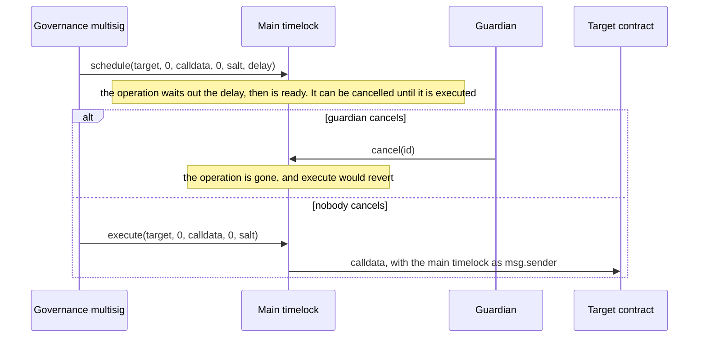
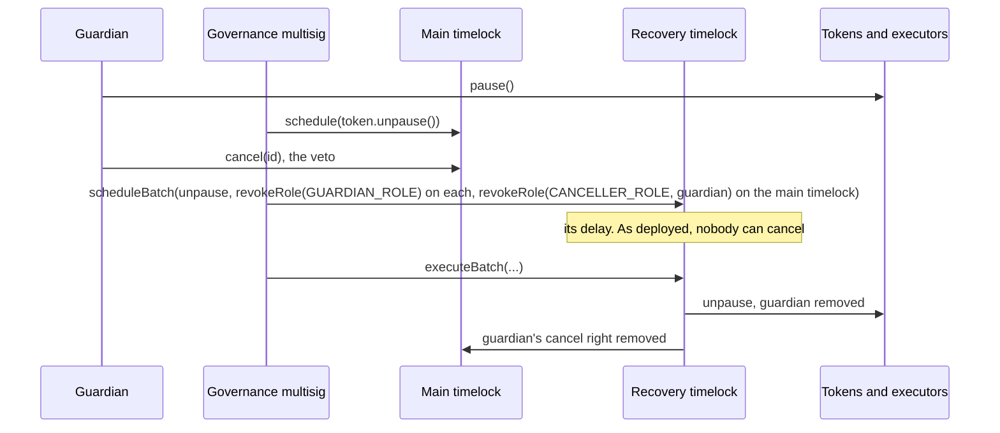
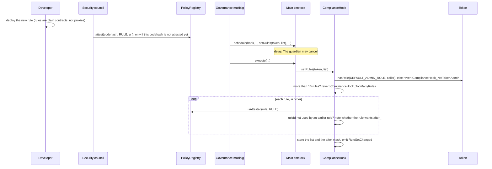
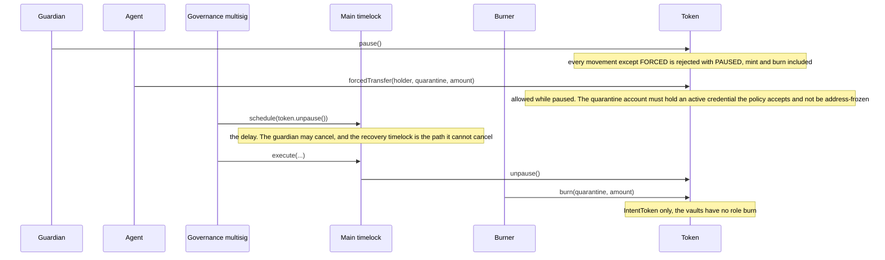
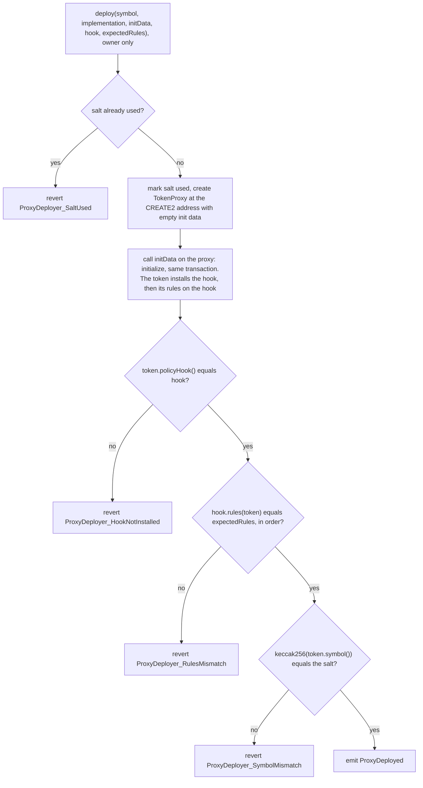
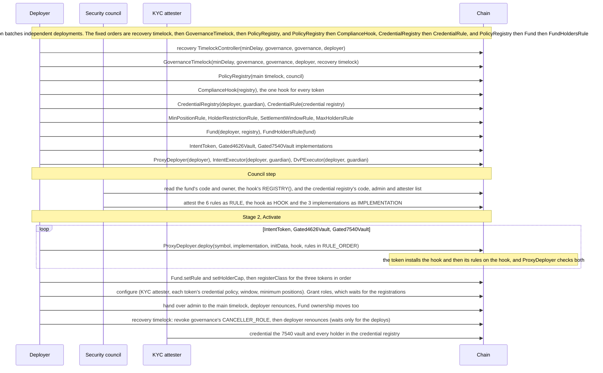

# Governance and deployment

How the policy around a token changes after it is live, what to watch, what to do in an incident, and how a token gets live in the first place. The council's reproducible-build procedure and the post-deploy checklist are in the [README runbook](../README.md#deployment-runbook). This page explains the order of calls and why the order is what it is.

## The timelocks

There are two timelocks.

**The main timelock** holds the admin powers: `DEFAULT_ADMIN_ROLE` on the tokens, both executors, the policy registry, the credential registry and itself, `UPGRADER_ROLE` on the tokens, and ownership of `ProxyDeployer` and `Fund`. It is `GovernanceTimelock`: OpenZeppelin's `TimelockController` unchanged, except that the holder of `RECOVERY_ROLE` on it may revoke `CANCELLER_ROLE` (and do nothing else). The hook has no admin of its own: it asks a token who holds `DEFAULT_ADMIN_ROLE` on it, so the main timelock's role on a token is its authority over that token's rule list.

**The recovery timelock** is a plain OpenZeppelin `TimelockController`. It holds `RECOVERY_ROLE` on the main timelock, granted by that contract's constructor, and, after `Activate`, on the three tokens, both executors and the credential registry. A token placed later does not get it from its initialiser: whoever holds `DEFAULT_ADMIN_ROLE` on that token (the main timelock, if it is initialised that way) must grant it. As deployed, nobody can cancel the recovery timelock's operations.

A timelock is itself the account that calls the target contract, so the target sees that timelock as `msg.sender`.

| Timelock function | Who may call it | What it does |
|---|---|---|
| `schedule(target, value, data, predecessor, salt, delay)` | `PROPOSER_ROLE` | Queues a call. `delay` must be at least `getMinDelay()` |
| `execute(target, value, payload, predecessor, salt)` | `EXECUTOR_ROLE` | Runs a queued call once its time has come |
| `cancel(id)` | `CANCELLER_ROLE` | Removes a queued call that has not been executed, whether or not its delay has passed |

On both timelocks `Components` gives the governance multisig `PROPOSER_ROLE` and `EXECUTOR_ROLE`, and OpenZeppelin's constructor gives that initial proposer `CANCELLER_ROLE` too. A proposer granted later does not get it. On the main timelock, `Activate` adds the guardian as a second canceller. On the recovery timelock, `Activate` revokes governance's `CANCELLER_ROLE`, so nobody holds it there. The guardian cannot schedule or execute on either, and holds nothing on the recovery timelock.

Both delays come from the `minDelay` parameter of `Components`, default 7 days. See [roles.md](roles.md#the-delay).

## What the main timelock does

| Change | Call, with the main timelock as caller | Checked on the way in |
|---|---|---|
| Unpause a token | `token.unpause()` | the token must be paused (`ExpectedPause` otherwise) |
| Replace the hook | `newHook.setRules(token, list)`, then `token.setPolicyHook(newHook)`, in one batch ([below](#replacing-the-hook)) | `setPolicyHook`: `newHook` codehash is attested as `HOOK`, and `newHook.REGISTRY()` is the token's registry. `setRules`: as in the next row |
| Replace a token's rule list | `hook.setRules(token, rules)` | the caller is the token or holds `DEFAULT_ADMIN_ROLE` on it (asked live), each rule is attested as `RULE`, at most 16, no two share a `ruleId` |
| Upgrade a token | `token.upgradeToAndCall(newImplementation, data)` | caller holds `UPGRADER_ROLE`; `newImplementation` is attested as `IMPLEMENTATION` and reports the token's own `templateId()` (`Templated_WrongTemplate` if it reports another id; an implementation with no `templateId()` is refused with a bare revert). OpenZeppelin also requires the call to go through the proxy and `newImplementation` to be a UUPS implementation (`proxiableUUID`) |
| Grant or revoke a role | `grantRole`, `revokeRole` on a token, an executor, the registry or the main timelock itself | none |
| Let the DvP executor settle against a gated cash token | `cashToken.grantRole(EXECUTOR_ROLE, dvpExecutor)`, with the cash token's administrator as caller | none. `Activate` grants `EXECUTOR_ROLE` only on the intent token it deploys, so a gated cash token is a separate instrument whose own deployment or governance does this ([flows-dvp.md](flows-dvp.md#policy-and-the-fund-layer)) |
| Window, minimum position, holder cap, holder-count seed, holder exemption | `SettlementWindowRule`, `MinPositionRule` and `MaxHoldersRule` functions | the rule asks the token whether the caller holds `DEFAULT_ADMIN_ROLE`. `setWindow` also rejects an invalid window, and `setExemptHolder` and `MinPositionRule.setExempt` a zero account. The three holder-count seeds also revert while the rule is in the token's rule list, and two of them check their inputs ([below](#the-holder-count-across-rule-and-hook-changes)). The minimum has its own section ([below](#setting-a-minimum-position)) |
| Add an attester, rotate its account, change the bits it may assert, kill or revive it, clear a guardian block | `credentials.addAttester`, `setAttesterAccount`, `setAttesterQuals`, `killAttester`, `reviveAttester`, `clearGuardianBlock` | `DEFAULT_ADMIN_ROLE` on the credential registry. At most 64 attesters, ids are never reused ([credentials.md](credentials.md#operations)) |
| Change a token's credential policy | `credentialRule.setPolicy(token, requireAll, requireAny, forbidAny, attesters)` | the rule asks the token whether the caller holds `DEFAULT_ADMIN_ROLE` |
| Change the 7540 custody address | `vault.setCustody(newCustody)` | non-zero address |
| Register a class, set the fund's cap, exempt an account | `fund.registerClass(token)`, `fund.setHolderCap(cap)`, `fund.setExempt(account, exempt)` | `registerClass`: the token reports ERC-165 support for `IPolicyGated`, its hook lists the fund's rule, its total supply is zero, and the fund has room (32 classes). `setHolderCap`: at most `type(uint48).max`. `setExempt`: a non-zero account |
| Replace the fund's rule | `fund.setRule(newRule)`, with `hook.setRules(class, list)` for every class in the same batch | `newRule` is attested as `RULE` ([below](#changing-the-funds-rule)) |
| Unpause an executor | `executor.unpause()`, `dvpExecutor.unpause()` | the executor must be paused |
| Place a new token | `proxyDeployer.deploy(symbol, implementation, initData, hook, expectedRules)` | see below. The token's rules go in `initData`, so a new token needs no new hook and no hook attestation. A new implementation is attested by the council as a runbook step, since `deploy` does not check it, and a token that joins the fund still needs `fund.registerClass` |
| Change the main timelock's delay | `timelock.updateDelay(newDelay)` | only the timelock itself can call it. OpenZeppelin sets no lower bound |

The main timelock's operations can be cancelled by the guardian and by governance until they are executed.

Several calls to one token can go as one `token.multicall(bytes[])`. The token runs each call with the caller as the sender, so every role gate applies to each call, and the batch is atomic. It is not payable. Calls to different targets still go in the timelock's own batch, as in the table above.

## What the recovery timelock does

Governance schedules and executes on the recovery timelock after its delay, and as deployed nobody can cancel. Through `RECOVERY_ROLE` it can make only these kinds of call:

| Change | Call, with the recovery timelock as caller |
|---|---|
| Unpause a token or an executor | `token.unpause()`, `executor.unpause()`, `dvpExecutor.unpause()` |
| Remove `GUARDIAN_ROLE` from an account on a token, an executor or the credential registry | `revokeRole(GUARDIAN_ROLE, account)` on it |
| Lift a guardian's block, or bring back an attester the guardian killed | `credentials.clearGuardianBlock(subject)`, `credentials.reviveAttester(id)` |
| Remove `CANCELLER_ROLE` from an account on the main timelock: the guardian's, or any other canceller's, governance included | `timelock.revokeRole(CANCELLER_ROLE, account)` |

Any other privileged call to a token, an executor, the credential registry or the main timelock reverts. Role-gated functions fail their role check, and `updateDelay` fails `TimelockUnauthorizedCaller`. Permissionless calls, such as `approve` or renouncing its own role, still succeed and give it nothing. It cannot grant roles there, revoke any other role, upgrade, change a hook or rule list, or schedule, execute or cancel on the main timelock. This path exists because the guardian can cancel these same calls on the main timelock ([roles.md](roles.md#what-the-guardian-can-do)). It bounds the guardian. It does not protect against a compromised governance multisig, which proposes on both timelocks.

`RECOVERY_ROLE` is not a role admin, because a role admin could also grant the role. Instead, the tokens, both executors, the credential registry and `GovernanceTimelock` let its holder through for exactly those revocations (their `revokeRole` overrides), the tokens and the executors accept it in `unpause()`, and the credential registry accepts it in `clearGuardianBlock` and `reviveAttester`.

Each `unpause` in such a batch must target a contract that is paused when the batch executes; otherwise `ExpectedPause` reverts the whole batch. The guardian keeps its powers until recovery runs: it can still pause at once and cancel other operations on the main timelock. The brief rules out an expiring pause, because it would turn a security control into a timer.

The recovery timelock also administers itself. Changing its own roles or delay is one of its own operations.

Code: `GovernanceTimelock.revokeRole`, `PolicyGatedERC20Upgradeable.unpause` and `revokeRole`, `IntentExecutor` and `DvPExecutor` `unpause` and `revokeRole`, `CredentialRegistry.revokeRole`, `clearGuardianBlock` and `reviveAttester`.

Things that wait for neither timelock: a guardian pause, a `cancel` on the main timelock, a council attestation or revocation, the work of the agent, minter, burner, operator and fulfiller, and an attester's writes and a guardian's block or kill in the credential registry.

## What attestation covers

`PolicyRegistry` stores a kind for each runtime codehash. `isAttested(target, kind)` returns whether the kind stored for `target.codehash` equals `kind`, and is always false for `NONE`. The council (`ATTESTER_ROLE`) calls `attest(codehash, kind, uri)`, where `uri` points to the review. Attesting something already attested reverts, so changing a kind means revoking first. The empty-code hashes cannot be attested.

| Where it is checked | Kind required | When |
|---|---|---|
| Token `initialize` (through `_setHook`) | `HOOK` | at deployment |
| `setPolicyHook` | `HOOK` | when the hook is replaced |
| `ComplianceHook.setRules` | `RULE` for each rule | when a token's rule list is installed: by its initialiser at deployment, and when governance replaces it |
| `Fund.setRule` | `RULE` | when the fund's rule is set |
| `_authorizeUpgrade` | `IMPLEMENTATION` | when a token is upgraded |

Attestation is checked at install time only. `revoke(codehash)` does not change a token that already runs the revoked code. The guardian can pause meanwhile, and the main timelock can then remove the component. Pause does not stop `FORCED` movements, and those still run the hook and its rules. Removal is a scheduled operation of the main timelock, which the guardian can cancel. If it does, the recovery timelock can strip the guardian of that cancel right first ([roles.md](roles.md#what-the-guardian-can-do)).

The codehash covers the runtime code, including immutable values. That has four consequences:

- A hook's only immutable is `REGISTRY`. One attestation covers the one hook that every token uses, and any other hook on the same registry shares its codehash. A token refuses a hook whose `REGISTRY()` is not its own registry (`PolicyGated_HookRegistryMismatch`), at `initialize` and at `setPolicyHook`.
- Each token's rule list lives in the hook's storage, keyed by token, so it is not part of the codehash. Two hooks on the same registry share a codehash whatever lists they hold. The council attests the hook before any token exists, so it has no list to read. The lists are pinned afterwards: `ProxyDeployer.deploy` compares `hook.rules(token)` with the expected list, and the post-deploy check compares it with `RULE_ORDER` and checks that each token runs the exact hook the council reviewed. [SECURITY.md](../SECURITY.md) item 3 covers it.
- Every deployment of a UUPS implementation has its own codehash, because `UUPSUpgradeable` stores `address(this)` in an immutable. Each new implementation needs its own attestation, even for identical source.
- `FundHoldersRule` takes its `Fund` as an immutable, so its codehash covers the fund's address and not the fund's code. The council attests the rule for one fund, and reads the fund's code and its owner before attesting it. `Fund` is not attested, like `ProxyDeployer`: nothing installs it by codehash.

## Changing the rule list

`setRules(token, rules)` replaces the whole ordered list of one token in one call, and leaves every other token's list alone. The caller must be the token itself, which is how its initialiser installs the first list, or hold `DEFAULT_ADMIN_ROLE` on the token, asked live (a token address without code is refused). After the hand-over that is the main timelock. If any rule fails a check, the call reverts and the old list stays. An empty list is accepted, and a token with no rules on the hook has every movement that passes the token's own pause and frozen checks rejected with `NO_RULES`. The hook emits `RuleSetChanged(token, ruleIds)`.

A redeployed copy of an existing rule shares its codehash if its constructor arguments are the same, and so does any copy of a rule that has no immutables. Such a copy is already attested, so `attest` would revert with `PolicyRegistry_AlreadyAttested`. Only new rule code, new immutable values, or a codehash the council has since revoked needs the council's attestation.

Never drop the credential rule from a token's list without putting an equivalent in its place. No other shipped rule looks at who holds, so a list without `CredentialRule` (or `IdentityRule`) admits any address, and the hook does not warn about it. `hook.rules(token)` in the post-deploy check, and the monitoring of it ([below](#watching-the-fund-and-the-policy)), are what catch the omission.

## Setting a minimum position

`MinPositionRule` holds one minimum per token, in raw units, and 0 means off. Whoever holds `DEFAULT_ADMIN_ROLE` on the token sets it with `setMinPosition(token, amount)` and lists exempt accounts with `setExempt(token, account, exempt)`. That is the deployer while `Activate` runs (the parameters `intentMinPosition`, `fundMinPosition` and `asyncFundMinPosition`, each 0 by default) and the main timelock after the hand-over, so a later change is a timelock operation with its delay. `setMinPosition` does not check that the rule is in the token's list.

After a movement the receiver must hold at least the minimum, and the sender must hold zero or at least the minimum. That applies to `TRANSFER`, `EXECUTED`, `MINT` and a `BURN` driven by the holder (a vault redemption), and a breach reverts with `PolicyGated_TransferRejected(BELOW_MIN_POSITION)`. Exempt: `FORCED` (the enforcement mint included), the token itself (the 7540 escrow), the accounts listed with `setExempt`, and a burn by an account that holds the token's `BURNER_ROLE`.

Raising the minimum changes no balance. A holder left below the new minimum keeps the position, and from then on can only leave completely (send the whole balance, or redeem it on a vault) or top up, in one movement, to at least the minimum. A partial move out, or a smaller top-up, is refused. The agent can still clear such a position with `forcedTransfer`, and on `IntentToken` the burner can with `burn`, because both are exempt. Lowering the minimum, or setting 0, applies from the next movement.

This closes review finding L-1 (one wei taking a holder slot of a counting rule) for the movements the rule judges, wherever a minimum is set. Where none is set, the problem stands.

On `Gated4626Vault` a deposit or mint that would leave the receiver below the minimum reverts the same way. `maxDeposit` and `maxMint` do not warn about it, because they probe a mint of a very large amount, which is above any minimum up to `type(uint128).max`, not the amount of the call. On `Gated7540Vault` a deposit claim that would leave the receiver below the minimum reverts, and the claimable stays: the agent's `recoverClaimable` delivers it (an enforcement mint is exempt), or the fulfiller rejects the request before fulfilling. A request cannot know how many shares it will buy, so `requestDeposit` is not refused for its size.

A token that will have no minimum should leave `MinPositionRule` out of its rule list. A rule that is in the list with the minimum at 0 still costs about 9,200 gas on every transfer: the call, the context it is handed, a cold account and a cold storage read. The demo lists carry it for all three tokens, off by default (`RULE_ORDER` in `ignition/modules/roles.ts`), so a deployment that wants no minimum on a token removes it from that token's entry before `Activate`. `Activate` still calls `setMinPosition` for every token, which has no effect on a token until the rule is in its list. Adding the rule later is a `setRules` through the main timelock, so leaving it out is reversible. To have a minimum in force from the moment the rule is listed, put `setMinPosition` before `setRules` in the same batch. The demo lists put the rule second, right after `CredentialRule`, so that, with a minimum set, the rules after it see real positions (FORCED, exempt accounts and burner burns can still leave dust).

Code: `MinPositionRule.setMinPosition`, `setExempt`, `check`; `Gated7540Vault.recoverClaimable`; `ignition/modules/roles.ts`, `Activate.ts`.

## Replacing the hook

There is one hook for the whole deployment, so a replacement is a decision about every token that runs it, and each token moves by its own `setPolicyHook`. `pause()` is per token too, so a defect in the shared hook takes one pause for each token that runs it.

1. Deploy a new `ComplianceHook(registry)`. It starts with no rules for any token.
2. The council reviews it: it reads `REGISTRY()`, which must be the deployment's registry. A hook on the same registry as an attested hook has the same codehash, so it is already attested; the council records the reviewed address, and `attest` would revert with `PolicyRegistry_AlreadyAttested`. A hook with new code, or whose codehash the council has revoked, must be attested as `HOOK`.
3. Governance schedules one batch on the main timelock. For each token that moves, the batch has `newHook.setRules(token, list)`, called by the main timelock as the token's admin (the list is usually the token's current one, from `oldHook.rules(token)`), then `token.setPolicyHook(newHook)`. The lists go in the same batch because a token whose new hook holds no list for it has every movement rejected with `NO_RULES`. The batch executes after the delay.
4. The token emits `PolicyHookChanged(oldHook, newHook)`. From the next movement on, the new hook decides.

The rules need no change. They accept `after_` from whichever hook `ctx.token` currently reports. A fund class's new list must still name the fund's current rule ([below](#changing-the-funds-rule)).

Code: `PolicyGatedERC20Upgradeable.setPolicyHook`, `_setHook`; `ComplianceHook.setRules`.

## Changing the fund's rule

The fund keeps the state, so a new rule needs no seed. What changes is who may write it. `Fund.setRule(newRule)` takes effect at once, and from then on only `newRule` may call `join` and `leave`. But each class's hook lists its rules by address, and a hook that still lists the old rule sends it every movement. The old rule reads the installed rule from the fund (`admission` returns it), finds that it is not itself, and rejects every movement of that class with `NOT_FUND_CLASS`. That includes movements that would not have written to the fund, and `forcedTransfer` and `burn`. `canTransfer` gives the same answer, so nothing lies and nothing drifts, but the class is closed until its hook lists the new rule. The change therefore goes in one batch on the main timelock:

1. If the new rule's codehash is not attested, the council attests it as `RULE`, after reading its `FUND()`. A new instance of the same code for the same fund has the same codehash, which is already attested, so `attest` would revert with `PolicyRegistry_AlreadyAttested`.
2. Governance schedules one batch: `fund.setRule(newRule)`, and `hook.setRules(class, list)` for every registered class, where each list is the class's current one (`hook.rules(class)`) with the old rule replaced by the new one.
3. After the delay the batch executes. From that transaction on every class runs the new rule, with the count and the class masks as they were.

Between the two steps, if they are scheduled as separate operations, the class is closed. If `Fund.setRule` executes first, the class's list still names the old instance, which answers `NOT_FUND_CLASS` to every movement that reaches it, `forcedTransfer` included, until a `setRules` lists the new one. If `setRules` executes first, the list names the new instance while the fund still has the old one installed, and the new instance answers `NOT_FUND_CLASS` in the same way until `Fund.setRule` runs. Nothing is lost in either case: the fund's state is untouched, and a closed class moves nothing. `Fund.firstBrokenClass()` names a class meanwhile ([below](#watching-the-fund-and-the-policy)). The batch runs both steps in one transaction, so no movement falls between them.

A hook installed with `setPolicyHook` has its own list for the class, empty until `setRules(class, list)` sets one, and an empty list rejects every movement that passes the token's own checks with `NO_RULES`. If the list names a replaced instance, the class is closed as above. If it lists no fund rule at all, nothing closes: the class runs uncounted and the fund goes stale (see the next sections), so a replacement hook's list for a class must include the fund's current rule.

Code: `Fund.setRule`, `Fund.admission`, `Fund.firstBrokenClass`, `FundHoldersRule.check`, `ComplianceHook.setRules`.

## Adding `MaxHoldersRule` to a class later

No demo class lists `MaxHoldersRule`: the investor count that matters for a fund is the fund-wide one that `FundHoldersRule` keeps in `Fund`. The rule is still deployed by `Components` and attested in the council step, so a class that has a limit of its own needs no new deployment and no new council step. It needs a `setRules` through the main timelock that lists the rule, and three things set first, in the same batch. Each is a call to the rule by the token's admin, which is the main timelock after the hand-over:

1. `setCap(token, cap)`. The cap is 0 until it is set, and a rule with cap 0 rejects every new holder with `MAX_HOLDERS`, except one that arrives by `FORCED`.
2. `setExemptHolder(token, account, true)` for every account that must not count. On `Gated7540Vault` that includes the vault itself, which escrows the shares of pending redemptions at its own address. Unlike `FundHoldersRule` and `MinPositionRule`, `MaxHoldersRule` does not treat the token as exempt, so without this call the escrow counts as a holder.
3. The seed, if the class already has holders. The rule has no count for a token it has not served, so the count must be seeded while the rule is out of the list. A class with no supply needs no seed.

The seeds, their limits and the paused procedure are in the next section. Without the seed on a class that has holders, the count starts at 0 and the cap admits holders past its limit.

Code: `MaxHoldersRule.setCap`, `setExemptHolder`, `seedHolderCountFromHolders`, `check`; `ComplianceHook.setRules`; `ignition/modules/Components.ts`.

## The holder count across rule and hook changes

`MaxHoldersRule` keeps its count in `after_`, which adds one when a movement creates a holder and subtracts one when it empties one. No demo class lists it, so the cases below describe a class that adds it ([above](#adding-maxholdersrule-to-a-class-later)) or a deployment that lists it from the start. Its state is keyed by token, and it accepts `after_` from whichever hook the token reports, so a new hook whose list still holds the same rule instance keeps the count. The count can go stale whenever the token's list uses a rule instance that missed movements that add or remove a holder:

- the rule is removed with `setRules` or with a new hook, and added back later;
- a new deployment replaces it, and starts at 0;
- it is added to a token that already has holders. One instance serves every token (`Components` deploys one), and unless they were set in advance, it has no count, cap or exemptions for a token it has not served.

Governance should not propose these for a token that has holders. To stop capping a token, it schedules `setCap(token, type(uint256).max)` instead, and the rule keeps counting.

If one of them cannot be avoided, the rule is seeded while it is out of the token's list, in the same batch that puts it in. A count read when the batch is proposed is at least the delay old when the batch executes, so either the seed reads the count when the batch executes, or nothing may move between the count and the batch (the paused procedure below):

- `seedHolderCountFromRule(token, previousRule)`, when a new instance replaces one that is in the list. It copies the count the old instance holds when the batch executes, whatever the number of holders, so the result is exact only if that count is and both instances exempt the same accounts that hold tokens. Exemptions are not copied and cannot be listed on-chain: the batch sets them on the new instance from the old one's `HolderExemptionSet` events. An instance that served the token before (A, then B, then A again) still has its old exemptions, which the batch brings in line too.
- `seedHolderCountFromHolders(token, holders)`, in any of the three cases. The list holds every account that may hold tokens when the batch executes, in ascending order. It may include credentialed accounts that hold nothing yet, so a listed account that becomes a holder during the delay does not break the batch. If an unlisted account holds tokens by then, the call reverts, the whole batch reverts, and nothing is installed.

The batch on the main timelock: `setCap` if the instance has never served the token, and the `setExemptHolder` calls that bring its exemptions in line with the token's (they leave the count alone while the rule is out of the list); then the seed, which reads those exemptions; then the `setRules` or `setPolicyHook` change. Without `setCap`, the cap is 0 and the rule rejects every new holder that does not arrive by `FORCED`.

`seedHolderCountFromHolders` reads the balance of every listed account, and the exemption of each one that holds tokens. Its NatSpec gives the measured costs on `IntentToken` through `GovernanceTimelock`, with `setRules` in the same batch: about 6,900 gas per account that holds tokens and 4,500 per empty entry. With no empty entries, about 2,400 holders fit in one transaction, and empty entries listed as a margin take room from that. When the list does not fit and there is no live instance to copy from, the count must be taken while nothing moves:

1. Check that no `unpause` of the token is pending on the recovery timelock. Nobody can cancel one there, and once it is ready it would lift the pause of step 2. If one is pending, clear it first: wait until it is ready, have the guardian pause the token, then execute it, which unpauses the token again. Step 2 then pauses it for the count. Governance schedules no other operation on the token, its hook or the rule's settings for the token until step 4, and the guardian cancels any that is pending on the main timelock.
2. The guardian pauses the token. While it is paused only `FORCED` movements run, so the agent does not call `forcedTransfer`, `recoverRedeemRequest` or `recoverClaimable` until step 4.
3. Governance counts the accounts that hold tokens from the token's `Transfer` events, leaving out the accounts that are exempt on the instance being installed.
4. Governance schedules the batch above with `seedHolderCount(token, count)` as the seed and `token.unpause()` at the end, and executes it after the delay.

If the token is unpaused at any point before the batch executes, the count no longer holds: cancel the batch and start again. A batch left in place fails at `token.unpause()` while the token is unpaused (`ExpectedPause`), but it would succeed after a second pause. The token stays paused for at least the delay.

`FundHoldersRule` does not need a seed. Its count lives in the fund, a class can be registered only while its total supply is zero, and until it is registered every movement of the class is rejected, so no holder exists that the fund has not seen. What leaves the fund stale is taking `FundHoldersRule` out of a registered class's rule list, with `setRules` or by installing a hook whose list for the class lacks it: movements made while the list did not name it are not recorded, and the fund has no seed to correct that. Do not remove it from a class that has holders. `Fund.firstBrokenClass()` reports such a class afterwards and prevents nothing ([below](#watching-the-fund-and-the-policy)). To stop capping, raise the fund's cap with `setHolderCap`.

Code: `MaxHoldersRule.after_`, `seedHolderCount`, `seedHolderCountFromHolders`, `seedHolderCountFromRule`, `setExemptHolder`; `BaseRule.onlyHook`; `PolicyGatedERC20Upgradeable._check` and `unpause`; `Fund.registerClass`, `Fund.isClassIntact`.

## Upgrading a token

1. Deploy the new implementation.
2. The council attests its codehash as `IMPLEMENTATION`.
3. Governance schedules `token.upgradeToAndCall(newImplementation, data)`. After the delay, the main timelock executes it.
4. `_authorizeUpgrade` requires `UPGRADER_ROLE` on the caller (the main timelock), the attestation, and that the new implementation's `templateId()` equals the token's own.

An attested implementation of another template, such as the `Gated4626Vault` implementation offered to an `IntentToken` proxy, is refused with `Templated_WrongTemplate`. The template ids are `keccak256('IntentToken')`, `keccak256('Gated4626Vault')` and `keccak256('Gated7540Vault')`, and they are not versioned, so a fixed implementation of the same template passes.

State is kept in ERC-7201 namespaces so the new implementation keeps reading the old fields. `npm run validate:upgrades` runs OpenZeppelin's upgrade-safety check over the build.

Code: `PolicyGatedERC20Upgradeable._authorizeUpgrade`, `templateId` on each template.

## Watching the fund and the policy

The hook accepts any list of attested rules, and `Fund.setRule` does not look at the classes. So a list can leave out the fund's rule, or the fund's rule can change under lists that still name the old one, and nothing in the contracts refuses it. `Fund` has two views for this, and the post-deploy check makes the same calls. They report. They prevent none of it.

| Poll | Answer and what it means |
|---|---|
| `fund.firstBrokenClass()` | The zero address: every registered class lists the fund's installed rule. Otherwise the first class, in registration order, that does not, or whose token or hook could not be asked. It names one class, so poll again after repairing it |
| `fund.isClassIntact(token)` | `true`: `token` is a registered class and its hook lists the installed rule. `false`: it does not, or `token` is not a registered class, or the token or its hook could not be asked |
| `hook.rules(token)` | The token's ordered list. Compare it with the list the council and governance last approved (`RULE_ORDER` at deployment). The two fund views look only for the fund's rule, so another rule that was dropped, `CredentialRule` for one, shows only here |
| `token.paused()` | `true`: every movement except `FORCED` is rejected with `PAUSED` |
| `executor.paused()`, `dvpExecutor.paused()` | `true`: the executor's operator cannot submit (`execute` and `executeBatch` revert with `EnforcedPause`, and the DvP pre-flights answer `PAUSED`). No token movement is blocked by an executor's pause |

`hook.rules(token)` tells what state a class that is not intact is in. If its list names an instance that is no longer the fund's rule, the class is closed: a movement that reaches the fund rule is rejected with `NOT_FUND_CLASS`, `forcedTransfer` included (the fund rule is last in the demo lists, so the pause, an earlier rule or the token's own frozen check can answer first), and the repair is a `setRules` that lists the current rule ([above](#changing-the-funds-rule)). If its list is empty, the class is closed too, with `NO_RULES`, once the movement has passed the token's own pause and frozen checks. If its list holds other rules but no fund rule, the class is uncapped: movements run and are not counted, so the fund's count and class masks go stale, and the fund cannot correct that. The guardian can pause the token while governance decides. A pause stops every movement except `FORCED` ones, not only the uncounted ones.

To watch instead of poll, the same changes emit `RuleSetChanged(token, ruleIds)` on the hook, `PolicyHookChanged(oldHook, newHook)` on the token and `RuleSet(oldRule, newRule)` on the fund. After the hand-over each is the result of a timelock operation, which is visible for the whole delay as `CallScheduled` and which the guardian can cancel in that time.

Code: `Fund.firstBrokenClass`, `Fund.isClassIntact`, `ComplianceHook.rules`, `PausableUpgradeable.paused` (inherited by the token); `test/nodejs/fixtures.ts` (`assertHandedOver`).

## Incident runbook: pause, enforce, resume

This is the order for an incident on one token: stop it, move what must be moved, resume. `forcedTransfer` works while the token is paused. The burner's `burn` does not: it waits for the unpause.

1. **Pause.** The guardian calls `pause()` on the token, with no delay. While the token is paused every movement except `FORCED` is rejected with `PAUSED`, `mint` and `burn` included, and a vault's `max*` functions return 0. Calls that move no balance still work: `setFrozenTokens`, and the agent's `setLockup` and `setFrozen` on `HolderRestrictionRule`. Each executor has its own `pause()`.
2. **Enforce.** The agent calls `forcedTransfer(from, quarantine, amount)`, which works while paused. It ignores the sender's credential standing, address freeze, lockup and minimum position, and it may take frozen tokens (it lowers the frozen amount by the part it takes). The receiver is judged. `quarantine` must hold an `ACTIVE` credential that the token's policy accepts (`RECEIVER_NOT_VERIFIED`, `CREDENTIAL_EXPIRED` or `RECEIVER_NOT_ELIGIBLE`) and must not be address-frozen (`RECEIVER_FROZEN`). Several enforcement calls to one token can go in one `multicall` from the agent.
3. **Resume.** The token stays paused until `unpause()`, which the holders of `DEFAULT_ADMIN_ROLE` (the main timelock, after the delay, and the guardian can cancel that) and of `RECOVERY_ROLE` (the recovery timelock, after its delay, and as deployed nobody can cancel that) can call. Plan for a pause of at least the delay.
4. **Burn what sits in quarantine.** On `IntentToken` the burner calls `burn(quarantine, amount)` after the unpause. It is an enforcement burn, exempt from the lockup, the minimum position and the credential check on the sender, but `quarantine` must still not be address-frozen. On both vaults the role `mint` and `burn` always revert (`Gated4626Vault_Unsupported`, `Gated7540Vault_Unsupported`), so there is no burn step: the shares leave through a redemption by the quarantine account.

Prepare the quarantine account before it is needed:

- The KYC attester credentials it with the bits the token's policy asks for, and renews it before `validUntil`: a lapsed account cannot receive, so a forced transfer into it would be refused with `CREDENTIAL_EXPIRED`.
- The agent never sets `HolderRestrictionRule.setFrozen` on it. An address freeze refuses payments into the account, forced ones included. To keep the account from sending, set a lockup with `setLockup`: it stops the account's transfers, executed intents and own burns (a vault redemption is one), and does not stop a `FORCED` move or a burner's `burn`. On a vault class the exit is the quarantine account's own redemption, so the agent clears the lockup (`setLockup(token, quarantine, 0)`) before it.
- On a fund class, governance can exempt it with `fund.setExempt(quarantine, true)`. A forced transfer is exempt from the investor cap but is still counted, so an account that is not exempt becomes an investor of the fund until its balance leaves. `setExempt` is a timelock operation, so it cannot wait for the incident.

**Why a frozen account is exited by `forcedTransfer` and not by a burn.** A role `burn` from an address-frozen account is refused with `SENDER_FROZEN`, even for the burner. A burner's `burn` from a holder with no credential or a blocked one passes `CredentialRule`, which exempts the enforcement burn. While the token is paused the same burn is refused with `PAUSED` first. `forcedTransfer` ignores the sender's freeze and credential standing, so it is the way out of such an account, and the burn then comes from the quarantine account. A frozen amount set with `setFrozenTokens` is a different thing: it stops the holder, but not `forcedTransfer` or a burner's `burn`, which may take frozen tokens.

**How this differs from the ERC-3643 reference token.** Checked on 2026-10-23, against `Token.sol` in the ERC-3643 repository, `main`. There `whenNotPaused` is on `transfer` and `transferFrom` only, and `mint`, `burn` and `forcedTransfer` carry `onlyAgent` alone, so its agents can mint, burn and force while the token is paused. Its `setAddressFrozen` blocks `transfer` and `transferFrom` in both directions, and `mint`, `burn` and `forcedTransfer` ignore the flag. Here the pause also blocks `mint` and `burn`, so the issuer cannot mint during a pause, and only `FORCED` movements run. An address freeze also refuses a mint into the frozen account and a forced transfer into it, and refuses any burn from it. Not checked: whether the ERC-3643 text, as opposed to that token, says anything about pause, and whether it declares an ERC-165 id. The comparison is with the reference token on that date, not with the standard.

Code: `PolicyGatedERC20Upgradeable.pause`, `unpause`, `forcedTransfer`, `burn`, `_check`; `CredentialRule.check`; `HolderRestrictionRule.check`; `FundHoldersRule.check` and `after_`; `Fund.setExempt`.

## Why deployment has two stages and a council step

Everything the council attests exists after `Components`: the hook, the rules and the implementations. The hook's only immutable is the registry, and it holds no rules for a token until that token installs them, so its codehash depends on no token. The council therefore attests once, before any token exists, and `Activate` then deploys the tokens against attestations that already exist. A token is initialised with the attested hook and its rule list, and installs the list on the hook itself in the same call: the hook accepts `setRules` from the token for its own address.

`ProxyDeployer` still places each token proxy, with CREATE2, init code `TokenProxy(implementation, "")` and salt `keccak256(bytes(symbol))`. The address depends on the `ProxyDeployer` contract's own address, the symbol and the implementation. It does not depend on the init data, which carries the admin, the hook and the rules. `predict(symbol, implementation)` is a view on the deployed `ProxyDeployer`: once it and the implementation exist, it returns the address before the proxy exists. `ProxyDeployer` also checks that the token came up with the shared hook and exactly the reviewed rules.

`deploy(symbol, implementation, initData, hook, expectedRules)` does these steps, and any revert undoes all of them, including the symbol being marked used:

`deploy` is owner-only. The address does not cover the init data, so without the gate anyone could take it with the same symbol and implementation but their own admin. A symbol can be used once, with any implementation. `deploy` does not check that `implementation` is attested. The token's `initialize` checks that the hook is attested as `HOOK` and names the token's registry, and the hook's `setRules` checks every rule as `RULE`. On chain, an implementation's attestation is enforced only when a token is upgraded, so for a first deployment it is a council step in the runbook.

`TokenProxy` is OpenZeppelin's `ERC1967Proxy` with one override, `_unsafeAllowUninitialized`, so it can be created without init data. `ProxyDeployer` initialises it in the same transaction.

Code: `ProxyDeployer.deploy`, `predict`, `TokenProxy`, `ComplianceHook.setRules`.

## The deployment sequence

### What each stage creates

`Components` (deployer account):

- The recovery timelock, a plain `TimelockController(minDelay, [governance], [governance], deployer)`, deployed before the main timelock so the main timelock can name it.
- The main timelock, `GovernanceTimelock(minDelay, [governance], [governance], deployer, recoveryTimelock)`. Its constructor grants the recovery timelock `RECOVERY_ROLE`. The deployer is the admin of both timelocks until `Activate`.
- `PolicyRegistry(mainTimelock, council)`.
- `ComplianceHook(registry)`, the one hook every token uses. It has no admin, no token binding and no rules yet.
- `CredentialRegistry(deployer, guardian)`, administered by the deployer until `Activate` hands it over, and five shared rules: `CredentialRule`, with the registry as its constructor argument, `MinPositionRule`, `HolderRestrictionRule`, `SettlementWindowRule` and `MaxHoldersRule`.
- `Fund(deployer, registry)`, owned by the deployer until `Activate`, and `FundHoldersRule(fund)`, the sixth rule. The fund and its rule need each other, so the rule takes the fund at construction and `Activate` installs the rule in the fund.
- One implementation per template: `IntentToken`, `Gated4626Vault`, `Gated7540Vault`.
- `ProxyDeployer(deployer)`, `IntentExecutor(deployer, guardian)` and `DvPExecutor(deployer, guardian)`. Neither executor is attested: neither is a hook, a rule or an implementation, and each token authorises an executor by granting it `EXECUTOR_ROLE`.

The council step attests six rules as `RULE` (the five shared ones and `FundHoldersRule`), the hook as `HOOK` and the three implementations as `IMPLEMENTATION`, in one step. `MaxHoldersRule` is attested although no demo class lists it, so governance can add it later without another council step. Before attesting `FundHoldersRule` the council reads the fund's code and owner, before attesting the hook it reads its `REGISTRY()`, and before attesting `CredentialRule` it reads the credential registry: its code, its admin and its attester list, none of which the rule's codehash covers. `Activate` is where the attestations are checked (the token's `initialize` for the hook, the hook's `setRules` for the rules, `Fund.setRule` for the fund's rule), so the step comes before it.

`Activate` gives each token its rule list from `RULE_ORDER` in `roles.ts`, in the token's init data:

| Token | Rules, in order |
|---|---|
| `IntentToken` (symbol `INT`) | `CredentialRule`, `MinPositionRule`, `HolderRestrictionRule`, `SettlementWindowRule`, `FundHoldersRule` |
| `Gated4626Vault` (`gFUND`) | `CredentialRule`, `MinPositionRule`, `HolderRestrictionRule`, `FundHoldersRule` |
| `Gated7540Vault` (`gASYNC`) | `CredentialRule`, `MinPositionRule`, `HolderRestrictionRule`, `FundHoldersRule` |

`MaxHoldersRule` is in none of them ([adding it later](#adding-maxholdersrule-to-a-class-later)). A token that wants no minimum position can leave `MinPositionRule` out of its entry ([why](#setting-a-minimum-position)).

The symbols above, and the token names in `TOKENS` ("Intent Token", "Gated Fund", "Gated Async Fund"), are the defaults in `roles.ts`. The parameters `<key>Symbol` and `<key>Name` can override them. The symbol is the CREATE2 salt, so an address predicted before `Activate` is right only for the symbol and implementation that `Activate` uses.

`Activate` runs in these stages. Ignition orders calls by their dependencies: the futures they use, plus the `after` lists in this module:

1. Deploy the three tokens through `ProxyDeployer`, each with its rule list in its init data. The tokens are initialised with the deployer as admin and the guardian as guardian, and each installs its own rules on the hook. Every later call waits for all three deploys, so a token that does not come up with the shared hook and exactly its rule list stops the whole stage before anything is configured or granted.
2. Configure, after the deploys and while the deployer still holds `DEFAULT_ADMIN_ROLE` on the tokens and on the credential registry: `CredentialRegistry.addAttester(kycAttester, kycAllowedQuals)` (attester 0, allowed to assert all eight named bits unless `kycAllowedQuals` narrows that), `CredentialRule.setPolicy(token, KYC, 0, 0, 1)` for each token (every receiver needs the `KYC` bit from attester 0, which is what the identity check asked for before; until a token has its policy its rule admits no receiver), `SettlementWindowRule.setWindow` for `IntentToken` (`windowOpen`, `windowClose`, `windowDays`), and `MinPositionRule.setMinPosition` for each token (`intentMinPosition`, `fundMinPosition`, `asyncFundMinPosition`, each 0 by default, which switches the rule off). There is no per-class holder cap and no escrow exemption to set: the fund counts investors across its classes, and the 7540 vault is the token itself, which `FundHoldersRule` does not count and `MinPositionRule` exempts.
   The fund is configured in the same stage, while the deployer owns it: `Fund.setRule(fundHoldersRule)` and `Fund.setHolderCap(fundHolderCap)`, then `Fund.registerClass` for `IntentToken`, `Gated4626Vault` and `Gated7540Vault`, each after the one before, so they are classes 1, 2 and 3. Registration checks that the token's hook lists the rule and that its supply is zero, so a rule list without the fund's rule stops `Activate` here. No role has been granted by then, and `Fund` ownership has not moved. The `ProxyDeployer` ownership transfer and the recovery timelock calls wait only for the deploys, so they may already have run.
3. Grant roles: `MINTER_ROLE` and `BURNER_ROLE` on `IntentToken`; `EXECUTOR_ROLE` on `IntentToken` to the intent executor and to the DvP executor, and to no one else; `FULFILLER_ROLE` on the 7540 vault; `AGENT_ROLE` on all three tokens; `UPGRADER_ROLE` on all three tokens to the main timelock; `OPERATOR_ROLE` on both executors; `CANCELLER_ROLE` on the main timelock to the guardian; `RECOVERY_ROLE` on all three tokens, on both executors and on the credential registry to the recovery timelock. The grants wait for the deploys and for the three registrations, so no operational role exists on a class the fund has not registered. The attester, policy, window and minimum-position calls of step 2 and these grants have no order between them.
4. Hand over: once configuration and the role grants are done, grant `DEFAULT_ADMIN_ROLE` on each token, on the credential registry and on both executors to the main timelock, then the deployer renounces it there. The deployer also renounces `DEFAULT_ADMIN_ROLE` on the main timelock once configuration and the grants are done. On the recovery timelock, after the deploys, `Activate` revokes governance's `CANCELLER_ROLE` (OpenZeppelin gave it as a proposer), then the deployer renounces `DEFAULT_ADMIN_ROLE` there. `ProxyDeployer` ownership goes to the main timelock after the deploys, and `Fund` ownership after the three registrations, with no order against the other hand-over calls, so any later token is placed, and any later class registered, through governance.

The KYC attester has to credential the 7540 vault, because the vault holds shares in escrow and `CredentialRule` checks it on both legs. The credential needs the `KYC` bit the policy asks for, and the `INFRA` bit is the fitting label for a vault. `Activate` does not do this. It needs attester 0, which `Activate` adds (nothing can be credentialed before that), so it happens after `Activate` and before the first redemption request. The vault's address is known earlier (`ProxyDeployer.predict`, with the symbol `Activate` will use). The runbook and the test fixture do it after `Activate`.

### After `Activate`

The roles are in [roles.md](roles.md#who-holds-what-after-activate). The test fixture's `assertHandedOver` checks that:

- the deployer holds no role on either timelock, the policy registry, the credential registry, the tokens or either executor;
- the main timelock holds `DEFAULT_ADMIN_ROLE` on itself, the policy registry, the credential registry, the tokens and both executors, and is the only `UPGRADER_ROLE` holder among the known accounts;
- the recovery timelock holds exactly `RECOVERY_ROLE` on the main timelock, each token, both executors and the credential registry, nothing on the policy registry, and `DEFAULT_ADMIN_ROLE` on itself;
- the DvP executor's `OPERATOR_ROLE` is held by the stack's operator and its `GUARDIAN_ROLE` by the guardian, and `EXECUTOR_ROLE` on `IntentToken` is held by the two executors and by no account the stack knows about;
- no known account can cancel on the recovery timelock, the guardian holds nothing there, and governance is its proposer and executor;
- `ProxyDeployer` and `Fund` are owned by the main timelock;
- the credential registry's guardian holds only `GUARDIAN_ROLE`, it has one attester, the KYC provider, which is not killed, the credential rule reads that registry and is attested as `RULE`, and each token's policy is `KYC` from attester 0 and nothing more;
- the fund runs the rule that points back at it and is attested as `RULE`, its cap is the intended one, and its classes 1, 2 and 3 are `IntentToken`, `Gated4626Vault` and `Gated7540Vault`, each of them intact (`isClassIntact`), so `firstBrokenClass()` is the zero address;
- every token runs the one hook the council reviewed, which names the deployment's registry, and `hook.rules(token)` holds each token's intended rules in `RULE_ORDER` order. No rule has its own access control;
- the guardian can cancel on the main timelock but not propose or execute;
- both delays are at least 7 days.

Code: `ignition/modules/Components.ts`, `Activate.ts`, `roles.ts`; `test/nodejs/fixtures.ts`.
