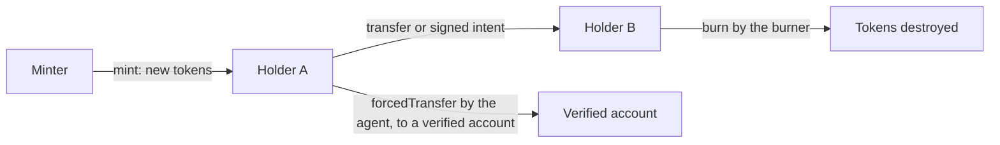
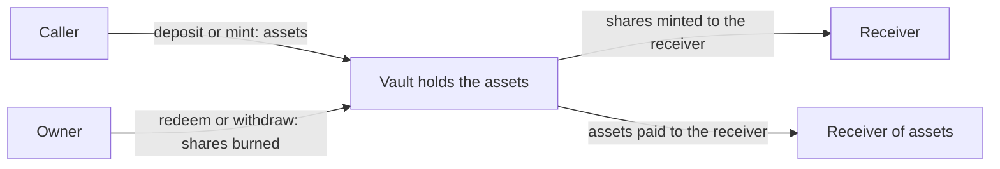
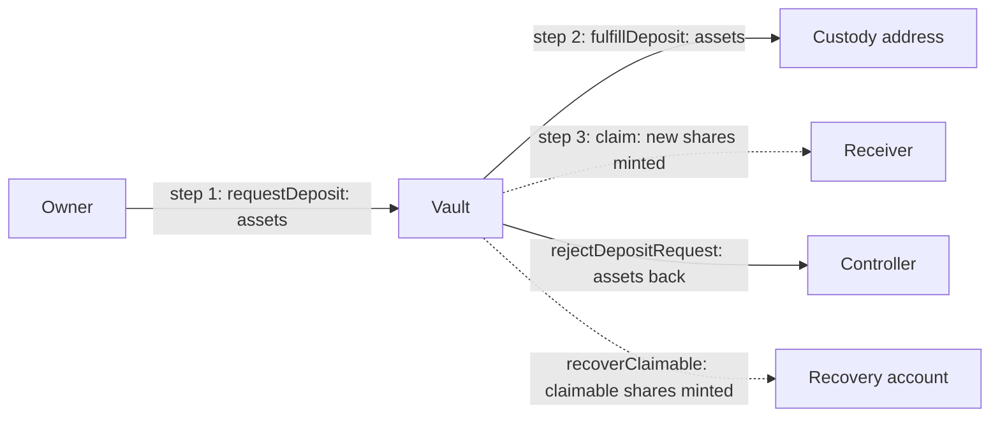
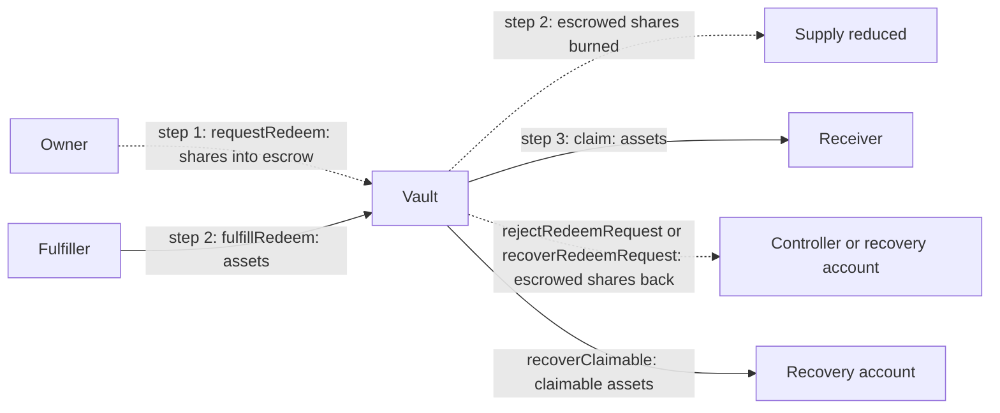

# Where the money goes

Two kinds of value move in this repo:

- **Token balances.** Every template is a gated ERC-20, and its balances move through the hook ([transfer-checks.md](transfer-checks.md)).
- **The vault asset.** `Gated4626Vault` and `Gated7540Vault` hold and pay out an ordinary ERC-20 chosen at deployment. The hook never sees these transfers.

What the code does not have: fees of any kind, interest or yield logic, a price oracle, or ETH handling. No contract written for this repo defines a `receive` or payable function, and none charges or pays a fee. `IntentToken` has no asset leg at all. (OpenZeppelin's `upgradeToAndCall` is payable but rejects value, as [SECURITY.md](../SECURITY.md) explains. The token proxy's `fallback` is payable, but the implementation behind it has no `receive`, no payable fallback, and no payable function other than `upgradeToAndCall`, so value sent through the proxy is rejected too. OpenZeppelin's `TimelockController`, and `GovernanceTimelock`, which extends it, can receive ETH.)

## `IntentToken`: the token is the instrument

There is no asset behind the token and no payment inside the token. The token's balances are the record. Settlement of cash, if any, happens outside the chain, and the intent's `ref` ties the on-chain move to that off-chain message. When the cash is itself a token, `DvPExecutor` can settle the shares and the cash in one transaction ([flows-dvp.md](flows-dvp.md)). An intent can state what its signer is to receive (`considerationToken`, `considerationAmount`). The token never moves it or checks that it was paid; it only rejects a stated consideration that names no executor. Only the executor the intent names can enforce the payment, if its code does. `DvPExecutor` is the one that does: it settles the share leg and the cash leg together ([flows-dvp.md](flows-dvp.md)).

| Event | Who calls | Effect on balances | Effect on `totalSupply` |
|---|---|---|---|
| Issue | minter: `mint(to, amount)` | `to` up | up |
| Redeem or destroy | burner: `burn(from, amount)` | `from` down | down |
| Transfer | holder or spender | `from` down, `to` up | none |
| Settle an intent | operator through the executor | `from` down, `to` up | none |
| Settle a trade ([flows-dvp.md](flows-dvp.md)) | operator through the DvP executor | the seller's shares down and the buyer's up, and the buyer's cash down and the seller's up, together or not at all | none |
| Clawback | agent: `forcedTransfer` | `from` down, `to` up | none |



Gas is paid by whoever sends the transaction. For a signed intent that is the operator, not the holder.

## `Gated4626Vault`: assets in, shares out



The vault keeps the assets itself. `totalAssets()` is OpenZeppelin's default: the vault's balance of the asset. The share price comes from OpenZeppelin's formulas with virtual amounts and a decimals offset of 6:

```
shares = assets x (totalSupply + 10^6) / (totalAssets + 1)
assets = shares x (totalAssets + 1) / (totalSupply + 10^6)
```

| Call | Conversion | Rounds |
|---|---|---|
| `deposit(assets)` | assets to shares | down: the receiver gets slightly fewer shares |
| `mint(shares)` | shares to assets | up: the caller pays slightly more |
| `withdraw(assets)` | assets to shares | up: more shares are burned |
| `redeem(shares)` | shares to assets | down: fewer assets are paid |

Share decimals are the asset's decimals plus 6. With a 6-decimal asset, shares have 12.

The vault does not change the price on a schedule. The price moves through the rounding dust of deposits and withdrawals, which stays in the vault, through direct transfers of the asset to the vault, and if the asset itself changes balance. There is no strategy, fee or yield code.

Example, a 6-decimal asset and an empty vault. A deposit of 1,000 assets (`1000e6`) mints `1000e6 x 10^6 / 1 = 1e15` raw shares, which is 1,000 shares at 12 decimals. Redeeming all of them pays `1e15 x (1000e6 + 1) / (1e15 + 10^6) = 1000e6`, so the full 1,000 assets come back.

Who is checked: the receiver of shares on a deposit (`IdentityRule`, `MaxHoldersRule`, `FundHoldersRule`), and the owner of shares on a redemption (`IdentityRule`, `LockupRule`, frozen amount). The party who pays assets in, and the party who receives assets out, are not checked.

Code: OpenZeppelin `ERC4626Upgradeable._convertToShares`, `_convertToAssets`, `totalAssets`; `Gated4626Vault._decimalsOffset`.

## `Gated7540Vault`: the fulfiller sets the price

### Deposit



### Redemption



Solid arrows are the asset. Dotted arrows are shares.

### Where the vault's code sends the asset

| Function | Asset goes to |
|---|---|
| `fulfillDeposit` | the `custody` address |
| `rejectDepositRequest` | the controller of the request |
| `redeem`, `withdraw` | the `receiver` chosen by the controller or its operator |
| `recoverClaimable` | `to`, the recovery account the agent names, which must pass the vault's policy as the receiver of a `FORCED` move (with the deployed rules, `IdentityRule` can refuse an unverified account, and `FundHoldersRule` everything for a token that is not a registered class or whose rule is retired) |

These are the vault's own functions. Two other things can also move the asset: an upgrade to another attested implementation, and powers held by the asset's own issuer.

The asset comes in on `requestDeposit` (from the owner) and on `fulfillRedeem` (from the fulfiller's wallet). `custody` is a plain address, set at initialisation. The main timelock can change it with `setCustody`. The code makes no assumption about what it is.

### The price

The fulfiller names both numbers in each fulfilment. The vault stores `lastPrice = floor(assets x 10^decimals / shares)`, never below 1, and emits it in `Fulfilled`. Nothing on chain compares that price with any reference. The controller's protection is that `FULFILLER_ROLE` is a trusted role.

`convertToShares(a) = floor(a x 10^decimals / lastPrice)` and `convertToAssets(s) = floor(s x lastPrice / 10^decimals)` use the stored price, and `totalAssets()` is `convertToAssets(totalSupply)`. These are only indicative. The amounts actually paid or minted come from each controller's own claimable pair, set by that controller's fulfilments.

Each fulfilment adds its assets and shares to the controller's claimable pair, and each claim subtracts what it used. A claim therefore uses the ratio of everything still claimable, blended across fulfilments.

Share decimals equal the asset's decimals. There is no offset.

### Worked example

A 6-decimal asset, so shares also have 6 decimals. Amounts below are whole units. Alice starts with 1,000 assets and has approved the vault on the asset. The fulfiller starts with 500 assets and has also approved the vault. Alice is verified. The identity provider has verified the vault, and `Activate` has exempted the vault from `MaxHoldersRule` and set a holder cap with room for Alice. The fund's investor cap has room for her too.

| Step | Alice assets | Vault assets | Custody assets | Fulfiller assets | Alice shares | Vault shares | Share supply |
|---|---|---|---|---|---|---|---|
| start | 1,000 | 0 | 0 | 500 | 0 | 0 | 0 |
| 1. `requestDeposit(1000, alice, alice)` | 0 | 1,000 | 0 | 500 | 0 | 0 | 0 |
| 2. `fulfillDeposit(alice, 1000, 800)` | 0 | 0 | 1,000 | 500 | 0 | 0 | 0 |
| 3. `deposit(1000, alice, alice)` | 0 | 0 | 1,000 | 500 | 800 | 0 | 800 |
| 4. `requestRedeem(400, alice, alice)` | 0 | 0 | 1,000 | 500 | 400 | 400 | 800 |
| 5. `fulfillRedeem(alice, 400, 500)` | 0 | 500 | 1,000 | 0 | 400 | 0 | 400 |
| 6. `redeem(400, alice, alice)` | 500 | 0 | 1,000 | 0 | 400 | 0 | 400 |

In step 2 the stored price is `1000 x 10^6 / 800 = 1,250,000`, which is 1.25 assets per share. Step 5 fulfils at the same price. After step 6, Alice has 500 assets and 400 shares, and custody holds 1,000 assets.

### Rounding in partial claims

Each partial claim rounds against the caller. The difference stays in the controller's claimable pair, and a claim of everything is exact, so the controller ends up with exactly the fulfilled totals and the vault keeps nothing. In raw units (the smallest unit of each token):

- A deposit has `claimableAssets = 1000` and `claimableShares = 800`. `deposit(333)` mints `floor(333 x 800 / 1000) = 266` shares. The claimable amounts become 667 assets and 534 shares. `mint(267)` then uses `ceil(267 x 667 / 534) = 334` assets.
- A redemption has `claimableShares = 7` and `claimableAssets = 10`. From that pair, `redeem(3)` pays `floor(3 x 10 / 7) = 4` assets. From the same pair, `withdraw(4)` uses `ceil(4 x 7 / 10) = 3` shares.

A zero input reverts with `Gated7540Vault_ZeroAmount` on all four claims. Of the computed amounts, only two are checked:
- `deposit` reverts with `Gated7540Vault_ZeroAmount` if it would mint 0 shares;
- `redeem` reverts with `Gated7540Vault_ZeroAmount` if it would pay 0 assets.

`mint` and `withdraw` round up, so they compute 0 only after the other side of the pair is used up. For example, a rounded-up partial `mint` can consume all the claimable assets and leave shares. A later `mint` then delivers those shares for 0 assets, and a later `withdraw` in the mirror case pays the remaining assets for 0 shares. Neither reverts, and the totals stay exact.

Code: `Gated7540Vault._recordPrice`, `_convertToShares`, `_convertToAssets`, `_claimDeposit`, `_claimMint`, `redeem`, `withdraw`, `fulfillDeposit`, `fulfillRedeem`, `rejectDepositRequest`, `recoverClaimable`, `setCustody`.
