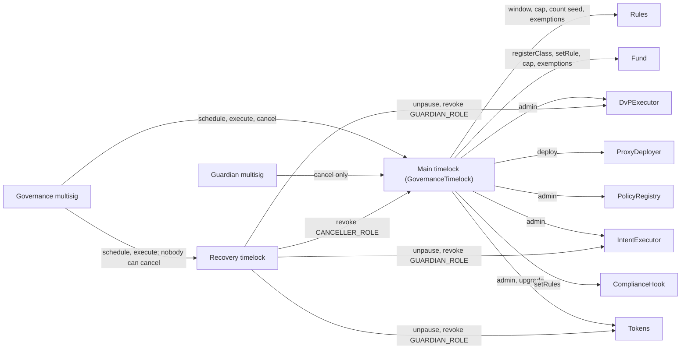
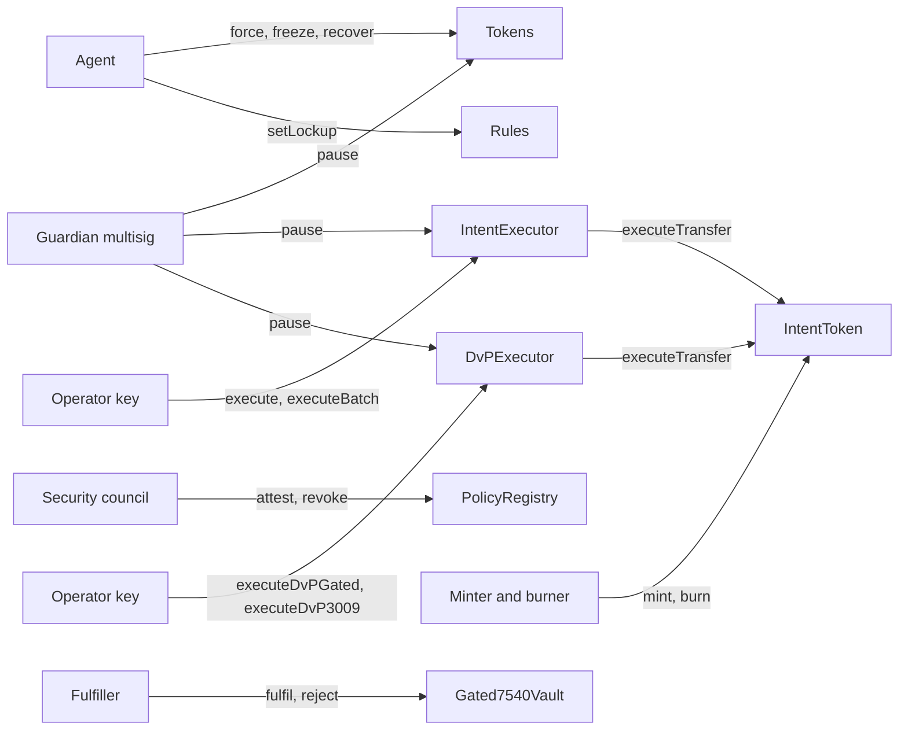

# Roles

Who can call what, and who holds each role once `Activate` has run. The role holders below are the ones the Ignition modules set up. Contracts do not forbid other holders: the main timelock can grant any `AccessControl` role on the tokens, the two executors, the registry and itself to anyone, after its delay. A hook's `ADMIN` is immutable and cannot be granted.

There are two timelocks. The **main timelock** is `GovernanceTimelock`, OpenZeppelin's `TimelockController` with one added power for the recovery timelock, and it holds the admin powers. The **recovery timelock** is a plain `TimelockController`. As deployed, nobody can cancel its operations. Like every timelock it administers itself; outside itself it holds one narrow role, `RECOVERY_ROLE`, which can only unpause, revoke `GUARDIAN_ROLE`, and revoke `CANCELLER_ROLE` on the main timelock (see [What the guardian can do](#what-the-guardian-can-do)).

In OpenZeppelin `AccessControl`, `DEFAULT_ADMIN_ROLE` administers every other role unless a contract changes that. None of these contracts does. So whoever holds `DEFAULT_ADMIN_ROLE` on a contract can grant and revoke every role on it.

The word "operator" means three different things in this repo:

| Where | Meaning |
|---|---|
| `OPERATOR_ROLE` on `IntentExecutor` and on `DvPExecutor` | the bank's or relayer's key that submits signed intents, or signed trades |
| `ctx.operator` in `TransferContext` | whoever called into the token for this movement: the holder, a spender, the agent, the minter, the executor |
| `setOperator` on `Gated7540Vault` | an account a controller has approved to act for it: a full delegate, which can also open requests with that account's assets or shares (owner decision L-5) |

## Who holds what after `Activate`

| Holder | Where | Role | Set by |
|---|---|---|---|
| Main timelock | each token | `DEFAULT_ADMIN_ROLE`, `UPGRADER_ROLE` | `Activate` grants admin, then the deployer renounces. `UPGRADER_ROLE` goes to the main timelock only |
| Main timelock | `PolicyRegistry` | `DEFAULT_ADMIN_ROLE` | constructor |
| Main timelock | `IntentExecutor`, `DvPExecutor` | `DEFAULT_ADMIN_ROLE` | `Activate` |
| Main timelock | itself | `DEFAULT_ADMIN_ROLE` | OpenZeppelin's constructor makes every timelock its own admin |
| Main timelock | each `ComplianceHook` | `ADMIN` (immutable) | constructor |
| Main timelock | `ProxyDeployer` | owner | `Activate` calls `transferOwnership` |
| Main timelock | `Fund` | owner | `Activate` calls `transferOwnership`, after it has registered the three tokens |
| Recovery timelock | each token, `IntentExecutor`, `DvPExecutor` | `RECOVERY_ROLE` | `Activate` |
| Recovery timelock | main timelock | `RECOVERY_ROLE` | `GovernanceTimelock` constructor |
| Recovery timelock | itself | `DEFAULT_ADMIN_ROLE` | OpenZeppelin's constructor |
| Governance multisig | main timelock | `PROPOSER_ROLE`, `EXECUTOR_ROLE`, `CANCELLER_ROLE` | `Components` passes it as proposer and executor. OpenZeppelin's constructor gives the initial proposers `CANCELLER_ROLE` too |
| Governance multisig | recovery timelock | `PROPOSER_ROLE`, `EXECUTOR_ROLE` | `Components` passes it as proposer and executor. `Activate` revokes the `CANCELLER_ROLE` OpenZeppelin gave it, so nobody can cancel there |
| Guardian multisig | each token | `GUARDIAN_ROLE` | token initialiser |
| Guardian multisig | `IntentExecutor`, `DvPExecutor` | `GUARDIAN_ROLE` | constructor |
| Guardian multisig | main timelock | `CANCELLER_ROLE` | `Activate`. The guardian holds nothing on the recovery timelock |
| Security council | `PolicyRegistry` | `ATTESTER_ROLE` | constructor |
| Agent (issuer's compliance ops) | each token | `AGENT_ROLE` | `Activate` |
| Minter, burner (issuer) | `IntentToken` | `MINTER_ROLE`, `BURNER_ROLE` | `Activate` |
| `IntentExecutor` and `DvPExecutor` contracts | `IntentToken` | `EXECUTOR_ROLE` | `Activate` |
| Relayer / bank key | `IntentExecutor`, `DvPExecutor` | `OPERATOR_ROLE` | `Activate` |
| Bank (fulfiller) | `Gated7540Vault` | `FULFILLER_ROLE` | `Activate` |

Until `Activate` finishes, the deployer account holds `DEFAULT_ADMIN_ROLE` on each token, on both executors and on both timelocks, and owns `ProxyDeployer` and `Fund`. To hand over, `Activate` does four things:
1. grants the main timelock `DEFAULT_ADMIN_ROLE` on the tokens and both executors;
2. moves `ProxyDeployer` and `Fund` ownership to the main timelock;
3. revokes governance's `CANCELLER_ROLE` on the recovery timelock;
4. has the deployer renounce `DEFAULT_ADMIN_ROLE` on the tokens, both executors and both timelocks.

Each timelock already administers itself.

Code: `ignition/modules/Activate.ts`, `ignition/modules/Components.ts`, `ignition/modules/roles.ts`.

## Authority map

Through a timelock. Every edge that leaves a timelock waits for that timelock's delay:

Takes effect at once, with no delay:

Holders act on the tokens directly and are not drawn.

## Token functions and who may call them

All three tokens share the base. Rows marked 7540 exist only on `Gated7540Vault`.

| Function | Caller | Notes |
|---|---|---|
| `mint(to, amount)` | `MINTER_ROLE` | Reverts on both vaults whatever the role |
| `burn(from, amount)` | `BURNER_ROLE` | Releases the frozen amount it needs first. Reverts on both vaults |
| `forcedTransfer(from, to, amount)` | `AGENT_ROLE` | Works while paused and on frozen tokens. The hook still runs, with kind `FORCED` |
| `setFrozen(user, amount)` | `AGENT_ROLE` | Absolute amount, at most the balance |
| `pause()` | `GUARDIAN_ROLE` | No delay |
| `unpause()` | `DEFAULT_ADMIN_ROLE` or `RECOVERY_ROLE` | The main or the recovery timelock. Anyone else gets `AccessControlUnauthorizedAccount(caller, DEFAULT_ADMIN_ROLE)` |
| `setPolicyHook(newHook)` | `DEFAULT_ADMIN_ROLE` | New hook must be attested as `HOOK` |
| `upgradeToAndCall(impl, data)` | `UPGRADER_ROLE` | New implementation must be attested as `IMPLEMENTATION` |
| `grantRole`, `revokeRole` | the role's admin, `DEFAULT_ADMIN_ROLE` | `RECOVERY_ROLE` may also revoke `GUARDIAN_ROLE`, and no other role. Any account may call `renounceRole` for itself |
| `transfer`, `transferFrom`, `approve`, `permit` | anyone | Movements go through the hook |
| `executeTransfer(intent, sig)` | `EXECUTOR_ROLE`, and the intent's `executor` if it names one | `IntentToken` only. The callers are `IntentExecutor` and `DvPExecutor` |
| `cancelIntent(nonce)` | anyone, for its own nonces | `IntentToken` only |
| `deposit`, `mint` | anyone | `Gated4626Vault` only |
| `withdraw`, `redeem` | the owner, or a spender with share allowance | `Gated4626Vault` only |
| `requestDeposit(assets, controller, owner)` | `owner`, or an operator of `owner` | 7540 |
| `requestRedeem(shares, controller, owner)` | `owner`, an operator of `owner`, or a spender with allowance | 7540 |
| `deposit`, `mint`, `redeem`, `withdraw` with a controller | the controller or an operator of it | 7540 claims. The two-argument `deposit(assets, receiver)` and `mint(shares, receiver)` claim with the caller as the controller |
| `setOperator(operator, approved)` | anyone, for itself | 7540 |
| `fulfillDeposit`, `fulfillRedeem`, `rejectDepositRequest`, `rejectRedeemRequest` | `FULFILLER_ROLE` | 7540 |
| `recoverRedeemRequest(controller, to)` | `AGENT_ROLE` | 7540. Pending redemptions |
| `recoverClaimable(controller, to)` | `AGENT_ROLE` | 7540. Claimable amounts, delivered to a verified `to`. Works while paused |
| `setCustody(newCustody)` | `DEFAULT_ADMIN_ROLE` | 7540 |

Code: `PolicyGatedERC20Upgradeable`, `IntentSettledUpgradeable`, `Gated4626Vault`, `Gated7540Vault`.

## Other contracts

| Contract | Function | Caller |
|---|---|---|
| `ComplianceHook` | `setRules(rules)` | `ADMIN` |
| `ComplianceHook` | `afterTransfer(ctx)` | `TOKEN` only |
| `PolicyRegistry` | `attest(codehash, kind, uri)`, `revoke(codehash)` | `ATTESTER_ROLE` |
| `PolicyRegistry` | `grantRole`, `revokeRole` | `DEFAULT_ADMIN_ROLE` |
| `IntentExecutor` | `execute`, `executeBatch` | `OPERATOR_ROLE`, and only while not paused. An intent that states a consideration is refused |
| `IntentExecutor` | `pause()` | `GUARDIAN_ROLE` |
| `IntentExecutor` | `unpause()` | `DEFAULT_ADMIN_ROLE` or `RECOVERY_ROLE` |
| `IntentExecutor` | `grantRole`, `revokeRole` | `DEFAULT_ADMIN_ROLE`. `RECOVERY_ROLE` may also revoke `GUARDIAN_ROLE` |
| `DvPExecutor` | `executeDvPGated`, `executeDvP3009` | `OPERATOR_ROLE`, and only while not paused |
| `DvPExecutor` | `pause()` | `GUARDIAN_ROLE` |
| `DvPExecutor` | `unpause()` | `DEFAULT_ADMIN_ROLE` or `RECOVERY_ROLE` |
| `DvPExecutor` | `grantRole`, `revokeRole` | `DEFAULT_ADMIN_ROLE`. `RECOVERY_ROLE` may also revoke `GUARDIAN_ROLE` |
| Main timelock | `schedule`, `scheduleBatch` | `PROPOSER_ROLE` |
| Main timelock | `execute`, `executeBatch` | `EXECUTOR_ROLE` |
| Main timelock | `cancel(id)` | `CANCELLER_ROLE` |
| Main timelock | `updateDelay`, `grantRole`, `revokeRole` | the timelock itself, through its own operations. `RECOVERY_ROLE` may also revoke `CANCELLER_ROLE`, and nothing else |
| Recovery timelock | `schedule`, `execute` and their batch forms | `PROPOSER_ROLE`, `EXECUTOR_ROLE`: governance |
| Recovery timelock | `cancel(id)` | `CANCELLER_ROLE`, which nobody holds after `Activate` |
| Recovery timelock | `updateDelay`, `grantRole`, `revokeRole` | the recovery timelock itself |
| `Fund` | `registerClass(token)`, `setRule(rule)`, `setHolderCap(cap)`, `setExempt(account, exempt)` | owner (OpenZeppelin `Ownable`) |
| `Fund` | `join(token, account)`, `leave(token, account)` | the installed rule only, and only for a registered class |
| `Fund` | `transferOwnership`, `renounceOwnership` | owner. Renouncing would freeze the class list, the rule, the cap and the exemptions for good |
| `ProxyDeployer` | `deploy(...)` | owner |
| `ProxyDeployer` | `transferOwnership`, `renounceOwnership` | owner (OpenZeppelin `Ownable`). Renouncing would disable `deploy` for good |

Rules have no roles of their own. `FundHoldersRule` has nothing to configure: its cap and exemptions live in the fund, and only the fund's owner sets them. Each of the other rules asks the token, at call time, who may configure it for that token:

| Rule function | Allowed if the caller holds, on the token |
|---|---|
| `SettlementWindowRule.setWindow` | `DEFAULT_ADMIN_ROLE` |
| `MaxHoldersRule.setCap`, `seedHolderCount`, `seedHolderCountFromHolders`, `seedHolderCountFromRule`, `setExemptHolder` | `DEFAULT_ADMIN_ROLE` |
| `LockupRule.setLockup` | `AGENT_ROLE` |

After `Activate`, `DEFAULT_ADMIN_ROLE` on a token is the main timelock. So `setWindow`, `setCap`, the seeds and `setExemptHolder` take effect only after the timelock delay. A count passed to `seedHolderCount` is therefore at least the delay old when it lands. `seedHolderCountFromHolders` and `seedHolderCountFromRule` read the count when the batch executes ([governance-and-deployment.md](governance-and-deployment.md#the-holder-count-across-rule-and-hook-changes)). The holder count itself still moves with every movement that adds or removes a holder. Lockups are set by the agent with no delay.

`afterTransfer` on the hook is open only to `TOKEN`. `after_` on a rule is open only to the hook currently installed on `ctx.token`, which the rule checks by calling `ctx.token.policyHook()`. Neither `ctx.token` nor the `token` argument of the setters is authenticated. Any contract can call these for a token address it controls, but that changes only that address's entries, never a real token's. `FundHoldersRule.after_` can be reached the same way, and there the entries are shared by every class, so the fund refuses any token that is not a registered class (`Fund_NotAClass`), and only the owner registers one.

Code: `ComplianceHook`, `PolicyRegistry`, `IntentExecutor`, `DvPExecutor`, `ProxyDeployer`, `Fund`, `BaseRule.onlyHook`, `SettlementWindowRule.setWindow`, `MaxHoldersRule.onlyTokenAdmin`, `LockupRule.setLockup`, `FundHoldersRule.after_`.

## What the guardian can do

The guardian multisig holds three separate powers, on three kinds of contract: each token, the two executors and the main timelock.

1. `pause()` on each token. It stops every token or share movement except `FORCED` ones. No delay. On `Gated7540Vault`, `fulfillDeposit` and `rejectDepositRequest` still move the asset while paused, because they move no shares.
2. `pause()` on `IntentExecutor` and on `DvPExecutor`. It stops `execute` and `executeBatch`, or `executeDvPGated` and `executeDvP3009`. No delay.
3. `cancel(id)` on the main timelock, through `CANCELLER_ROLE`. It cancels any operation there that has not been executed yet, including one whose delay has passed.

It cannot schedule or execute timelock operations, unpause, change the hook, grant roles, or upgrade. It holds nothing on the recovery timelock.

The main timelock's `cancel` does not look at what an operation does. The guardian can therefore cancel a scheduled `unpause` there, or a scheduled revocation of its own roles. The recovery timelock is the way around that. Governance schedules any of these on the recovery timelock:
- `unpause()` on a token or on an executor;
- `revokeRole(GUARDIAN_ROLE, guardian)` on each token and on each executor;
- `revokeRole(CANCELLER_ROLE, guardian)` on the main timelock.

After `Activate` nobody holds `CANCELLER_ROLE` on the recovery timelock, so these run after its delay whatever the guardian does. A guardian that vetoes or keeps re-pausing can be removed everywhere this way.

`RECOVERY_ROLE` allows nothing else. It cannot grant any role, revoke any other role, propose, execute, cancel, upgrade or change the hook.

Code: `PolicyGatedERC20Upgradeable.pause`, `unpause`, `revokeRole`; `IntentExecutor` and `DvPExecutor` `pause`, `unpause`, `revokeRole`; `GovernanceTimelock.revokeRole`; `ignition/modules/Activate.ts` (the `timelock_canceller` grant and the `recovery_no_cancellers` call).

## The delay

A timelock operation waits at least that timelock's `getMinDelay()`, counted from when it is scheduled. The proposer can choose a longer delay, and a later `updateDelay` does not change operations already scheduled. `Components.ts` gives both timelocks the same `minDelay` parameter, default 7 days. The module does not refuse a smaller value. The test fixture's post-deploy check does: it asserts `getMinDelay() >= 7 days` on both. Changing a delay later is itself an operation of that timelock (`updateDelay` can only be called by the timelock itself).

Actions with no delay: a guardian pause, a `cancel` on the main timelock (by the guardian or governance), council attestation and revocation, and everything the agent, minter, burner, executor operators and fulfiller do.

Code: `ignition/modules/Components.ts`, `test/nodejs/fixtures.ts` (`assertHandedOver`).

## What the code does not allow

- Change a token's registry. `registry()` is set in the initialiser and has no setter. Only an upgrade to an attested implementation, through the main timelock, could change that.
- Mint or burn vault shares through `mint(to, amount)` or `burn(from, amount)`. They are role-gated on `IntentToken`; on the vaults they have no role check and revert for every caller. Shares are minted by ERC-4626 `deposit` and `mint(shares, receiver)`, by 7540 deposit claims and by `recoverClaimable`. They are burned by 4626 redemptions and 7540 redemption fulfilments.
- Make `transfer` return `false`. A movement that the base's pause and frozen checks or the hook reject reverts with `PolicyGated_TransferRejected(reason)`. OpenZeppelin's own checks (zero address, allowance, the reentrancy guard) revert with their own errors. A zero-amount transfer, or one to yourself, that the rules allow returns `true` and moves nothing.
- Let an executor change an intent. Each passes the holder's signed fields to the token, which checks the signature. `DvPExecutor` builds nothing: it checks that the two signed legs mirror each other and runs them.
- Let an executor run an intent that names another executor. The token compares the intent's `executor` with its caller and rejects with `WRONG_EXECUTOR`, even when the caller holds `EXECUTOR_ROLE`.
- Let a rule configure itself for a token. Each rule that has per-token settings reads the permission from the token. `FundHoldersRule` has none: the fund's owner sets the cap and the exemptions.
