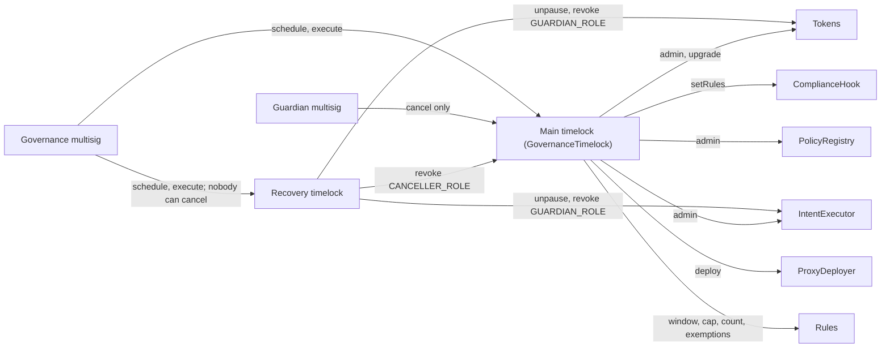
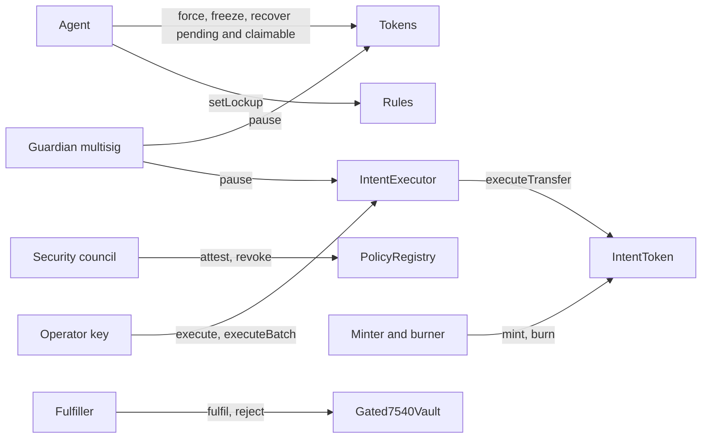

# Roles

Who can call what, and who holds each role once `Activate` has run. The role holders below are the ones the Ignition modules set up. Contracts do not forbid other holders: the timelock can grant any role to anyone, after its delay.

In OpenZeppelin `AccessControl`, `DEFAULT_ADMIN_ROLE` administers every other role unless a contract changes that. None of these contracts does. So whoever holds `DEFAULT_ADMIN_ROLE` on a contract can grant and revoke every role on it. The one addition is `RECOVERY_ROLE` (v0.2.0): it is not an admin of anything, but the tokens, the executor and the main timelock let its holder through for one or two specific revocations and `unpause` (see [what the guardian can do](#what-the-guardian-can-do)).

The word "operator" means three different things in this repo:

| Where | Meaning |
|---|---|
| `OPERATOR_ROLE` on `IntentExecutor` | the bank's or relayer's key that submits signed intents |
| `ctx.operator` in `TransferContext` | whoever called into the token for this movement: the holder, a spender, the agent, the minter, the executor |
| `setOperator` on `Gated7540Vault` | an account a controller has approved to act for it: a full delegate per ERC-7540, which can also open requests with the owner's assets or shares |

## Who holds what after `Activate`

| Holder | Where | Role | Set by |
|---|---|---|---|
| Timelock | each token | `DEFAULT_ADMIN_ROLE`, `UPGRADER_ROLE` | `Activate` grants admin, then the deployer renounces. `UPGRADER_ROLE` goes to the timelock only |
| Timelock | `PolicyRegistry` | `DEFAULT_ADMIN_ROLE` | constructor |
| Timelock | `IntentExecutor` | `DEFAULT_ADMIN_ROLE` | `Activate` |
| Timelock | each `ComplianceHook` | `ADMIN` (immutable) | constructor |
| Timelock | `ProxyDeployer` | owner | `Activate` calls `transferOwnership` |
| Governance multisig | main timelock | `PROPOSER_ROLE`, `EXECUTOR_ROLE`, `CANCELLER_ROLE` | `Components` passes it as proposer and executor. OpenZeppelin gives proposers `CANCELLER_ROLE` too |
| Governance multisig | recovery timelock | `PROPOSER_ROLE`, `EXECUTOR_ROLE` | `Components`; `Activate` revokes the `CANCELLER_ROLE` OpenZeppelin added, so nobody can cancel there |
| Recovery timelock | each token, `IntentExecutor` | `RECOVERY_ROLE` | `Activate` |
| Recovery timelock | main timelock | `RECOVERY_ROLE` | `GovernanceTimelock` constructor |
| Guardian multisig | each token | `GUARDIAN_ROLE` | token initialiser |
| Guardian multisig | `IntentExecutor` | `GUARDIAN_ROLE` | constructor |
| Guardian multisig | timelock | `CANCELLER_ROLE` | `Activate` |
| Security council | `PolicyRegistry` | `ATTESTER_ROLE` | constructor |
| Agent (issuer's compliance ops) | each token | `AGENT_ROLE` | `Activate` |
| Minter, burner (issuer) | `IntentToken` | `MINTER_ROLE`, `BURNER_ROLE` | `Activate` |
| `IntentExecutor` contract | `IntentToken` | `EXECUTOR_ROLE` | `Activate` |
| Relayer / bank key | `IntentExecutor` | `OPERATOR_ROLE` | `Activate` |
| Bank (fulfiller) | `Gated7540Vault` | `FULFILLER_ROLE` | `Activate` |

Until `Activate` finishes, the deployer account holds `DEFAULT_ADMIN_ROLE` on each token and on the executor, is the admin of both timelocks, and is the `ProxyDeployer` owner. `Activate` hands all of these to the main timelock (or, on the recovery timelock, simply renounces) and the deployer ends with no role anywhere.

Code: `ignition/modules/Activate.ts`, `ignition/modules/Components.ts`, `ignition/modules/roles.ts`.

## Authority map

Through the timelock. Every edge that leaves the timelock waits for the timelock delay:

Takes effect at once, with no delay:

Holders act on the tokens directly and are not drawn.

## Token functions and who may call them

All three tokens share the base. Rows marked 7540 exist only on `Gated7540Vault`.

| Function | Caller | Notes |
|---|---|---|
| `mint(to, amount)` | `MINTER_ROLE` | Reverts on both vaults whatever the role |
| `burn(from, amount)` | `BURNER_ROLE` | Releases the frozen amount it needs first. Reverts on both vaults |
| `forcedTransfer(from, to, amount)` | `AGENT_ROLE` | Works while paused and on frozen tokens. The hook still runs, with kind `FORCED` |
| `setFrozen(user, amount)` | `AGENT_ROLE` | Absolute amount, at most the balance |
| `pause()` | `GUARDIAN_ROLE` | No delay |
| `unpause()` | `DEFAULT_ADMIN_ROLE` or `RECOVERY_ROLE` | The main timelock, or the recovery timelock |
| `setPolicyHook(newHook)` | `DEFAULT_ADMIN_ROLE` | New hook must be attested as `HOOK` |
| `upgradeToAndCall(impl, data)` | `UPGRADER_ROLE` | New implementation must be attested as `IMPLEMENTATION` |
| `grantRole`, `revokeRole` | the role's admin, `DEFAULT_ADMIN_ROLE` | Exception: `RECOVERY_ROLE` may revoke `GUARDIAN_ROLE`. Any account may call `renounceRole` for itself |
| `transfer`, `transferFrom`, `approve`, `permit` | anyone | Movements go through the hook |
| `executeTransfer(intent, sig)` | `EXECUTOR_ROLE` | `IntentToken` only |
| `cancelIntent(nonce)` | anyone, for its own nonces | `IntentToken` only |
| `deposit`, `mint` | anyone | `Gated4626Vault` only |
| `withdraw`, `redeem` | the owner, or a spender with share allowance | `Gated4626Vault` only |
| `requestDeposit(assets, controller, owner)` | `owner`, or an operator of `owner` | 7540 |
| `requestRedeem(shares, controller, owner)` | `owner`, an operator of `owner`, or a spender with allowance | 7540 |
| `deposit`, `mint`, `redeem`, `withdraw` with a controller | the controller or an operator of it | 7540 claims |
| `setOperator(operator, approved)` | anyone, for itself | 7540 |
| `fulfillDeposit`, `fulfillRedeem`, `rejectDepositRequest`, `rejectRedeemRequest` | `FULFILLER_ROLE` | 7540 |
| `recoverRedeemRequest(controller, to)` | `AGENT_ROLE` | 7540, pending redemptions |
| `recoverClaimable(controller, to)` | `AGENT_ROLE` | 7540, claimable assets and shares; works while paused and at a full cap |
| `setCustody(newCustody)` | `DEFAULT_ADMIN_ROLE` | 7540 |

Code: `PolicyGatedERC20Upgradeable`, `IntentSettledUpgradeable`, `Gated4626Vault`, `Gated7540Vault`.

## Other contracts

| Contract | Function | Caller |
|---|---|---|
| `ComplianceHook` | `setRules(rules)` | `ADMIN` |
| `ComplianceHook` | `afterTransfer(ctx)` | `TOKEN` only |
| `PolicyRegistry` | `attest(codehash, kind, uri)`, `revoke(codehash)` | `ATTESTER_ROLE` |
| `PolicyRegistry` | `grantRole`, `revokeRole` | `DEFAULT_ADMIN_ROLE` |
| `IntentExecutor` | `execute`, `executeBatch` | `OPERATOR_ROLE`, and only while not paused |
| `IntentExecutor` | `pause()` | `GUARDIAN_ROLE` |
| `IntentExecutor` | `unpause()` | `DEFAULT_ADMIN_ROLE` or `RECOVERY_ROLE` |
| `IntentExecutor` | `grantRole`, `revokeRole` | `DEFAULT_ADMIN_ROLE`; `RECOVERY_ROLE` may revoke `GUARDIAN_ROLE` |
| `GovernanceTimelock` | `revokeRole(CANCELLER_ROLE, …)` | `DEFAULT_ADMIN_ROLE` (itself) or `RECOVERY_ROLE` |
| `ProxyDeployer` | `deploy(...)` | owner |

Rules have no roles of their own. Each rule asks the token, at call time, who may configure it for that token:

| Rule function | Allowed if the caller holds, on the token |
|---|---|
| `SettlementWindowRule.setWindow` | `DEFAULT_ADMIN_ROLE` |
| `MaxHoldersRule.setCap`, `seedHolderCount`, `setExemptHolder` | `DEFAULT_ADMIN_ROLE` |
| `LockupRule.setLockup` | `AGENT_ROLE` |

After `Activate`, `DEFAULT_ADMIN_ROLE` on a token is the timelock, so the window, the cap, the count and the exemptions change only after the timelock delay. Lockups are set by the agent with no delay.

`afterTransfer` on the hook is open only to `TOKEN`. `after_` on a rule is open only to the hook currently installed on `ctx.token`, which the rule checks by calling `ctx.token.policyHook()`.

Code: `ComplianceHook`, `PolicyRegistry`, `IntentExecutor`, `ProxyDeployer`, `BaseRule.onlyHook`, `SettlementWindowRule.setWindow`, `MaxHoldersRule.onlyTokenAdmin`, `LockupRule.setLockup`.

## What the guardian can do

The guardian multisig holds three separate powers, on three contracts:

1. `pause()` on each token. It stops every movement except `FORCED` ones. No delay.
2. `pause()` on `IntentExecutor`. It stops `execute` and `executeBatch`. No delay.
3. `cancel(id)` on the timelock, through `CANCELLER_ROLE`. It cancels any scheduled operation that has not run yet.

It cannot schedule or execute timelock operations, unpause, change the hook, grant roles, or upgrade.

The main timelock's `cancel` does not look at what an operation does, so the guardian can cancel a scheduled `unpause`, or a scheduled revocation of its own roles. Since v0.2.0 that veto has a limit (owner decision M-1): the recovery timelock, on which nobody can cancel and the guardian holds nothing, can after its delay unpause every token and the executor, revoke `GUARDIAN_ROLE` on each of them, and revoke the guardian's `CANCELLER_ROLE` on the main timelock. It can do nothing else. [governance-and-deployment.md](governance-and-deployment.md#the-recovery-timelock) shows the sequence.

Code: `PolicyGatedERC20Upgradeable.pause`, `unpause`, `revokeRole`; `IntentExecutor.pause`, `unpause`, `revokeRole`; `GovernanceTimelock.revokeRole`; `ignition/modules/Activate.ts` (`timelock_canceller`, `*_recovery`).

## The delay

Everything the timelock does waits for `getMinDelay()` after it is scheduled. `Components.ts` takes the delay as the parameter `minDelay`, default 7 days. The module does not refuse a smaller value. The test fixture's post-deploy check does: it asserts `getMinDelay() >= 7 days`. Changing the delay later is itself a timelock operation (`updateDelay` can only be called by the timelock).

The recovery timelock has the same minimum delay, also checked by the post-deploy check.

Actions with no delay: guardian pause, council attestation and revocation, and everything the agent, minter, burner, executor operator and fulfiller do.

Code: `ignition/modules/Components.ts`, `test/nodejs/fixtures.ts` (`assertHandedOver`).

## What the code does not allow

- Change a token's registry. `registry()` is set in the initialiser and has no setter. Only an upgrade to an attested implementation, through the timelock, could change that.
- Mint or burn vault shares through `mint` or `burn`.
- Make `transfer` return `true` without moving a balance. A rejected movement reverts.
- Let the executor change an intent. It passes the holder's signed fields to the token, which checks the signature.
- Let a rule configure itself for a token. Each rule reads the permission from the token.
