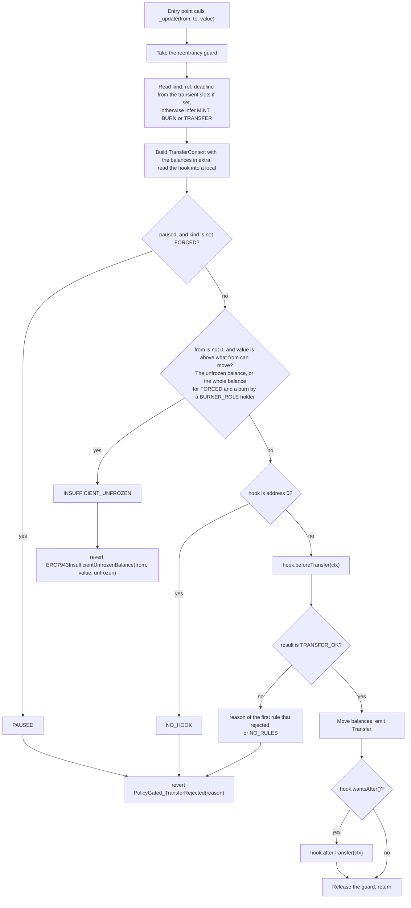

# How a movement is decided

Every change to a token balance goes through `_update` in `PolicyGatedERC20Upgradeable`: transfers, mints, burns, forced transfers, executed intents, vault deposits and redemptions. This page follows one movement from the entry point to the balance change, and lists what each check looks at.

## The context

The token builds a `TransferContext` for every movement. Callers cannot supply one.

| Field | Value |
|---|---|
| `token` | the token's own address |
| `from` | the sender. `address(0)` on a mint |
| `to` | the receiver. `address(0)` on a burn |
| `id` | always 0 |
| `amount` | the amount of tokens moved |
| `operator` | `_msgSender()` inside `_update`: the account that called into the token |
| `kind` | one of `TRANSFER`, `EXECUTED`, `FORCED`, `MINT`, `BURN` |
| `extra` | the balances of `from` and `to` before the move, `abi.encode(fromBalance, toBalance)`, each 0 for the zero address. For `EXECUTED` the intent's `ref` and `deadline` follow: `abi.encode(fromBalance, toBalance, ref, deadline)` |

The operator is whoever called the token, so it changes with the entry point. For `transferFrom` it is the spender. For `executeTransfer` it is the executor. For a `Gated4626Vault` `redeem` or `withdraw`, or a `Gated7540Vault` `requestRedeem`, made by a spender with allowance, it is the spender.

Every kind carries the two balances. A rule reads them with `abi.decode(extra, (uint256, uint256))`, which ignores the `EXECUTED` tail, and works out the balances after the move from `amount`, so it needs no call back into the token for them. The write path and the pre-flights that take a movement (`canTransfer`, `canTransferWithReason`, `canExecute`) build the context with the same function, so a rule sees the same data in both.

Code: `PolicyGatedERC20Upgradeable._context`.

## Where the kind comes from

`_update` takes the kind from the transient slots if a function announced one. Otherwise it infers the kind from the addresses: `from == 0` is `MINT`, `to == 0` is `BURN`, anything else is `TRANSFER`. An announced kind wins over the addresses, so the enforcement mint in `recoverClaimable` (`from == 0`) reaches the hook as `FORCED`, not `MINT`.

| Entry point | Kind | Announced or inferred |
|---|---|---|
| `transfer`, `transferFrom` | `TRANSFER` | inferred |
| `Gated7540Vault.requestRedeem` (owner to vault) | `TRANSFER` | inferred |
| `Gated7540Vault.rejectRedeemRequest` (vault to controller) | `TRANSFER` | inferred |
| `executeTransfer` | `EXECUTED` | announced by `_moveAs` |
| `forcedTransfer` | `FORCED` | announced by `_moveAs` |
| `Gated7540Vault.recoverRedeemRequest` (vault to recovery account) | `FORCED` | announced by `_moveAs` |
| `Gated7540Vault.recoverClaimable` (claimable deposit shares minted to the recovery account) | `FORCED`, with `from == 0` | announced by `_mintAs` |
| `IntentToken.mint`, `Gated4626Vault.deposit`/`mint`, `Gated7540Vault` deposit claims | `MINT` | inferred |
| `IntentToken.burn`, `Gated4626Vault.withdraw`/`redeem`, `Gated7540Vault.fulfillRedeem` | `BURN` | inferred |

Code: `PolicyGatedERC20Upgradeable._consumePending`, `_moveAs`, `_mintAs`, `_inferKind`.

## The steps inside `_update`

Notes on the steps:

- **Pause.** While paused, every kind except `FORCED` is rejected, mints and burns included. What an incident leaves possible is in [During a pause](roles.md#during-a-pause).
- **Frozen.** The token keeps a frozen amount for each account (`setFrozenTokens`, `getFrozenTokens`), and the amount may be larger than the balance. The check runs for every kind, and only when `from` is not the zero address. What `from` can move is its unfrozen balance, `balanceOf(from) - getFrozenTokens(from)`, or 0 when the frozen amount is the larger. For `FORCED`, and for a `BURN` whose operator holds `BURNER_ROLE`, it is the whole balance: an enforcement action can take frozen tokens, but never more than the balance. The check runs before the hook, so a transfer larger than the balance is rejected here, not with OpenZeppelin's `ERC20InsufficientBalance`. The write reverts with `ERC7943InsufficientUnfrozenBalance(account, amount, unfrozen)`, where `unfrozen` is the unfrozen balance. A pre-flight returns `INSUFFICIENT_UNFROZEN`. Only a real shortfall gets that error. A rule that returns `INSUFFICIENT_UNFROZEN` while the sender has enough still reverts with `PolicyGated_TransferRejected`.
- **`burn` by the burner.** `burn` first calls `_releaseFrozen`. It reverts with `ERC20InsufficientBalance` if `amount` is above the balance. Otherwise it lowers the frozen amount by exactly the part of `amount` that does not fit in the unfrozen balance, and emits `Frozen` with the new amount before the `Transfer`. If the unfrozen balance covers `amount`, it changes nothing. With a balance of 10 and a frozen amount of 100, taking 10 leaves a frozen amount of 90. A holder or vault burn, such as `redeem`, does not call it and is bounded by the unfrozen balance, so frozen tokens cannot be redeemed.
- **`forcedTransfer`.** It calls `_releaseFrozen` first, as `burn` does, then moves the tokens as `FORCED`, emits `ForcedTransfer(from, to, amount)` and `ForcedTransferBy(from, to, amount, agent)`, and returns `true`. If `amount` is above the balance it reverts with `ERC20InsufficientBalance`.
- **The hook is read once.** `afterTransfer` goes to the hook that approved the movement.
- **`afterTransfer` is optional.** `ComplianceHook.wantsAfter()` answers for the token that calls it, and is true only if at least one rule in that token's list wants `after_`.

Code: `PolicyGatedERC20Upgradeable._update`, `_check`, `_availableToMove`, `_releaseFrozen`.

## The hook and the rules

One `ComplianceHook` serves every token of a deployment. Its only immutable is the registry. For each token it keeps an ordered rule list, at most 16 rules, and a mask of the rules that want `after_`.

`beforeTransfer` takes the list of `ctx.token`. It returns `NO_RULES` if the list is empty, and otherwise calls `check` on each rule in order and returns the first reason that is not `TRANSFER_OK`. A token with no rules installed therefore has every movement rejected. `afterTransfer` accepts only a call from the token named in the context (`ComplianceHook_OnlyToken`) and calls `after_` on the rules that asked for it when the list was installed. `checkSend(token, account)` and `checkReceive(token, account)` go through the same list in the same way, calling each rule's own `checkSend` or `checkReceive`, and also return `NO_RULES` for an empty list.

A token's list is installed in two ways. The token's initialiser takes `initialRules`, installs the hook, and, when the list is not empty, calls `hook.setRules(address(this), rules)`, so the token is live with its policy at deployment. A token accepts a hook only if it is attested as `HOOK` and its `REGISTRY()` is the token's own registry (`PolicyGated_HookRegistryMismatch`). Later, `setRules(token, rules)` replaces the whole list. The hook accepts the call from the token itself, or from an account that holds `DEFAULT_ADMIN_ROLE` on that token, which it asks the token at call time. After `Activate` that account is the main timelock. Every rule must be attested as `RULE`, no two may share a `ruleId`, and the list holds at most 16. Each install emits `RuleSetChanged(token, ruleIds)`, and `rules(token)` and `ruleCount(token)` read a token's list.

The Ignition module (`RULE_ORDER` in `ignition/modules/roles.ts`) passes each token its list in its init data. It uses:

| Token | Order |
|---|---|
| `IntentToken` | `IdentityRule`, `MinPositionRule`, `HolderRestrictionRule`, `SettlementWindowRule`, `FundHoldersRule` |
| `Gated4626Vault`, `Gated7540Vault` | `IdentityRule`, `MinPositionRule`, `HolderRestrictionRule`, `FundHoldersRule` |

No demo list has `MaxHoldersRule`: the investor count that matters for a fund is fund-wide, and `FundHoldersRule` keeps it. `Components` still deploys `MaxHoldersRule`, and the runbook has the council attest it with the other rules, so governance can add it to a class that has a limit of its own with `setRules`, without another council step.

Order decides which reason the caller sees. A sender who is both unverified and locked gets `SENDER_NOT_VERIFIED`, because `IdentityRule` runs first.

Code: `ComplianceHook.beforeTransfer`, `afterTransfer`, `checkSend`, `checkReceive`, `setRules`, `_setRules`.

## What each rule does with each kind

| Check | `TRANSFER` | `EXECUTED` | `FORCED` | `MINT` | `BURN` |
|---|---|---|---|---|---|
| Base: pause | rejects | rejects | passes | rejects | rejects |
| Base: unfrozen balance of `from` | applies | applies | passes, up to the whole balance | no `from` | applies. A burn by a `BURNER_ROLE` holder passes, up to the whole balance |
| `IdentityRule` | `from` and `to` verified | `from` and `to` verified | `to` verified | `to` verified | `from` verified |
| `MinPositionRule` | `to` ends at the minimum or more, `from` at 0 or the minimum or more | the same | passes | `to` ends at the minimum or more | `from` ends at 0 or the minimum or more, unless the operator holds `BURNER_ROLE` on the token |
| `HolderRestrictionRule`, `from` | `SENDER_FROZEN`, then `LOCKED` while locked | `SENDER_FROZEN`, then `LOCKED` while locked | passes | no `from` | `SENDER_FROZEN` (the burner included), then `LOCKED` while locked, unless the operator holds `BURNER_ROLE` on the token, which waives the lockup only |
| `HolderRestrictionRule`, `to` | `RECEIVER_FROZEN` | `RECEIVER_FROZEN` | `RECEIVER_FROZEN` | `RECEIVER_FROZEN` | no `to` |
| `SettlementWindowRule` | passes | needs an open window | passes | passes | passes |
| `MaxHoldersRule.check` | caps a new holder | caps a new holder | passes | caps a new holder | passes |
| `MaxHoldersRule.after_` | updates the count | updates the count | updates the count | updates the count | updates the count |
| `FundHoldersRule.check` | caps a new investor | caps a new investor | passes | caps a new investor | passes |
| `FundHoldersRule.after_` | updates the fund | updates the fund | updates the fund | updates the fund | updates the fund |

`MaxHoldersRule` is in no demo list, so its rows apply only where governance adds it. `MinPositionRule` passes every movement while the token's minimum is 0, which is the default.

`FundHoldersRule.check` has one more outcome that applies to every kind, `FORCED` and `BURN` included: `NOT_FUND_CLASS`, for a token that is not a registered class of the fund and for a rule the fund has replaced (see [FundHoldersRule](#fundholdersrule)). The row shows what it does once the token is a class and the rule is the fund's.

The `FORCED` column also covers the enforcement mint in `recoverClaimable`, where `from` is 0. Each standard rule has a unit test for that case. No code path produces `FORCED` with `to == 0`; the project brief reserves it.

### IdentityRule

Calls `isVerified(address)` on the identity registry that was passed to its constructor. The registry address is an immutable, so it is part of the attested codehash.

The sender is checked unless the kind is `MINT` or `FORCED`. The receiver is checked unless the kind is `BURN`. The sender check comes first. `IdentityRule` never checks the caller, the spender or the executor. It checks only `from` and `to`.

A holder who loses verification can no longer send or receive. The burner cannot burn their tokens either, because a `BURN` checks `from`. The agent can still take their tokens with `forcedTransfer`, but only to a verified account.

`checkSend(token, account)` and `checkReceive(token, account)` ask the same registry. They return `SENDER_NOT_VERIFIED` or `RECEIVER_NOT_VERIFIED` for an unverified account.

Rule id: `keccak256('IdentityRule.v1')`.

### MinPositionRule

Keeps a minimum position for each token: a movement may not leave an account holding a balance above zero and below the minimum. A minimum of 0, the default, switches the rule off. It then passes every movement, and the hook still calls it each time.

`check` reads the balances before the move from `extra`, works out the balances after it from `amount`, and runs these steps in order, stopping at the first that applies:

1. The minimum is 0, `amount == 0`, `from == to`, or the kind is `FORCED`, the enforcement mint included: passes.
2. `to` is not the zero address, ends with less than the minimum and is not exempt: rejects with `BELOW_MIN_POSITION`. A receiver of a non-zero amount always ends above zero.
3. `from` is not the zero address, keeps a balance above zero and below the minimum, is not exempt, and the movement is not a burn by an account that holds `BURNER_ROLE` on the token: rejects with `BELOW_MIN_POSITION`. A sender whose whole balance leaves ends at 0 and passes.

So it judges `TRANSFER` and `EXECUTED` on both sides, `MINT` on the receiver, and a holder's `BURN` on the sender, such as a `Gated4626Vault` `redeem`. Exempt accounts are the token itself, which is the escrow of a `Gated7540Vault`, and the accounts listed with `setExempt(token, account, exempt)`. The rule asks the token for `BURNER_ROLE` only when a burn would leave a remainder. A holder left below a raised minimum cannot send part of the balance. It can send all of it, or receive enough to reach the minimum. The sums are guarded, so they cannot overflow or underflow.

`setMinPosition(token, amount)` and `setExempt(token, account, exempt)` need `DEFAULT_ADMIN_ROLE` on the token. `Activate` sets each token's minimum from `intentMinPosition`, `fundMinPosition` and `asyncFundMinPosition`, all 0 by default, while the deployer is still the admin. After that a change is a timelock operation. `minPosition(token)` and `isExempt(token, account)` are views.

The rule has no opinion about an account on its own: `checkSend` and `checkReceive` accept every account, so `canSend` and `canReceive` do not see the minimum. The vaults' `maxDeposit` and `maxMint` probe a mint of a very large amount, which is above any minimum up to `type(uint128).max`, so they do not see such a minimum either. A deposit that would leave the receiver below it passes the `max*` check and is rejected in `_update` with `PolicyGated_TransferRejected(BELOW_MIN_POSITION)`. On `Gated7540Vault` a request cannot know how many shares it will buy, so `requestDeposit` is not refused for size. If the shares claimed, added to what the receiver already holds, come to less than the minimum, the claim reverts the same way and the claimable amount stays. The agent's `recoverClaimable` delivers it, since an enforcement mint is exempt, or the fulfiller rejects the request before fulfilling.

This is the answer to dust taking a holder slot (review L-1, [SECURITY.md](../SECURITY.md)) wherever the rule is listed with a non-zero minimum: a movement the rule judges cannot leave an account with less than the minimum. `FORCED`, exempt accounts and burns by the burner are outside that. Where no minimum is set, which is every token until `setMinPosition` is called with a non-zero amount, the problem stays open.

Rule id: `keccak256('MinPositionRule.v1')`.

### HolderRestrictionRule

Keeps two settings for each token and holder, an address freeze and a lockup, in one storage word. It replaces `LockupRule`. The address freeze is not the token's frozen amount (`setFrozenTokens`), which holds back part of a balance. A frozen address cannot send or receive by any route except a forced transfer out of it.

`check` judges the sender first, then the receiver:

- The sender, for every kind except `FORCED` and `MINT`. A frozen sender returns `SENDER_FROZEN`. Then, while `block.timestamp < unlockTime`, `TRANSFER` and `EXECUTED` return `LOCKED`, and so does `BURN` unless the operator holds `BURNER_ROLE` on the token. The rule asks the token for the role only while a lockup runs on a burn. A burn by the burner is therefore an enforcement action that ignores the lock, but not the freeze.
- The receiver, for every kind except `BURN`. A frozen receiver returns `RECEIVER_FROZEN`, so a mint, an enforcement mint and a forced transfer into a frozen address are refused.

A burn from a frozen address is refused even for the burner. The enforcement way out of a frozen address is `forcedTransfer` to a quarantine account, which must not be address-frozen, and must be verified where `IdentityRule` is listed. A locked holder can still receive tokens, and the lock covers the whole balance, including tokens received later.

On `Gated4626Vault`, a holder's `redeem` or `withdraw` is a holder burn and respects both settings. For a non-zero amount the caller sees `ERC4626ExceededMaxRedeem` or `ERC4626ExceededMaxWithdraw`, because the vault's `max*` is 0 for a locked or frozen owner. The `max*` probe treats the owner as the operator. This matches the real burn unless an account holds the vault's `BURNER_ROLE`, which `Activate` never grants. `maxDeposit` and `maxMint` are 0 for a frozen receiver.

On `Gated7540Vault` the lock applies twice:
- at `requestRedeem`, which moves the owner's shares to the vault as a `TRANSFER`;
- at the claim, where `redeem` and `withdraw` run a zero-amount burn pre-flight on the controller, so a locked controller cannot collect until the unlock. The pre-flight treats the controller as the operator, so a controller holding the vault's `BURNER_ROLE` would pass the lock; `Activate` never grants that role on a vault.

The freeze applies at the same two points. A frozen controller can also neither request nor claim a deposit, because both run a mint probe for the controller, and a mint to a frozen address is refused with `RECEIVER_FROZEN`.

`setLockup(token, holder, unlockTime)` and `setFrozen(token, holder, frozen)` need `AGENT_ROLE` on the token, which the rule asks the token at call time. Each keeps the other setting. A lockup time at or before now clears the lock, and a future time above 64 bits reverts with `HolderRestrictionRule_UnlockTimeTooLarge`. The holder cannot be the zero address. The events are `LockupSet` and `HolderFrozenSet`, and `unlockTime(token, holder)` and `isFrozen(token, holder)` are views.

`checkSend(token, account)` returns `SENDER_FROZEN` for a frozen account, then `LOCKED` while its lockup runs, otherwise `TRANSFER_OK`. So `canSend` is false for a frozen or a locked holder. It cannot answer for the kinds `check` exempts: `FORCED` passes `check` for a frozen or a locked sender, and a burn by the burner passes it for a locked one but not for a frozen one. `checkReceive(token, account)` returns `RECEIVER_FROZEN` for a frozen account and accepts a locked one.

Rule id: `keccak256('HolderRestrictionRule.v1')`.

### SettlementWindowRule

Only `EXECUTED` movements are checked. Direct transfers and every other kind pass.

A window is `open` and `close` as seconds into the UTC day, plus a weekday mask. Bit 0 is Monday and bit 6 is Sunday. `MON_TO_FRI` is `0x1F`. The weekday of a timestamp is `((timestamp / 1 days) + 3) % 7`, with Monday as 0. The constraints on `setWindow`: `open` and `close` are below 86400, they differ, and the mask is non-zero and fits in 7 bits.

- If `open < close`, the window is open on an enabled day when `open <= second < close`.
- If `open > close`, the window runs overnight and belongs to the day it opened. It is open when today is enabled and `second >= open`, or when yesterday is enabled and `second < close`.
- A token with no window set rejects every `EXECUTED` movement with `OUTSIDE_SETTLEMENT_WINDOW`.

`setWindow` needs `DEFAULT_ADMIN_ROLE` on the token. `isOpen(token, timestamp)` and `windowOf(token)` are views.

Rule id: `keccak256('SettlementWindowRule.v1')`.

### MaxHoldersRule

Caps the number of holders of a token. A holder is an account with a balance above zero, so one unit of the smallest denomination counts as a holder. No demo rule list contains it. It stays in the repo for a class that has a limit of its own (see [The hook and the rules](#the-hook-and-the-rules)).

On a token without a minimum position, a transfer of one unit to a verified account takes a holder slot until the agent takes it back (review L-1, [SECURITY.md](../SECURITY.md)). A `MinPositionRule` minimum closes that, as described in [MinPositionRule](#minpositionrule).

`check` runs these steps in order and stops at the first that applies:

1. `amount == 0`, `from == to` or `to == address(0)`: passes.
2. `to` is exempt: passes.
3. `to` already has a balance above zero: passes. It is not a new holder.
4. The kind is `FORCED`: passes.
5. Work out whether the sender leaves: `from` is not the zero address, is not exempt, and its whole balance equals `amount`.
6. If the cap is 0, rejects with `MAX_HOLDERS`. Otherwise rejects with `MAX_HOLDERS` when `holderCount + (sender leaves ? 0 : 1) > cap`.

The rule has no account-level opinion: it does not override `checkSend` or `checkReceive`, so `BaseRule`'s default accepts. The cap is a rule about a movement, and the account questions of ERC-7943 are independent of any amount, so the cap is `check`'s alone. A full cap does not make `canReceive` false for a new account. A mint or a partial transfer to it is refused by `check` with `MAX_HOLDERS`, and a vault's `maxDeposit` and `maxMint`, which probe a mint, go to 0 for it. A transfer that takes its sender's whole balance passes while the count is at the cap, because the sender leaves as the receiver joins, and `canReceive` agrees with that.

`after_` runs after the balances moved and keeps the count. It does nothing if `amount == 0` or `from == to`. Otherwise it adds one if `to` is a non-exempt account that held nothing before the move, and subtracts one if `from` is a non-exempt account whose whole balance the move takes. It reads the balances before the move from `extra`. The subtraction is checked: if the stored count is lower than the real one, an exit that takes it below zero reverts, which reverts the movement.

Because `FORCED` skips the check but is still counted, the count can end above the cap. Lowering the cap does not block existing holders, since a move to an existing holder passes at step 3. While the count is above the cap, step 6 rejects every move to a new holder, including one where the sender leaves. At exactly the cap, only moves where the sender leaves pass.

Exempt accounts never count and never trigger the cap. The rule does not treat the token's own address specially, and a `Gated7540Vault` holds its escrowed shares at its own address, so the escrow counts as a holder unless a 7540 class that lists this rule exempts that address with `setExemptHolder`. `Activate` sets no exemption, because no demo class lists the rule. `setExemptHolder` adjusts the count by one when the account already has a balance and the rule is in the token's rule list. While the rule is out of the list it leaves the count alone, so exemptions are set before the seed.

Admin functions, all needing `DEFAULT_ADMIN_ROLE` on the token: `setCap`, `setExemptHolder` and three seeds. The seeds revert with `MaxHoldersRule_RuleActive` while the rule is in the rule list of the token's current hook, which the rule reads with `rules(token)`. To seed, a batch seeds before it puts the rule in the list, or takes it out first. A hook without `rules(token)` makes the seeds revert, and `setExemptHolder` too when it changes the exemption of an account that holds a balance.

- `seedHolderCountFromHolders(token, holders)` takes accounts in strictly ascending order (otherwise `MaxHoldersRule_HoldersNotAscending`), sums their balances and counts the non-exempt ones that hold tokens. It reverts with `MaxHoldersRule_HoldersIncomplete` unless the sum equals `totalSupply()`. A sum equal to the supply means no unlisted account holds tokens, so the count is exact when the call executes. Accounts with no balance may be listed, but every entry costs a balance read, so they take room in the transaction. Exempt accounts that hold tokens must be listed, or the sum falls short. Exemptions are read as they are when the call runs.
- `seedHolderCountFromRule(token, previousRule)` copies `previousRule.holderCount(token)`. It reverts with `MaxHoldersRule_PreviousRuleNotActive` unless `previousRule` is in the token's rule list, so the count it copies is live. It copies that count as it stands, so the result is exact only if that count is and both instances exempt the same accounts that hold tokens. It does not copy exemptions.
- `seedHolderCount(token, count)` sets the number it is given, unchecked.

Without a seed, the count is right only if the rule has seen every movement that added or removed a holder since the token had no holders. No demo class lists the rule, so none has a count. A class that has it in its list from its first movement on keeps the count right as long as the rule stays in the list. To stop capping a token that lists it, raise the cap with `setCap(token, type(uint256).max)` instead of removing the rule. The count can go stale when the rule is removed and added back later, when a new deployment replaces it (it starts at 0), or when it is added to a token that already has holders. A count that is too high turns away new holders below the cap. One that is too low admits holders past the cap. Once it reaches 0, any movement that empties a non-exempt sender without adding a holder reverts, `forcedTransfer` and `burn` included, because `after_` runs for every kind. [governance-and-deployment.md](governance-and-deployment.md#the-holder-count-across-rule-and-hook-changes) describes how to seed in those cases.

Rule id: `keccak256('MaxHoldersRule.v1')`.

### FundHoldersRule

Caps the number of distinct investors across all the classes of one fund. An investor is an account that holds at least one class and is not exempt, and it counts once however many classes it holds. The rule keeps no state of its own. It reads and writes the fund (`Fund`, see [architecture.md](architecture.md#the-fund)), so replacing the rule keeps the count. The rule holds the fund's address as an immutable, so each fund has its own rule instance, shared by that fund's classes.

`check` reads the fund once, with `admission(token, to)`, and runs these steps in order, stopping at the first that applies:

1. The token is not a registered class of the fund, or the fund's installed rule is not this rule: rejects with `NOT_FUND_CLASS`. This is for every movement, a zero amount, a burn and `FORCED` included, so a retired rule never says yes in a pre-flight while the write fails, and `canSend` and `canReceive` are false for a class that is not registered yet.
2. `amount == 0`, `from == to`, `to == address(0)`, the kind is `FORCED`, `to` is the class token itself (the 7540 vault's escrow), `to` is exempt, or `to` already holds any class: passes. It is not a new investor.
3. If the cap is 0, rejects with `MAX_HOLDERS`.
4. If the count is below the cap, passes.
5. If the count equals the cap, passes only when the sender leaves the fund. The rule reads the sender's `admission` for this, and only here. The sender's balance comes from `extra`. The sender leaves when it is not the zero address and not the class token, is not exempt, holds only this class, and its whole balance equals `amount`. A sender who holds a second class stays an investor and frees no slot.
6. Otherwise rejects with `MAX_HOLDERS`. That includes a count above a lowered cap, where nobody new is admitted, a sender who leaves included.

`checkSend(token, account)` and `checkReceive(token, account)` return only the `NOT_FUND_CLASS` answer of step 1, and `TRANSFER_OK` otherwise. The cap is a rule about a movement, which the account questions of ERC-7943 leave out, so it is `check`'s alone. A full fund does not make `canReceive` false for a new investor. A mint or a partial move to it is refused by `check` with `MAX_HOLDERS`, and a move that takes the sender's only class passes at the cap (step 5).

`after_` runs after the balances moved. It does nothing if `amount == 0` or `from == to`. Otherwise it calls `Fund.join(token, to)` when `to` held none of the class before the move, and `Fund.leave(token, from)` when the move takes `from`'s whole balance. It reads the balances before the move from `extra`. A movement between accounts that stay holders of the class writes nothing. `FORCED` skips the cap at step 2 and is still counted, so the count can end above the cap.

The cap and the exemptions are set on the fund by its owner, not on the token, so they take effect after the main timelock's delay. A fund-wide count by address has the weaknesses of `MaxHoldersRule`'s: one investor with two wallets counts twice, and on a class whose token has no minimum position, a dust transfer to a verified account takes a slot until the agent takes it back. The demo lists put `MinPositionRule` before this rule, and it stays off until a minimum is set.

The cap lives in the fund, but the rule has to be in each class's list for it to apply. The hook accepts any attested list, so a list that leaves the rule out, or still names a replaced one, is not stopped at installation. `Fund.isClassIntact(token)` is true when the token is a registered class and its hook's `rules(token)` lists the fund's installed rule. `Fund.firstBrokenClass()` returns the first registered class, in registration order, that is not intact, or the zero address. Neither reverts when a token fails to name its hook or a hook fails to list rules: that counts as a broken class (a hook address with no code is not covered, and an attested hook always has code). They report a dropped rule, a replaced rule that a list still names, and a hook swapped for one that does not list the rule. They prevent none of these. The post-deploy check in `test/nodejs/fixtures.ts` (`assertHandedOver`) asserts that every class is intact. [governance-and-deployment.md](governance-and-deployment.md#changing-the-funds-rule) covers the batch that replaces the rule.

Rule id: `keccak256('FundHoldersRule.v1')`.

Code: `IdentityRule.check`, `IdentityRule.checkSend`, `IdentityRule.checkReceive`, `MinPositionRule.check`, `MinPositionRule.setMinPosition`, `MinPositionRule.setExempt`, `HolderRestrictionRule.check`, `HolderRestrictionRule.checkSend`, `HolderRestrictionRule.checkReceive`, `HolderRestrictionRule.setLockup`, `HolderRestrictionRule.setFrozen`, `SettlementWindowRule._isOpen`, `SettlementWindowRule.setWindow`, `MaxHoldersRule.check`, `MaxHoldersRule.after_`, `MaxHoldersRule.seedHolderCountFromHolders`, `MaxHoldersRule.seedHolderCountFromRule`, `MaxHoldersRule.setExemptHolder`, `FundHoldersRule.check`, `FundHoldersRule.checkReceive`, `FundHoldersRule.checkSend`, `FundHoldersRule.after_`, `Fund.admission`, `Fund.join`, `Fund.leave`, `Fund.isClassIntact`, `Fund.firstBrokenClass`.

## Reason codes

Each code is `keccak256` of its name, so `TRANSFER_OK` is not zero. A hook or rule that forgets to set its return value therefore rejects. The table is in `contracts/interfaces/Errors.sol`. Values are never renamed or renumbered.

| Code | Returned by |
|---|---|
| `TRANSFER_OK` | rules and hook, when the movement is allowed |
| `PAUSED` | the base, while paused and the kind is not `FORCED`, and in the mint probe `Gated7540Vault` runs on a controller (`Gated7540Vault_ControllerNotEligible(PAUSED)`); also `DvPExecutor`'s pre-flights, while the executor is paused |
| `INSUFFICIENT_UNFROZEN` | the base, when `from` cannot move the amount (see Frozen above). The write reverts with `ERC7943InsufficientUnfrozenBalance` instead |
| `SENDER_NOT_VERIFIED` | `IdentityRule` |
| `RECEIVER_NOT_VERIFIED` | `IdentityRule` |
| `OUTSIDE_SETTLEMENT_WINDOW` | `SettlementWindowRule` |
| `MAX_HOLDERS` | `MaxHoldersRule`, `FundHoldersRule`, from `check`. Neither rule's `checkSend` or `checkReceive` returns it |
| `LOCKED` | `HolderRestrictionRule` |
| `INTENT_EXPIRED` | `executeTransfer` and `canExecute`, when `block.timestamp > deadline` |
| `NONCE_USED` | `executeTransfer`, `canExecute`, and `cancelIntent` |
| `BAD_SIGNATURE` | `executeTransfer` and `canExecute` |
| `WRONG_EXECUTOR` | `executeTransfer` and `canExecute`, when the intent names an executor and the caller is another account |
| `INTENT_NOT_YET_VALID` | `executeTransfer` and `canExecute`, when `block.timestamp < validAfter` |
| `CONSIDERATION_NEEDS_EXECUTOR` | `executeTransfer` and `canExecute`, when the intent states a consideration and names no executor |
| `NO_HOOK` | the base, when the token has no hook. An initialised proxy always has one (initialisation and `setPolicyHook` refuse the zero address), so in practice only a bare implementation returns it |
| `NO_RULES` | `ComplianceHook`, when the token's rule list is empty. `checkSend` and `checkReceive` return it too |
| `NOT_FUND_CLASS` | `FundHoldersRule`, for a token that is not a registered class of the fund, or when the rule is not the fund's installed one. `checkSend` and `checkReceive` return it too |
| `LEGS_DO_NOT_MATCH` | `DvPExecutor`'s pre-flights, when the two legs of a trade do not describe one trade |
| `BELOW_MIN_POSITION` | `MinPositionRule`, when the movement would leave an account holding less than the token's minimum position and more than zero |
| `SENDER_FROZEN` | `HolderRestrictionRule`, when the sender's address is frozen. `checkSend` returns it too |
| `RECEIVER_FROZEN` | `HolderRestrictionRule`, when the receiver's address is frozen. `checkReceive` returns it too |

`DvPExecutor`'s ERC-3009 pre-flight also returns `INTENT_NOT_YET_VALID`, `INTENT_EXPIRED`, `NONCE_USED` and `INSUFFICIENT_UNFROZEN` for the buyer's authorization ([flows-dvp.md](flows-dvp.md#pre-flight)).

## How a rejection reaches the caller

| Where | What the caller sees |
|---|---|
| Any token entry point, when the pause check or the hook rejects | revert `PolicyGated_TransferRejected(bytes32 reason)` |
| Any token entry point that moves tokens out of an account, for an amount above what the account can move | revert `ERC7943InsufficientUnfrozenBalance(account, amount, unfrozen)`. The amount is checked against the unfrozen balance, or against the whole balance for `forcedTransfer` and a burn by the burner. Those two call `_releaseFrozen` first, so for them an amount above the balance reverts earlier with `ERC20InsufficientBalance` |
| `IntentExecutor.execute` | the token's revert, unchanged; or `IntentExecutor_ConsiderationNotSupported(0)`, from the executor itself, when the intent states a consideration |
| `IntentExecutor.executeBatch` | revert `IntentExecutor_BatchItemFailed(index, reason)`, where `reason` is the token's revert data, or `IntentExecutor_ConsiderationNotSupported(index)` for an intent that states a consideration. The whole batch is undone |
| `DvPExecutor.executeDvPGated`, `executeDvP3009`, when a leg fails | revert `DvPExecutor_LegFailed(leg, reason)`, where `leg` is `CASH` (0) or `SECURITIES` (1) and `reason` is the token's revert data. The whole trade is undone. A failing payout to the seller in the ERC-3009 form reverts with the cash token's own error |
| `DvPExecutor`, when the two legs do not describe one trade, or the cash does not balance | `DvPExecutor_LegsDoNotMatch()`, or `DvPExecutor_CashNotConserved(account, expected, actual)` |
| `Gated4626Vault.deposit`, `mint`, `withdraw`, `redeem` when the matching `max*` is lower than the request | OpenZeppelin's `ERC4626ExceededMaxDeposit`, `ERC4626ExceededMaxMint`, `ERC4626ExceededMaxWithdraw`, `ERC4626ExceededMaxRedeem`, before `_update` runs. `maxDeposit` and `maxMint` probe a mint of a very large amount to the receiver and `maxRedeem` and `maxWithdraw` ask a zero-amount burn from the owner, so for a non-zero amount a rejection that depends on the account (identity, freeze, lockup, a full holder cap, pause) appears as a max of 0 and this error, not as `PolicyGated_TransferRejected`. A rejection that depends on the amount of the call does not: `MinPositionRule`'s `BELOW_MIN_POSITION` passes the max check and reverts in `_update` with `PolicyGated_TransferRejected`. A zero-amount call passes the max check. It reverts with `PolicyGated_TransferRejected` if the token is paused, or if the hook rejects a zero-amount movement: `IdentityRule` does for an unverified receiver (`deposit`, `mint`) or owner (`withdraw`, `redeem`), and `HolderRestrictionRule` does for a frozen receiver, a frozen owner and a locked owner. `MaxHoldersRule` and `MinPositionRule` do not. The `max*` probe treats the owner as the operator, which matches the real burn with the roles `Activate` grants |
| `Gated7540Vault.requestDeposit`, the deposit claims `deposit` and `mint`, and the redemption claims `redeem` and `withdraw` | `Gated7540Vault_ControllerNotEligible(reason)`, from the controller check that runs before anything moves. For a request or a deposit claim it is a mint probe for the controller, the pre-flight of a mint of a very large amount that `maxDeposit` also uses, so `reason` is the hook's own reason, for example `RECEIVER_NOT_VERIFIED`, `RECEIVER_FROZEN` or `MAX_HOLDERS`, or `PAUSED`. For a redemption claim it is a zero-amount burn from the controller. A deposit claim that would leave the receiver below the minimum position passes this check and reverts in `_update` with `PolicyGated_TransferRejected(BELOW_MIN_POSITION)`. The claimable amount stays, and `recoverClaimable` delivers it. A `requestRedeem` that would leave the owner below the minimum reverts the same way |
| `Gated7540Vault.recoverClaimable` | `Gated7540Vault_RecipientNotEligible(reason)` if `to` fails the pre-flight, a zero-amount `FORCED` mint to `to` through the hook. With the standard rules, `IdentityRule` rejects an unverified `to`, `HolderRestrictionRule` rejects a frozen `to` with `RECEIVER_FROZEN`, and `FundHoldersRule` rejects everything with `NOT_FUND_CLASS` for a token that is not a registered class or whose rule is retired |
| `Gated7540Vault.redeem`, `withdraw` while paused | OpenZeppelin's `EnforcedPause`, before any other check |

`transfer` never returns `false`. A rejected transfer reverts.

## Pre-flight calls

Every token has `canTransfer`, `canTransferWithReason`, `canSend` and `canReceive`. `canTransfer`, `canSend` and `canReceive` belong to the ERC-7943 fungible interface, together with `forcedTransfer`, `setFrozenTokens` and `getFrozenTokens`, and the token advertises that interface through ERC-165 (`0x3edbb4c4`). `canTransfer` returns a `bool`. `IntentToken` also has `canExecute`, and `DvPExecutor` has `canExecuteDvPGated` and `canExecuteDvP3009` ([flows-dvp.md](flows-dvp.md#pre-flight)). `canTransfer`, `canTransferWithReason` and `canExecute` run the same checks as the write path without writing. `canSend` and `canReceive` ask the hook about one account. All of them run at the current block's timestamp. A transaction mined in a later block can see a different time, which matters at a lockup end, a window edge, an intent deadline or an intent's `validAfter`.

| Function | What it asks |
|---|---|
| `canTransfer(from, to, amount)` | Would a holder-driven movement pass? The kind is `MINT` if `from == 0`, `BURN` if `to == 0`, otherwise `TRANSFER`. The operator is `from`, or the caller for a mint. It runs the pause check, the frozen check and the hook |
| `canTransferWithReason(from, to, amount)` | The same check, returning `(ok, reason)`. `canTransfer` is its first value. This is the one to call to learn why a movement would fail |
| `canSend(account)` | May the account send at all? False while paused, false if the token has no hook, otherwise true when the hook's `checkSend(token, account)` returns `TRANSFER_OK`. It does not depend on an amount or a receiver |
| `canReceive(account)` | May the account receive at all? The same, with `checkReceive(token, account)`. It does not depend on an amount or a sender either, and none of the shipped rules answers a holder or investor cap in it |
| `canExecute(intent, sig)` | Would `executeTransfer` pass, apart from the caller's `EXECUTOR_ROLE`? It checks the deadline, the nonce, the consideration, the named executor, `validAfter` and the signature, in that order, then the same path with kind `EXECUTED` and the intent's `ref` and `deadline`. The operator is the caller, and it is also the account compared with the intent's `executor`, so call it from the executor's address |

What `canSend` and `canReceive` can see depends on the rules in the token's list. With the standard rules, `IdentityRule` rejects an unverified account, `HolderRestrictionRule` a frozen one (and, for `canSend`, a locked one), and `FundHoldersRule` everything for a token that is not a registered class of its fund. `MinPositionRule`, `SettlementWindowRule` and `MaxHoldersRule` have no opinion about an account, and `FundHoldersRule` has none about its cap: a holder cap or an investor cap is decided by `check`, on a movement, where a new holder at a full cap is refused with `MAX_HOLDERS`.

Differences from the real call:

- `canTransfer` cannot model `FORCED` or `EXECUTED`, or a `burn` by the burner. It treats a burn as a holder burn, so frozen tokens count against the amount and the lockup applies. The one exception is a sender that itself holds `BURNER_ROLE`. The operator in the pre-flight is the sender, so the base and the rules treat that burn as the burner's: it may take frozen tokens, up to the balance, and the `BURNER_ROLE` exemptions of the rules apply.
- `canSend` and `canReceive` judge the account only. A lockup that `canSend` reports does not stop a `forcedTransfer` or a burn by the burner, which pass `check`. A rule's account answer and its `check` agree for the kinds the rule does not exempt, so a `TRANSFER` that `canTransfer` accepts is not refused by `canSend` for its sender or `canReceive` for its receiver. `RuleSetIntegration.t.sol` fuzzes the plain `TRANSFER` with `IdentityRule`, `HolderRestrictionRule` and `MaxHoldersRule` live (`MinPositionRule` is installed at 0, `SettlementWindowRule` judges only `EXECUTED`, and `FundHoldersRule` is not in that list). A holder or investor cap is not in the account answers: at a full cap `canTransfer` says no to a mint to a new account and can say yes to a transfer that empties its sender, and `canReceive` does not change.
- None of them runs `afterTransfer`.
- Apart from these, `canTransfer`, `canTransferWithReason` and `canExecute` run the same `_check` as the write. `RuleSetIntegration.t.sol` and `test/nodejs/parity.test.ts` compare their answers with the state-changing calls.

The vaults' `max*` functions do not probe a one-unit movement, because a minimum position would read one unit as dust, and they do not use `canReceive`. `maxDeposit` and `maxMint` pre-flight a mint of a very large amount to the receiver (`type(uint128).max` shares, `_mintProbe`), as `canTransfer(address(0), receiver, amount)` would, with the caller as operator. The result is 0 while paused, with no hook, or when the hook rejects it (identity, freeze, a holder or investor cap, the fund-class check). The amount is not zero, so a cap sees a new holder and refuses it, and it is above any minimum position up to `type(uint128).max`, so such a minimum does not refuse. A rule that bounded the size of a position, such as a supply cap or a maximum balance, would refuse the probe and take both functions to 0. None of the standard rules does. `Gated4626Vault.maxRedeem` is the unfrozen balance, and 0 when a zero-amount burn from the owner would be rejected (`canTransfer(owner, 0, 0)`: pause, identity, freeze, lockup, the fund-class check). `maxWithdraw` is `maxRedeem` converted to assets, rounded down. On `Gated7540Vault`, `maxDeposit`, `maxMint`, `requestDeposit` and the deposit claim use the same mint probe on the controller, and `maxRedeem`, `maxWithdraw` and the redemption claim use the zero-amount burn probe `canTransfer(controller, 0, 0)`. See [flows-vaults.md](flows-vaults.md).

Code: `PolicyGatedERC20Upgradeable.canTransfer`, `canTransferWithReason`, `canSend`, `canReceive`, `_canTransfer`, `_mintProbe`, `IntentSettledUpgradeable.canExecute`.

## Reentrancy

`_update` is `nonReentrant` and uses transient storage (`ReentrancyGuardTransient`). A rule's `check` runs under `STATICCALL` and cannot write at all. `after_` can write, and runs while the guard is held, so a call from a rule that reaches `_update` reverts with `ReentrancyGuardReentrantCall`. `transfer` does. A call that fails an earlier check reverts with that check's error instead. Examples are `AccessControlUnauthorizedAccount` from a role gate, and `ERC20InsufficientAllowance` from `transferFrom`. The role-gated functions include `IntentToken.mint` and `burn`, `forcedTransfer`, `executeTransfer`, and the 7540 fulfil, reject and recover functions. On the vaults, `mint(address,uint256)` and `burn(address,uint256)` have no role check: they revert with `Gated4626Vault_Unsupported` or `Gated7540Vault_Unsupported` for every caller. Their share `mint` functions reach `_update` like `transfer`. `MockReentrantRule` calls `transfer(ctx.to, 0)` from `after_`, and `IntentToken.t.sol` expects that revert.

Code: `PolicyGatedERC20Upgradeable._update`, `contracts/test/MockReentrantRule.sol`.
