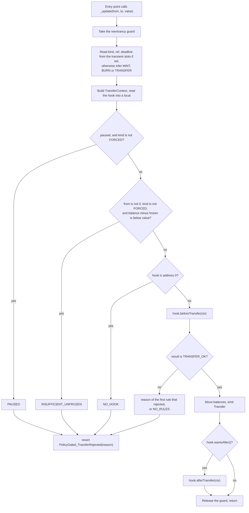

# How a movement is decided

Every change to a token balance goes through `_update` in `PolicyGatedERC20Upgradeable`: transfers, mints, burns, forced transfers, executed intents, vault deposits and redemptions. This page follows one movement from the entry point to the balance change, and lists what each check looks at.

## The context

The token builds a `TransferContext` for every movement. Callers cannot supply one.

| Field | Value |
|---|---|
| `token` | the token's own address |
| `from` | the sender. `address(0)` on a mint |
| `to` | the receiver. `address(0)` on a burn |
| `id` | always 0 |
| `amount` | the amount of tokens moved |
| `operator` | `_msgSender()` inside `_update`: the account that called into the token |
| `kind` | one of `TRANSFER`, `EXECUTED`, `FORCED`, `MINT`, `BURN` |
| `ref` | the intent's `ref` for `EXECUTED`, otherwise 0 |
| `deadline` | the intent's `deadline` for `EXECUTED`, otherwise 0 |
| `extra` | always empty |

The operator is whoever called the token, so it changes with the entry point. For `transferFrom` it is the spender. For `executeTransfer` it is the executor. For a vault `redeem` made by a spender with allowance it is the spender.

## Where the kind comes from

`_update` takes the kind from the transient slots if a function announced one. Otherwise it infers the kind from the addresses: `from == 0` is `MINT`, `to == 0` is `BURN`, anything else is `TRANSFER`.

| Entry point | Kind | Announced or inferred |
|---|---|---|
| `transfer`, `transferFrom` | `TRANSFER` | inferred |
| `Gated7540Vault.requestRedeem` (owner to vault) | `TRANSFER` | inferred |
| `executeTransfer` | `EXECUTED` | announced by `_moveAs` |
| `forcedTransfer` | `FORCED` | announced |
| `Gated7540Vault.rejectRedeemRequest`, `recoverRedeemRequest` (vault to controller or recovery account) | `FORCED` | announced |
| `IntentToken.mint`, `Gated4626Vault.deposit`/`mint`, `Gated7540Vault` deposit claims | `MINT` | inferred |
| `IntentToken.burn`, `Gated4626Vault.withdraw`/`redeem`, `Gated7540Vault.fulfillRedeem` | `BURN` | inferred |

Code: `PolicyGatedERC20Upgradeable._consumePending`, `_moveAs`, `_inferKind`.

## The steps inside `_update`

Notes on the steps:

- **Pause.** While paused, every kind except `FORCED` is rejected, mints and burns included.
- **Frozen.** The check runs for every kind except `FORCED`, and only when `from` is not the zero address. It rejects if `balanceOf(from) - getFrozen(from) < amount`. It runs before the hook, so a transfer larger than the balance is rejected as `INSUFFICIENT_UNFROZEN`, not with OpenZeppelin's `ERC20InsufficientBalance`.
- **`burn` by the burner.** `burn` lowers the frozen amount first (`_releaseFrozen`, which emits `Frozen`), so the frozen check passes. A holder or vault burn, such as `redeem`, does not, so frozen tokens cannot be redeemed.
- **`forcedTransfer`.** It calls `_releaseFrozen` first, then moves the tokens as `FORCED`. If `amount` is above the balance it reverts with `ERC20InsufficientBalance`.
- **The hook is read once.** `afterTransfer` goes to the hook that approved the movement.
- **`afterTransfer` is optional.** `ComplianceHook.wantsAfter()` is true only if at least one installed rule wants `after_`.

Code: `PolicyGatedERC20Upgradeable._update`, `_check`, `_releaseFrozen`.

## The hook and the rules

`ComplianceHook.beforeTransfer` copies its rule list into memory, returns `NO_RULES` if the list is empty, and otherwise calls `check` on each rule in order. The first reason that is not `TRANSFER_OK` is returned. `afterTransfer` accepts only the token it is bound to and calls `after_` on the rules that asked for it when the list was installed.

The rule order is set when the hook is deployed. The Ignition module (`RULE_ORDER` in `ignition/modules/roles.ts`) uses:

| Token | Order |
|---|---|
| `IntentToken` | `IdentityRule`, `LockupRule`, `SettlementWindowRule`, `MaxHoldersRule` |
| `Gated4626Vault`, `Gated7540Vault` | `IdentityRule`, `LockupRule`, `MaxHoldersRule` |

Order decides which reason the caller sees. A sender who is both unverified and locked gets `SENDER_NOT_VERIFIED`, because `IdentityRule` runs first.

Code: `ComplianceHook.beforeTransfer`, `afterTransfer`, `_setRules`.

## What each rule does with each kind

| Check | `TRANSFER` | `EXECUTED` | `FORCED` | `MINT` | `BURN` |
|---|---|---|---|---|---|
| Base: pause | rejects | rejects | passes | rejects | rejects |
| Base: frozen balance of `from` | applies | applies | passes | no `from` | applies. `burn` by the burner lowers it first |
| `IdentityRule` | `from` and `to` verified | `from` and `to` verified | `to` verified | `to` verified | `from` verified |
| `LockupRule` (looks at `from`) | `LOCKED` while locked | `LOCKED` while locked | passes | passes | `LOCKED` while locked, unless the operator holds `BURNER_ROLE` on the token |
| `SettlementWindowRule` | passes | needs an open window | passes | passes | passes |
| `MaxHoldersRule.check` | caps a new holder | caps a new holder | passes | caps a new holder | passes |
| `MaxHoldersRule.after_` | updates the count | updates the count | updates the count | updates the count | updates the count |

### IdentityRule

Calls `isVerified(address)` on the identity registry that was passed to its constructor. The registry address is an immutable, so it is part of the attested codehash.

The sender is checked unless the kind is `MINT` or `FORCED`. The receiver is checked unless the kind is `BURN`. The sender check comes first. The caller, the spender and the executor are never checked. Only `from` and `to` are.

A holder who loses verification can no longer send or receive. The agent can still take their tokens with `forcedTransfer`, but only to a verified account.

Rule id: `keccak256('IdentityRule.v1')`.

### LockupRule

Keeps an unlock time for each token and holder. It looks at `from`. The movement passes if `block.timestamp >= unlockTime`, which includes the stored 0 for "not locked".

While locked, `TRANSFER` and `EXECUTED` return `LOCKED`. `BURN` returns `LOCKED` unless the operator holds `BURNER_ROLE` on the token, which makes a burn by the burner an enforcement action that ignores the lock. A holder who redeems vault shares is a holder burn and respects the lock. `FORCED` and `MINT` pass. A locked holder can still receive tokens, and the lock covers the whole balance, including tokens received later.

`setLockup(token, holder, unlockTime)` needs `AGENT_ROLE` on the token. A time at or before now clears the lock. The holder cannot be the zero address.

Rule id: `keccak256('LockupRule.v1')`.

### SettlementWindowRule

Only `EXECUTED` movements are checked. Direct transfers and every other kind pass.

A window is `open` and `close` as seconds into the UTC day, plus a weekday mask. Bit 0 is Monday and bit 6 is Sunday. `MON_TO_FRI` is `0x1F`. The weekday of a timestamp is `((timestamp / 1 days) + 3) % 7`, with Monday as 0. The constraints on `setWindow`: `open` and `close` are below 86400, they differ, and the mask is non-zero and fits in 7 bits.

- If `open < close`, the window is open on an enabled day when `open <= second < close`.
- If `open > close`, the window runs overnight and belongs to the day it opened. It is open when today is enabled and `second >= open`, or when yesterday is enabled and `second < close`.
- A token with no window set rejects every `EXECUTED` movement with `OUTSIDE_SETTLEMENT_WINDOW`.

`setWindow` needs `DEFAULT_ADMIN_ROLE` on the token. `isOpen(token, timestamp)` and `windowOf(token)` are views.

Rule id: `keccak256('SettlementWindowRule.v1')`.

### MaxHoldersRule

Caps the number of holders of a token. A holder is an account with a balance above zero, so one unit of the smallest denomination counts as a holder.

`check` runs these steps in order and stops at the first that applies:

1. `amount == 0`, `from == to` or `to == address(0)`: passes.
2. `to` is exempt: passes.
3. `to` already has a balance above zero: passes. It is not a new holder.
4. The kind is `FORCED`: passes.
5. Work out whether the sender leaves: `from` is not the zero address, is not exempt, and its whole balance equals `amount`.
6. If the cap is 0, rejects with `MAX_HOLDERS`. Otherwise rejects with `MAX_HOLDERS` when `holderCount + (sender leaves ? 0 : 1) > cap`.

`after_` runs after the balances moved and keeps the count. It does nothing if `amount == 0` or `from == to`. Otherwise it adds one if `to` is a non-exempt account whose balance now equals `amount` (it had none before), and subtracts one if `from` is a non-exempt account whose balance is now 0. The subtraction is checked: if the stored count is lower than the real one, an exit that takes it below zero reverts, which reverts the movement.

Because `FORCED` skips the check but is still counted, the count can end above the cap. Lowering the cap does not block existing holders, since a move to an existing holder passes at step 3. While the count is above the cap, step 6 rejects every move to a new holder, including one where the sender leaves. At exactly the cap, only moves where the sender leaves pass.

Exempt accounts never count and never trigger the cap. The 7540 vault is exempted for itself in `Activate`, because it holds escrowed shares. `setExemptHolder` adjusts the count by one when the account already has a balance.

Admin functions, all needing `DEFAULT_ADMIN_ROLE` on the token: `setCap`, `seedHolderCount`, `setExemptHolder`. `seedHolderCount` overwrites the count. It is only meant for use while the rule is not in the token's active rule list.

Rule id: `keccak256('MaxHoldersRule.v1')`.

Code: `IdentityRule.check`, `LockupRule.check`, `LockupRule.setLockup`, `SettlementWindowRule._isOpen`, `SettlementWindowRule.setWindow`, `MaxHoldersRule.check`, `MaxHoldersRule.after_`.

## Reason codes

Each code is `keccak256` of its name, so `TRANSFER_OK` is not zero. A hook or rule that forgets to set its return value therefore rejects. The table is in `contracts/interfaces/Errors.sol`. Values are never renamed or renumbered.

| Code | Returned by |
|---|---|
| `TRANSFER_OK` | rules and hook, when the movement is allowed |
| `PAUSED` | the base, while paused and the kind is not `FORCED` |
| `INSUFFICIENT_UNFROZEN` | the base, when `from` does not have enough unfrozen balance |
| `SENDER_NOT_VERIFIED` | `IdentityRule` |
| `RECEIVER_NOT_VERIFIED` | `IdentityRule` |
| `OUTSIDE_SETTLEMENT_WINDOW` | `SettlementWindowRule` |
| `MAX_HOLDERS` | `MaxHoldersRule` |
| `LOCKED` | `LockupRule` |
| `INTENT_EXPIRED` | `executeTransfer` and `canExecute`, when `block.timestamp > deadline` |
| `NONCE_USED` | `executeTransfer`, `canExecute`, and `cancelIntent` |
| `BAD_SIGNATURE` | `executeTransfer` |
| `NO_HOOK` | the base, when the token has no hook |
| `NO_RULES` | `ComplianceHook`, when its rule list is empty |

## How a rejection reaches the caller

| Where | What the caller sees |
|---|---|
| Any token entry point | revert `PolicyGated_TransferRejected(bytes32 reason)` |
| `IntentExecutor.execute` | the token's revert, unchanged |
| `IntentExecutor.executeBatch` | revert `IntentExecutor_BatchItemFailed(index, reason)`, where `reason` is the token's revert data. The whole batch is undone |
| `Gated4626Vault.deposit`, `mint`, `withdraw`, `redeem` when the matching `max*` is lower than the request | OpenZeppelin's `ERC4626ExceededMaxDeposit`, `ERC4626ExceededMaxMint`, `ERC4626ExceededMaxWithdraw`, `ERC4626ExceededMaxRedeem`, before any hook call |
| `Gated7540Vault.requestDeposit` | `Gated7540Vault_ControllerNotEligible(reason)` |

`transfer` never returns `false`. A rejected transfer reverts.

## Pre-flight calls

The token has three read functions that run the same checks as the write path without writing. They run at the current block's timestamp. A transaction mined in a later block can see a different time, which matters at a lockup end, a window edge or an intent deadline.

| Function | What it asks |
|---|---|
| `canTransfer(from, to, amount)` | Would a holder-driven movement pass? The kind is `MINT` if `from == 0`, `BURN` if `to == 0`, otherwise `TRANSFER`. The operator is `from`, or the caller for a mint. It runs the pause check, the frozen check and the hook |
| `canExecute(intent)` | Would `executeTransfer` pass, apart from the signature? It checks the deadline and the nonce, then the same path with kind `EXECUTED` and the intent's `ref` and `deadline`. The operator is the caller, so call it from the executor's address. It cannot check the signature because the interface has no signature parameter |
| `isUserAllowed(user)` | Would the hook accept a mint of amount 0 to `user`? It ignores pause and frozen balance, and returns `false` if there is no hook. With the four standard rules only `IdentityRule` can reject a zero-amount mint, so this answers "is the user verified" |

Differences from the real call:

- `canTransfer` cannot model `FORCED` or `EXECUTED`, or a `burn` by the burner. It treats a burn as a holder burn, so frozen tokens count against the amount.
- None of the three runs `afterTransfer`.
- Apart from these, `canTransfer` and `canExecute` run the same `_check` as the write. `RuleSetIntegration.t.sol` and `test/nodejs/parity.test.ts` compare their answers with the state-changing calls.

The vaults build `max*` from the same internal function that `canTransfer` uses. See [flows-vaults.md](flows-vaults.md).

Code: `PolicyGatedERC20Upgradeable.canTransfer`, `isUserAllowed`, `_canTransfer`, `IntentSettledUpgradeable.canExecute`.

## Reentrancy

`_update` is `nonReentrant` and uses transient storage (`ReentrancyGuardTransient`). A rule's `check` runs under `STATICCALL` and cannot write at all. `after_` can write, and runs while the guard is held, so a call from a rule back into `transfer`, `mint`, `burn` or any other function that reaches `_update` reverts with `ReentrancyGuardReentrantCall`. `MockReentrantRule` calls `transfer(ctx.to, 0)` from `after_`, and `IntentToken.t.sol` expects that revert.

Code: `PolicyGatedERC20Upgradeable._update`, `contracts/test/MockReentrantRule.sol`.
